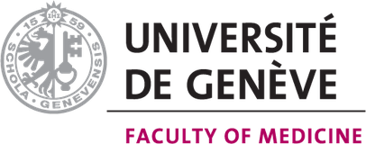
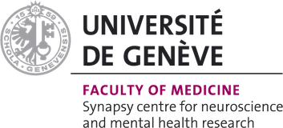
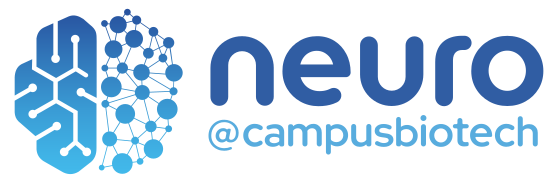
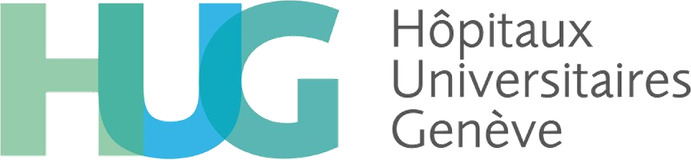
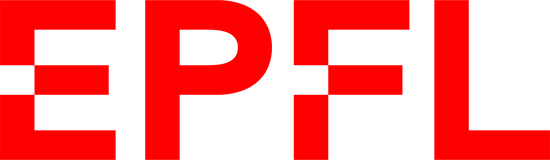
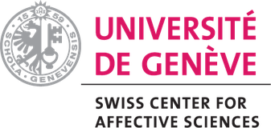

<!-- ====== SLIDE 1 — Title ====== -->
<!-- _class: ink -->
<!-- _paginate: false -->
<!-- _footer: "" -->

Crash Course #2 · Thursday 22 October 2026 · 17:00 → 19:00 · on Zoom

# Vibe coding &amp; AI-assisted development
## Direct the agent. Check the result.

Tonight you open your challenge repository, put an AI agent to work in it, and learn to catch it when it is confidently wrong.

FacMed Hack #1 · Digital Phenotyping of Mental Health · Fri 6 – Sat 7 November 2026 · Campus Biotech · in English

<h3>The road to 6 November</h3>

<b>Thu 8 Oct</b> · B1 · Digital phenotyping &amp; the Swiss data rules

<b>Today</b> · B2 · Vibe coding &amp; AI-assisted development

<b>Thu 29 Oct</b> · B3 · Grant writing for pop-up projects, with the RGO

<b>Fri 6 – Sat 7 Nov</b> · the hackathon, 32 hours

---

<!-- ====== OPENING QUOTE — Zador ======
Read it aloud, then pause. The frame for the evening: nobody in this room, nor
the people who build these tools, knows how this plays out for neuroscience,
which is why tonight starts with what you imagine and ends with a discussion.
Same quote closes the deck.
Source: A. Zador's response to DePasquale, The Transmitter, 16 June 2026.
-->
<!-- _class: ink quote -->
<!-- _paginate: false -->

> "AI is obviously going to have a massive impact on how we do science, and it's hard to know what the long run looks like."

<b>Anthony Zador</b> · Cold Spring Harbor Laboratory · <i>The Transmitter</i>, June 2026

---

<!-- ====== SLIDE 2 — Opening question ======
Facilitator: read the question aloud, then silence. 90 seconds for everyone to type
one or two lines in the Zoom chat (ask them to hold Enter until you say "send", so
early answers don't anchor the rest). Read 4–5 aloud, picking ones far apart
(clinic vs. theory vs. lab bench vs. publishing). Save the chat: at 18:50 we sort
the answers into the places the session showed agents change today vs. the places
that are still imagination.
-->
<!-- _class: ink -->

4 min

Before anything else · 90 seconds · one or two lines in the Zoom chat

# Where do you imagine vibe coding and agentic coding will change science? Name one place, and what changes there.

Your own field or any other. A method, an instrument, a job in the lab, a stage of publishing: be specific.

 

> *"What would you do if you had all the models of the brain you wanted?"*
> Grace Lindsay, NYU, responding to this week's pre-read (DePasquale, <i>The Transmitter</i>, June 2026)

---

<!-- ====== SLIDE 3 — Quiz cover ====== -->
<!-- _class: ink -->

8 min

Six questions about where this is going

## Five have no right answer. One does.

<h3>How</h3>

One question per slide, about a minute each. A Zoom poll pops up with each one. Anonymous. Answer with what you actually expect for your field.

<h3>Why</h3>

The split in the room is the material for tonight. We keep the results, set them against what researchers in the field are saying, and come back to them before 19:00.

 

No poll on your screen? Type your letter in the chat.

---

<!-- ====== SLIDE 4 — Q1: where first? ======
Opinion, no right answer. Zoom: multiple choice, up to two.
Push: whichever wins, ask someone who picked the least-chosen option to defend it.
Most current evidence of real change is in A (analysis and modelling: the
pre-read's argument) and C (literature tools); B is where the money is going
(autonomous labs). D and E are where the policy fights are.
Comes back: live build (17:15) shows A for real; hands-on (17:40) tries it on
the challenge repositories.
-->

Question 1 of 6 · Where first

## Where will agentic coding change research practice most in the next five years? *Pick up to two.*

<b>A</b>Analysing data and building models

<b>B</b>Designing and running experiments: automated labs

<b>C</b>Reading and synthesising the literature

<b>D</b>Writing papers and grants

<b>E</b>Peer review and replication

---

<!-- ====== SLIDE 5 — Q2: the scarce skill ======
Opinion, no right answer. Links straight to the opening question.
Push: if C or D wins, ask the PIs in the room how they hire for it today, and
how a PhD student practises it. The course's thesis sits between C and D
(director of the code: intent, judgment, verification).
Voices: Stachenfeld (DeepMind/Columbia) calls LLMs "a flashlight as opposed to a
laser pointer", useful near known ideas, unlikely to find very unusual ones (C).
Gjorgjieva (TUM): expertise is needed "to recognize when an AI system is
inventing concepts that do not actually exist" (D).
Comes back: review hunt (18:15) is D, practised.
-->

Question 2 of 6 · The scarce skill

## In 2031, the scarcest skill in a neuroscience lab will be…

<b>A</b>Programming

<b>B</b>Statistics and methods

<b>C</b>Choosing the question worth asking

<b>D</b>Judging whether a result is true

<b>E</b>Collecting good data from real people

---

<!-- ====== SLIDE 6 — Q3: prolific but shallow? ======
Opinion. Checks the pre-read without making it a test.
DePasquale: "The field risks becoming prolific but shallow—generating models
faster than we can generate insights."
B is Dan Goodman's point (Imperial): the field already rewards producing models
over understanding them, and vibe modelling could make that worse.
C is the hopeful reading of DePasquale's own four directions.
Push: ask a D voter what evidence would change their mind, and by when.
Comes back: close (18:50).
-->

Question 3 of 6 · Depth

## This week's pre-read warns that AI coding could make theoretical neuroscience *"prolific but shallow"*. For your own field, you think…

<b>A</b>It is already happening

<b>B</b>It will happen unless incentives change

<b>C</b>The opposite: faster coding frees time to think

<b>D</b>Too early to say

 

B. DePasquale, "Models at the speed of thought: How AI coding is reshaping theoretical neuroscience", <i>The Transmitter</i>, 16 June 2026.

---

<!-- ====== SLIDE 7 — Q4: training the next generation ======
Opinion, and the one where PhD students and PIs tend to split. After the
results, ask in the chat: "PhD students: does this match what you'd want? PIs:
is this what you do?"
DePasquale's argument: the struggle of turning an idea into equations and code
is "a form of disciplined thinking"; skip it and you never know your own model.
Schuck's lab policy (second pre-read) answers it in practice: trainees do by hand
the work that builds core skills (questions, models, arguments) and hand off what
they don't need to learn; they draft text themselves before any AI editing.
Talmo Pereira (Salk) worries about losing the craft of scientific software.
The counter: if directing agents is the job, learn it from day one (A).
Comes back: hands-on (17:40), where pairs direct an agent in a challenge repo.
-->

Question 4 of 6 · Training

## A first-year PhD student can now get working analysis code from an agent in minutes. In their first year, they should…

<b>A</b>Use agents freely: directing them is the skill that matters now

<b>B</b>Write their core analyses by hand first, agents later

<b>C</b>Use agents, but explain every line at lab meeting

<b>D</b>Keep agents away from thesis-critical analyses

---

<!-- ====== SLIDE 8 — Q5: the literature ======
Opinion. The futures question with the widest spread.
Push: A and C are the same technology with opposite incentives. Who would pay
for the checking? (Funders, journals, an AI reviewer, nobody?)
Voice from the pre-read: Dan Goodman (Imperial College London) argues that
publication incentives already reward producing models over understanding them,
and that vibe modelling could make this worse. That is C and D; A needs someone
to reward the checking.
Comes back: how the hack runs (18:35): every team's repository is re-runnable
by the jury, which is A, at the scale of one weekend.
-->

Question 5 of 6 · The literature

## Soon an agent can re-run any published analysis from its repository in minutes. What happens to your field's literature?

<b>A</b>Replication becomes routine and the literature gets cleaner

<b>B</b>A wave of corrections and retractions, then a cleaner literature

<b>C</b>Little changes: nobody is rewarded for checking

<b>D</b>AI-generated papers multiply faster than anyone can check them

---

<!-- ====== SLIDE 9 — Q6: a reality check ======
The one question with an answer: D. Reveal it now, right after the poll closes.
Tasks took 19% longer with AI. Before starting, the developers forecast a 24%
speed-up; afterwards they still estimated AI had made them ~20% faster.
Caveat to say out loud: early-2025 tools, experts in large mature repositories
they knew intimately. METR says the result may not hold for small new projects
or unfamiliar code, which is closer to a 32-hour hack.
Why it closes the quiz: five minutes of imagining the future, then evidence
that our sense of what AI does for us can be wrong in sign. Imagine boldly;
measure before you believe.
Comes back: review hunt (18:15).
-->

Question 6 of 6 · A reality check

## In a 2025 randomised trial, experienced open-source developers worked on their own projects with and without AI tools. With AI, they were…

<b>A</b>about 40% faster

<b>B</b>about 20% faster

<b>C</b>no faster and no slower

<b>D</b>about 19% slower

 

METR (Model Evaluation &amp; Threat Research), "Measuring the impact of early-2025 AI on experienced open-source developer productivity", July 2025 · 16 developers, 246 real tasks.

---

<!-- ====== SLIDE 10 — Tonight's three objectives ======
Facilitator: the quiz has just shown the room is split on where this goes.
These three objectives are the answer to "so what do we do tonight".
Objective 3 matters most for anyone who arrived without tools installed: say
explicitly that this is fine, and that the hack offers the HPE / NVIDIA
environment to everyone, with or without their own setup.
-->

Tonight · three objectives

## By 19:00 you should…

1 · Imagine
<h3>See your place in agentic science</h3>

Your contribution to science, your career and your purpose, once agents write much of the code. What becomes yours to do?

2 · Understand
<h3>Know how vibe coding works</h3>

Think fast and slow: let the agent go fast, check slowly. Try, fail and retry cheaply. GitHub as the safety net. Working as a team, with agents in the loop.

3 · Prepare
<h3>Know how it runs at the hack</h3>

Whether you already have the tools or not, both paths are covered: your own setup, or the HPE / NVIDIA environment, open to every team to build and test on.

 

Objective 2 follows the course <i>Vibe Coding for Scientists</i> (github.com/wazaahhh/vibe-coding-crash-course): modules 01–04 were this week's pre-work; tonight draws on modules 02, 03, 05, 06 and 08.

---

<!-- ====== SLIDE 11 — Tonight's programme ====== -->

Tonight · 17:00 → 19:00

## Hold your answers: each one comes back tonight

| Time | Block | Obj. | Quiz |
|---|---|---|---|
| 17:00 | Opening question and quiz | 1 | — |
| 17:15 | **Live build**: a sleep and mood analysis on phenotyping data, from question to pull request | 2 | Q1&nbsp;Q6 |
| 17:40 | **Hands-on in pairs** (breakout rooms), in a challenge you voted for: explain, plan, commit, pull request | 2 | Q4 |
| 18:15 | **Review hunt**: find the planted errors in an AI-written analysis | 2 | Q2&nbsp;Q6 |
| 18:35 | **How the hack runs**: with or without your own tools, the HPE / NVIDIA environment, data rules | 3 | Q5 |
| 18:50 | **Your place**: the room's answers, voices from the field, back to the opening question | 1 | Q1&nbsp;Q3 |
