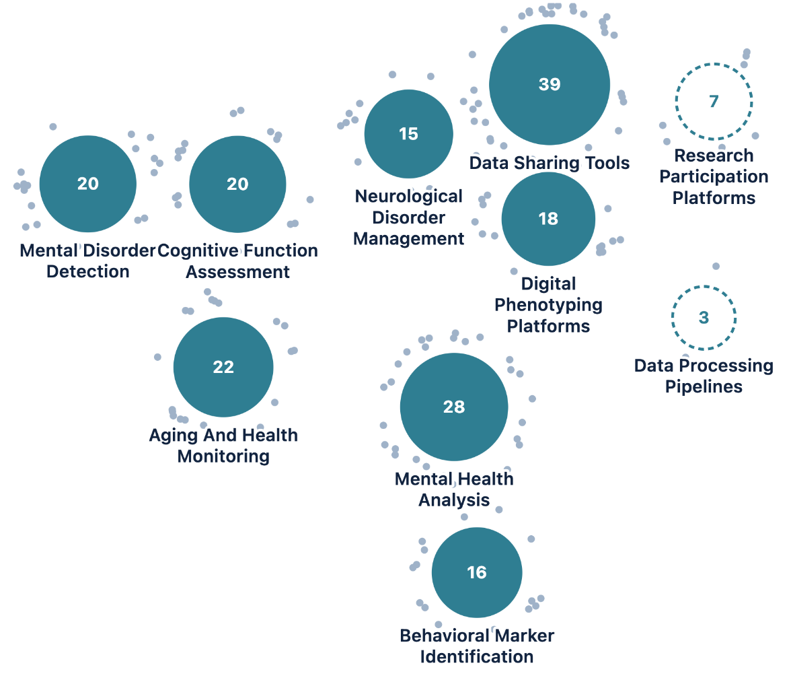
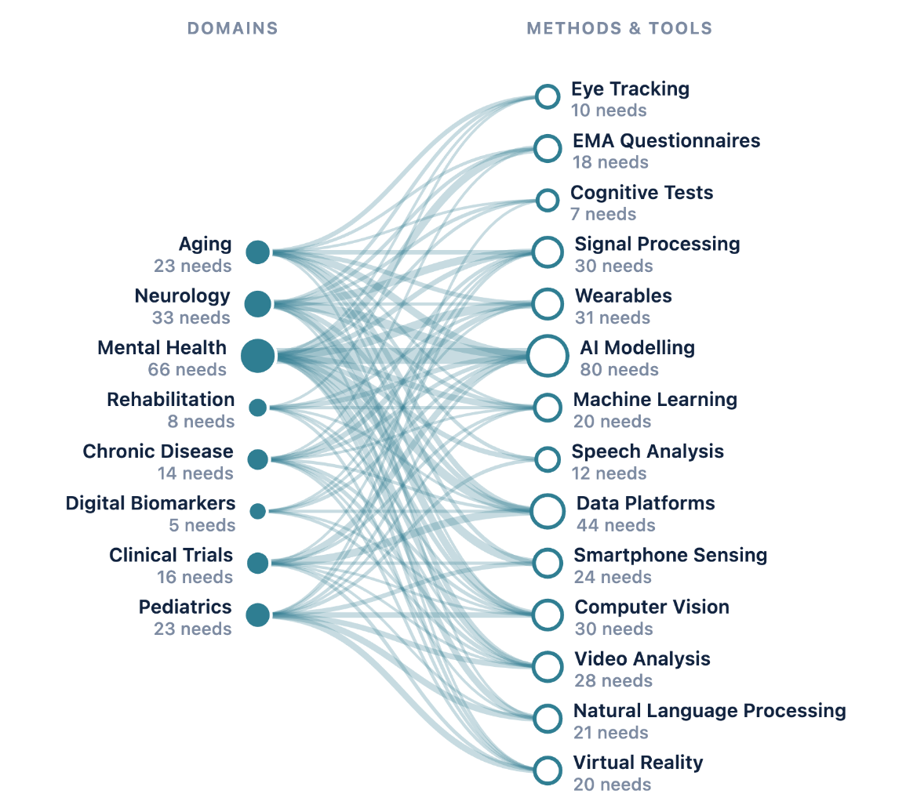

<!-- ====== OPENING 1 — Title ====== -->
<!-- _class: ink -->
<!-- _paginate: false -->
<!-- _footer: "" -->

Crash Course #2 · Thursday 22 October 2026 · 17:00 → 19:00 · on Zoom

# Vibe coding &amp; AI-assisted development
## Direct the agent. Check the result.

Where AI agents come from, how they change research, and how to work with one: hands on, in pairs, on real data.

FacMed Hack #1 · Digital Phenotyping of Mental Health · Fri 6 – Sat 7 November 2026 · Campus Biotech · in English

---

<!-- ====== OPENING 1b — Celebration: the needs library ======
30 seconds, with energy: before anything else, thank the room. The needs call
aimed for 100 needs and the library holds 188 (Thomas, 22 Oct), almost twice
the goal. Plots: the "Where the needs are so far" panel of the needs page,
captured 22 Oct (topic bubbles sum to 188; biggest: data sharing tools 39,
mental health analysis 28; thin: research participation 7, data pipelines 3). These needs became the challenges you will rank from tomorrow
(Part 6 has the details).
-->
<!-- _class: ink -->

Before anything else · thank you

## You built the needs library

188

needs, against a goal of <b>100</b>

**Almost twice the goal.** Every challenge at the hack starts from one of your needs.

Where the needs are: topics (left) · domains × methods (right) · facmed-hack.sparkboard.com/needs, 22 Oct

---

<!-- ====== OPENING 1c — From needs to challenges ======
40 seconds. How the needs become the hackathon's challenges (source: corp repo,
docs/pipeline/FacMed/.../challenges/README.md and method/). Clustering groups
needs by the technical problem a team would work on, balanced for diversity of
contributors and institutions. The steering committee of 14 Oct kept 8
candidates, aiming for about 7. Each challenge gets a sheet, a postdoc challenge
runner, stand-in data, and its equipment, compute and privacy route. Then you
vote (23 → 28 Oct) and teams are formed from your rankings. Details in Part 6.
-->

From here to 6 November

## From your needs to the challenges

1 · Needs<h3>188 needs</h3>
Posted by researchers and clinicians; call closed 15 October.

2 · Clusters<h3>Grouped</h3>
By the technical problem a team would work on, across labs and institutions.

3 · Selection<h3>Steering committee</h3>
14 October: 8 candidate challenges, aiming for about 7.

4 · Shaping<h3>Challenge sheets</h3>
A postdoc runner, data ready on day 1, compute and privacy routes.

5 · You<h3>Vote and teams</h3>
23 → 28 Oct: rank three challenges; teams are formed from your rankings.

 

> Every challenge at the hack can be traced back to **needs you wrote**.

---

<!-- ====== HOUSEKEEPING 1 — The road to 6 November ======
30 seconds. Where tonight sits: the second of three crash courses before the
hack. The two actions for this week come back in detail in Part 6.
-->

Housekeeping · 1 of 2

## The road to 6 November

Thu 8 Oct<h3>Crash Course #1</h3>
Digital phenotyping &amp; the Swiss data rules

Today<h3>Crash Course #2</h3>
Vibe coding &amp; AI-assisted development

23 → 28 Oct<h3>Challenge voting</h3>
Rank your three favourite challenges and confirm your place

Thu 29 Oct<h3>Crash Course #3</h3>
Grant writing for pop-up projects, with the Research and Grants Office (RGO)

6 – 7 Nov<h3>The hackathon</h3>
32 hours at Campus Biotech, in English

 

> **Challenge voting, 23 → 28 October:** the final list goes online on the 23rd; rank three challenges and confirm your place, from the email.

---

<!-- ====== HOUSEKEEPING 2 — Tonight on Zoom ======
30 seconds. [CONFIRM] whether tonight is recorded; if so, say it here, before
anyone speaks (and that the recording goes to registered participants only).
Paste in the chat now: the quiz PIN. At 17:45: the practical folder link.
-->

Housekeeping · 2 of 2

## Tonight on Zoom

- **Microphone off**, unless you speak; camera on if you can.
- **Questions in the chat**, any time: we pick them up between parts.
- **Live quiz** on your phone or laptop: it starts on the next slide.

- **17:47, breakout rooms of two**: a laptop with a browser is enough; your own agent if you have one.
- **The practical folder** and the slides: link in the chat.
- **We end at 19:00** sharp.

---

<!-- ====== OPENING 2 — LIVE QUIZ · How do you use AI? ======
First thing on the quiz app: everyone joins now (QR or link + PIN), so the later
questions run without friction. Paste the PIN in the Zoom chat as well, for
those on the same device as Zoom. Question "uses" (multi-select). Give 60 s,
then open the presenter view's live results and read them aloud in one
sentence; we come back to them in Part 1 ("Six everyday uses").
-->
<!-- _class: ink -->

Live quiz · on your phone or laptop

## What have you already used AI for in your research? *Tick all that apply.*

Finding and summarising papers · analysis code · modelling · writing and editing · learning or explaining code and methods · building small tools · **nothing yet**

 

Anonymous. Results appear live; we come back to them in Part 1.

<b>Live quiz · scan, or open</b>{{QUIZ_URL}}{{QUIZ_PIN_LABEL}}

---

<!-- ====== OPENING 3 — Opening question (live quiz, free text) ======
Read Grace Lindsay's question first, then the opening question. Second question
on the quiz app; everyone is already in. Live quiz question "opening" (free
text, one or two lines). 90 seconds; keep the results hidden until time is up, so early answers
don't anchor the rest. Then show the answers on the presenter view and read 4–5
aloud, picking ones far apart (clinic vs. theory vs. lab bench vs. publishing).
Export them: at 18:47 we sort them into what the session showed agents change
today vs. what is still imagination (Part 7, "the opening question, revisited").
-->
<!-- _class: ink -->

3 min

> *"What would you do if you had all the models of the brain you wanted?"*
> Grace Lindsay, NYU, responding to this week's pre-read (DePasquale, <i>The Transmitter</i>, June 2026)

Live quiz · 90 seconds · one or two lines

## Where do you imagine vibe coding and agentic coding will change science?

Name **one place, and what changes there**. Your own field or any other: a method, an instrument, a job in the lab, a stage of publishing. Be specific.

<b>Live quiz · scan, or open</b>{{QUIZ_URL}}{{QUIZ_PIN_LABEL}}

---

<!-- ====== OPENING 4 — Objectives ======
Objective 3 matters most for anyone who arrived without tools installed: say
explicitly that this is fine, and that the hack offers the HPE / NVIDIA
environment to everyone, with or without their own setup.
-->

Tonight · three objectives

## By 19:00 you should…

1 · Imagine
<h3>See your place in agentic science</h3>

Where these tools come from, what they already do in research, and what becomes yours to do: your contribution, your career, your purpose.

2 · Understand
<h3>Know how vibe coding works</h3>

Think fast and slow. Try, fail and retry cheaply. Git as the safety net, run by the agent for you. Working as a team, with agents in the loop.

3 · Prepare
<h3>Know how it runs at the hack</h3>

Whether you already have the tools or not, both paths are covered: your own setup, or the HPE / NVIDIA environment, open to every team to build and test on.

 

Built on the course <i>Vibe Coding for Scientists</i> (github.com/wazaahhh/vibe-coding-crash-course, CC BY-NC 4.0). Pre-reads: DePasquale (2026) and Schuck (2026), both in <i>The Transmitter</i>.

---

<!-- ====== OPENING 5 — Programme ======
Eight live-quiz questions are spread through the evening (the second, "opening", is free text; app at {{QUIZ_URL}},
presenter view at /present?key=…), each where its topic comes up. Show each
result right away and take one or two reactions; "the room's answers" in Part 7
recaps them. Zoom polls (zoom_polls.md) are the fallback.
-->

Tonight · 17:00 → 19:00

## Seven parts, a live quiz along the way

| Time | Part | Poll | Obj. |
|---|---|---|---|
| 17:00 | Opening: housekeeping, a question and a first poll in the live quiz, three objectives | quiz | 1 |
| 17:05 | **1 · Where this comes from**: from artificial neurons to coding agents; how an LLM works; what it means for hackathons; opportunities and pitfalls (pre-read 1) | 1 · 2 | 1 |
| 17:30 | **2 · How vibe coding works**: four disciplines, how to ask, three dials | — | 2 |
| 17:36 | **3 · Git &amp; GitHub, without the jargon**: version control as a lab book, and how the agent runs it for you | 3 | 2 |
| 17:47 | **4 · Practical in pairs** (breakout rooms): synthetic sleep data, then a real EEG recording | 4 | 2 |
| 18:24 | **5 · Review hunt**: would you sign this AI-written analysis? | 5 | 2 |
| 18:31 | **6 · The hack**: where we are, how it runs, with or without your own tools | — | 3 |
| 18:41 | **7 · A future worth building**: AI governance in science (pre-read 2), your place | 6 | 1 |
