<!-- ====== CONTEXT 1 — Divider ====== -->
<!-- _class: ink divider -->

25 min

17:10 · Part 1 of 7 · Objective 1 · Imagine

# Where this comes from

From an artificial neuron in 1943 to an agent that edits your analysis code. What these tools are, what scientists do with them, and where they fail.

---

<!-- ====== CONTEXT 2 — It started in your field ======
For a neuroscience audience: the idea of artificial neural networks came from
neuroscience. Keep it to two minutes; the point is the lineage.
Definitions (say them only if asked):
- Artificial neuron (McCulloch & Pitts): a unit that adds up its weighted inputs
  and "fires" (outputs 1) when the sum passes a threshold.
- Perceptron (Rosenblatt): one layer of such units whose weights are LEARNED from
  labelled examples: wrong answer → nudge the weights.
- Neural network (multi-layer): layers of units, every connection a weight; the
  hidden layers build intermediate features the output layer combines.
- Hopfield network: a recurrent network in which memories are stable states
  (energy minima) the network settles into.
- Backpropagation: computes how much each weight contributed to the error and
  adjusts all weights, layer by layer, from the output backwards.
- Deep learning: neural networks with many layers, trained on large data with GPUs.
Sources: McCulloch & Pitts 1943 (Bull. Math. Biophys.); Rosenblatt 1958;
Hopfield 1982 (PNAS); Rumelhart, Hinton & Williams 1986 (Nature);
Krizhevsky, Sutskever & Hinton 2012 (AlexNet); Nobel Prize in Physics 2024.
Diagrams: drawn for this deck.
-->

A short history · part 1

## It started in your field

| Year | What happened |
|---|---|
| 1943 | **McCulloch &amp; Pitts** model a neuron as a logic unit: the first artificial neuron |
| 1958 | **Rosenblatt's perceptron** learns its weights from examples |
| 1982 | **Hopfield networks**: memories as stable states of a network |
| 1986 | **Backpropagation** (Rumelhart, Hinton &amp; Williams): how multi-layer networks learn |
| 2012 | **Deep learning** wins image recognition (AlexNet): GPUs + data + depth |
| 2024 | **Nobel Prize in Physics** to Hopfield and Hinton |

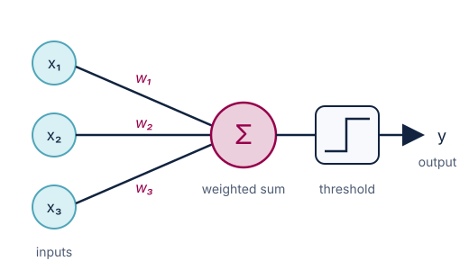
Perceptron: weighted inputs → sum → threshold

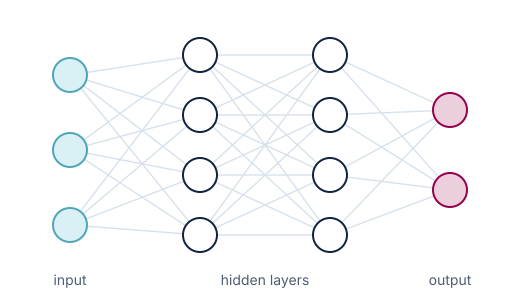
Multi-layer network, trained by backpropagation

---

<!-- ====== CONTEXT 3 — From next word to agents ======
Definitions:
- Token: a piece of text, a word or part of a word ("neur" + "on").
- Parameter (weight): a number learned in training; GPT-3 has 175 billion.
- Transformer: the architecture behind every modern language model: a stack of
  layers, each with self-attention and a feed-forward network; processes all
  tokens of a text in parallel.
- Self-attention: lets every token weigh every other token when building its
  representation ("it" looks back at "neuron").
- GPT: "generative pre-trained transformer".
- Reasoning model: trained to work through intermediate steps before answering.
- Coding agent: a language model in a loop with tools (files, terminal, tests).
Sources: Vaswani et al. 2017 "Attention is all you need"; Brown et al. 2020
(GPT-3, 175 billion parameters); GitHub Copilot preview June 2021; ChatGPT
30 Nov 2022; OpenAI o1, Sept 2024; Claude Code (Feb 2025 preview) and OpenAI
Codex (2025); Karpathy coins "vibe coding", Feb 2025.

ATTENTION, in more detail (say as much as the room wants, 1–2 min):
- The paper: Vaswani, Shazeer, Parmar, Uszkoreit, Jones, Gomez, Kaiser &
  Polosukhin (Google), "Attention is all you need", NeurIPS 2017,
  arXiv:1706.03762. Built for machine translation; it dropped the recurrent
  networks (which read a sentence word by word) and kept only attention, so a
  whole text is processed in parallel on GPUs. That is what made training on
  internet-scale text possible.
- The mechanism: each token produces three vectors, a query ("what am I looking
  for?"), a key ("what do I contain?") and a value ("what do I pass on?"). The
  query of one token is compared with the keys of all others (dot product);
  a softmax turns the scores into weights that sum to 1; the token's new
  representation is the weighted sum of the values.
  Formula: Attention(Q, K, V) = softmax(Q·Kᵀ / √d) · V.
- Multi-head: several attention patterns run side by side (one may track
  grammar, another which noun "it" refers to, another the variable name defined
  forty lines up). Positions are added to the tokens, since attention itself
  ignores order.
- Self-attention cost grows with the square of the text length: this is why
  the context window is finite, and why very long contexts dilute attention
  (models use the start and the end of a long context better than the middle:
  Liu et al., "Lost in the middle", TACL 2024).
- Analogy for neuroscientists: soft, content-addressable retrieval, closer to
  a Hopfield-style associative memory than to biological visual attention
  (Ramsauer et al., "Hopfield networks is all you need", ICLR 2021).

WHY IT MATTERS FOR VIBE CODING (the hint on the slide): everything the model
writes is a weighted reading of what is in its context. Your question, your
codebook, your constraints, the error you paste: these are what it attends to.
A vague request gets the most generic, most plausible answer; a precise one
moves its attention to what matters. The scientist's attention steers the
model's attention. Bridge to the next slide: same data, different questions.
-->

A short history · part 2

## From predicting the next word to editing your code

| Year | What happened |
|---|---|
| 2017 | **The Transformer**: Vaswani et al., "Attention is all you need", <i>NeurIPS</i> · arXiv:1706.03762 |
| 2020 | **GPT-3**: 175 billion parameters; scale brings surprising abilities |
| 2021 | **GitHub Copilot** autocompletes code in the editor |
| Nov 2022 | **ChatGPT**: language models reach everyone |
| 2023–24 | Claude, GPT-4, open-weight models; **"reasoning" models** |
| 2025 | **Coding agents** work inside your project; Karpathy names **"vibe coding"** |
| 2026 | Agents in research labs (this week's two pre-reads) |

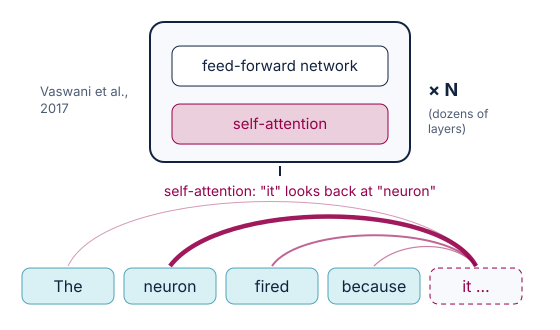
A Transformer layer: each word attends to the others, then a feed-forward step; stacked dozens of times

<h3>Why "attention" matters to you</h3>
To write each token, the model weighs every token in its context. Your question, codebook and constraints are what it attends to: <b>your attention steers its attention.</b>

---

<!-- ====== CONTEXT 3a — Einstein & Infeld: new questions ======
Read it, pause, then go to the exercise. Full passage: A. Einstein & L. Infeld,
The Evolution of Physics (Simon & Schuster, 1938), p. 92: "The formulation of a
problem is often more essential than its solution, which may be merely a matter
of mathematical or experimental skill. To raise new questions, new
possibilities, to regard old problems from a new angle, requires creative
imagination and marks real advance in science."
Companion, on confronting results: J. S. Mill, On Liberty (1859), ch. 2: "He who
knows only his own side of the case, knows little of that."
Portrait: Oren Jack Turner, 1947; public domain (US), via Wikimedia Commons.
-->
<!-- _class: ink quote -->
<!-- _footer: "" -->

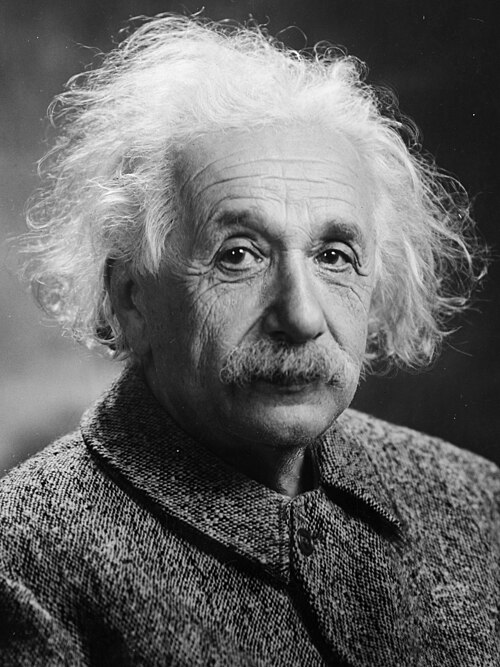

> "To raise new questions, new possibilities, to regard old problems from a new angle, requires creative imagination and marks real advance in science."

<b>Albert Einstein</b> &amp; Leopold Infeld · <i>The Evolution of Physics</i>, 1938

Portrait: Oren Jack Turner, 1947 · public domain, via Wikimedia Commons

---

<!-- ====== CONTEXT 3b — EXERCISE · Same data, your question ======
3 minutes. The dataset is fictional but real files: practical/phone-study/data/
(generated by facilitator/generate_phone_study.py; codebook in the folder's
README.md). It looks like the hack's digital-phenotyping data on purpose.
Live quiz question "explore" (free text, short), shown as a word cloud. 60
seconds; keep results hidden until time is up so early answers don't anchor
the rest. Then show the cloud and read 6–8 answers aloud, chosen far apart,
sorting them out loud into families:
- describe (how much do they sleep? how does mood vary over the term?)
- predict (can phone data predict a PHQ-9 rise?)
- explain / cause (does less roaming come before low mood, or after?)
- data quality (who stops answering, and when? who drops out?)
- subgroups and fairness (faculties, genders?)
- ethics and privacy (should we be collecting GPS at all?)
Things built into the data that good questions find: exam weeks (7, 12) with
shorter sleep, more screen time, less roaming and lower mood; weekends; mood
answers thinning out over the term and on bad days; ~12% dropouts; the clock
change on 25 Oct (an extra hour in bed); PHQ-9 rising by week 12, most in
Medicine and Law.
Point: one dataset, a room of different questions. Each question leads to a
different analysis, with different blind spots. That diversity is the strength:
science advances by looking at a problem from several angles and confronting
the results (previous slide).
Save the export: the families come back at the hack (challenge shaping, team
formation).
-->
<!-- _class: ink -->

Exercise · 3 minutes · live quiz

## Same data, your question

<h3>The phone study (fictional data, real files)</h3>

<b>150 students, 12 weeks</b>, one phone app, consent on file. 
<b>Every day, passively:</b> steps · how far they roam (GPS radius) · screen-on minutes · phone-estimated sleep · number of calls and messages (counts only, no content). 
<b>Every evening:</b> one-tap mood, 1 to 7. 
<b>Weeks 0, 6, 12:</b> PHQ-9 depression questionnaire. 
<b>Also:</b> age, gender, faculty; exam weeks flagged.

 

**What would you find worth exploring in this data?** A few words, in the live quiz.

<b>Live quiz</b>{{QUIZ_URL}}{{QUIZ_PIN_LABEL}}

Then we look at the word cloud: how many different questions did one dataset raise? The files are in the course folder, <code>phone-study/</code>.

---

<!-- ====== CONTEXT 4 — How an LLM works ======
Key reference: T. Brown et al., "Language models are few-shot learners",
NeurIPS 2020, arXiv:2005.14165 (GPT-3: next-token prediction at scale, 175
billion parameters, tasks learned from a few examples in the prompt).
Walk through the five steps on the diagram. Then the five consequences: fluent
is not the same as true; it only knows its training data; it only "sees" what
fits in its context window; the same question can give different answers
(step 4 picks among probabilities); and temperature sets how adventurous that
pick is.
Temperature: the scores for every possible next token are divided by T before
they become probabilities. T near 0: the top token almost always wins (focused,
repeatable, good for code and extraction). T around 1 or above: lower-ranked
tokens get picked more often (more varied and surprising, good for
brainstorming, and more errors). In coding agents the temperature is usually
fixed for you; to diverge, ask instead for "five different ways to analyse
this" (pillar 1, Divergence, in Part 2).
-->

Under the hood, in plain words · Brown et al., "Language models are few-shot learners", <i>NeurIPS</i> 2020

## How a large language model (LLM) writes, one token at a time

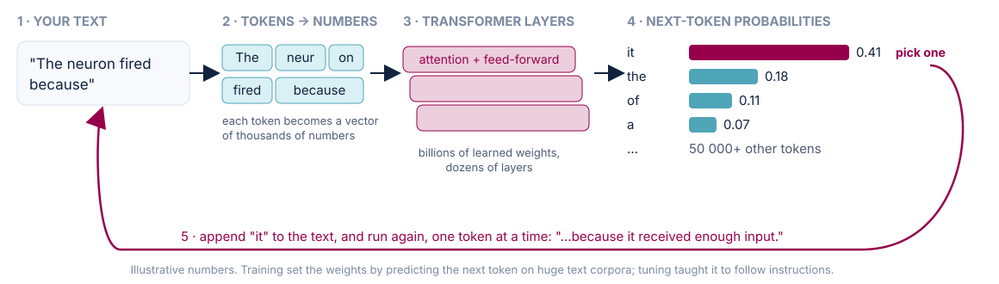

<h3>Fluent ≠ true</h3>
Most plausible, not proven: it can invent a citation.

<h3>Cut-off</h3>
Knows nothing after its training data.

<h3>Context</h3>
Only "sees" what fits in its window.

<h3>Not deterministic</h3>
Same question, maybe another answer.

<h3>Temperature</h3>
The dial on step 4. Low: safe, repeatable. High: bolder, more creative, more errors.

---

<!-- ====== CONTEXT 4b — VLM in a nutshell ======
Key reference: H. Liu, C. Li, Q. Wu & Y. J. Lee, "Visual instruction tuning",
NeurIPS 2023, arXiv:2304.08485 (LLaVA: a vision encoder whose outputs are
projected into an LLM's token space, exactly the diagram).
1 minute. Vision-language model (VLM): an LLM that also takes images. The
image is cut into patches (e.g. 14 × 14 or 16 × 16 pixels); a vision encoder
(a transformer for images, ViT: Dosovitskiy et al., "An image is worth 16x16
words", ICLR 2021), often pre-trained to match images with captions (CLIP:
Radford et al. 2021), turns each patch into a vector; a small projection maps
these into the LLM's token space; the LLM attends over image and text tokens
together (LLaVA: Liu et al., NeurIPS 2023). Today's assistants (Claude, GPT,
Gemini, open Qwen-VL) are all VLMs.
For tonight: agents can look at the figures they make (did the plot come out
right?), read a screenshot of an error, or turn a whiteboard sketch into code.
Limits: weak at counting and exact measurement, small print, fine detail; they
describe plausibly what they expect to see. And an image of a participant is
personal data (Crash Course #1, the Swiss data rules).
-->

Under the hood · when the model can see · Liu et al., "Visual instruction tuning", <i>NeurIPS</i> 2023

## Vision-language models (VLM) in a nutshell

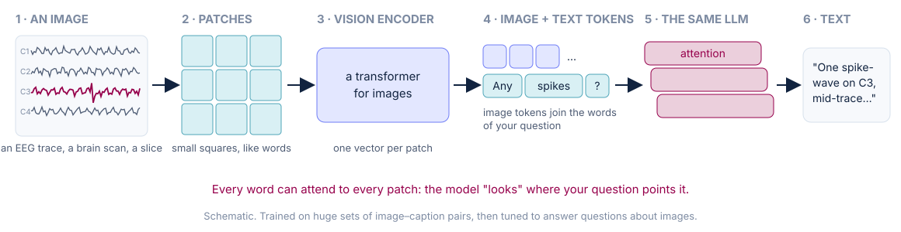

<h3>What it adds</h3>
Reads EEG traces, brain scans, histology, figures and screenshots of errors, next to your text.

<h3>Why agents use it</h3>
An agent can <b>look at the figure it just made</b> and fix the axis, the colours, the missing panel.

<h3>Where it fails</h3>
Counting, exact values, small print: it describes what it <i>expects</i> to see. And a face is personal data.

---

<!-- ====== CONTEXT 5 — Three environments ======
Three steps in how people code with AI, in the order they arrived (see the
history slide): chat (2022), completion in the editor (Copilot, 2021, spread
with the chat era), agents (2025). The pictures are faithful mock-ups (replace
assets/env_chat.png, env_completion.svg and env_agents.svg with real
screenshots if you prefer, e.g. the Claude Code desktop app or the Codex app
with several sessions open).
- Chat: you carry the context and copy the code back.
- Completion: the editor suggests the next lines in grey as you type; Tab
  accepts. Fast for the code you already know how to write; you still drive
  every line.
- Agents: you give a goal; each agent works in its own copy of the project (its
  own branch), plans, edits, runs the tests, saves, and comes back for review.
  Point out the list on the left: several agents in parallel, two waiting for
  you. Your job shifts to dispatching and reviewing (the git part, Part 3, is
  what makes this safe).
-->

Three environments · from chat to agents

## From chatbot, to code completion, to agentic coding

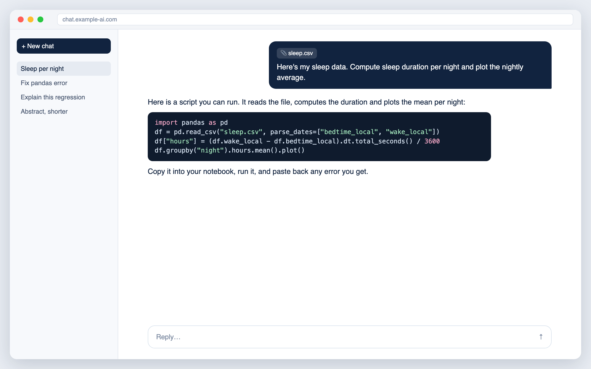

<b>1 · Chatbot</b> (browser, app): you paste code, data and errors; <b>you</b> carry the context and copy the code back.


<b>2 · Code completion</b> (VS Code): it suggests the next lines as you type; Tab accepts. <b>You</b> still drive every line.

<b>3 · Agentic coding</b> (e.g. Claude Code, Codex): several agents in parallel, each reads, plans, edits, runs and saves on its own branch; <b>you</b> review and merge.

> An agent is an LLM **in a loop with tools**: goal → plan → act → look at the result → adjust → report.

---

<!-- ====== CONTEXT 6 — Why coding first ======
From module 00 ("What vibe coding means"). Source for the usage figures:
Anthropic Economic Index, launch report, 10 Feb 2025: "37.2% of queries sent to
Claude were in this category" (computer and mathematical, largely software
engineering); report of 24 Mar 2026: "Coding remains the most common use on our
platforms", 35% of Claude.ai conversations, and coding tasks "continue to
migrate ... to more automated workflows" in API traffic (incl. Claude Code).
Caveat (Anthropic's own): Claude is marketed as a coding model, so coding may be
over-represented.
-->

Why coding came first

## Software development is where agentic AI is used most

**Why coding first**
- Code is text, and there is a vast public corpus of it.
- Code can be **run**: errors and tests give immediate feedback.
- The result can be **checked**, by the machine and by you.

37%

of conversations with one major assistant were software and maths tasks, by far the first use (Anthropic Economic Index, 2025); still first in 2026, and moving from chat to <b>autonomous agent workflows</b>.

**"Vibe coding"** (Andrej Karpathy, 2025)
- You describe **what you want** in plain language; the model writes the code.
- Tool-agnostic: Claude Code, Codex, Copilot, Cline, or paste-into-chat.

> The honest version for scientists: the vibe is in **how you produce** code, never in whether it's correct.

---

<!-- ====== CONTEXT 6b — What a hackathon is ======
Pedagogy, 1 minute. The FacMed Hack is not a coding contest: it is a
time-bounded sprint that combines three things that are hard to get together
in a normal research week.
- Creativity: people from different labs, clinics and disciplines on a fresh
  problem; the needs campaign (Part 6) gave the problems, the mix of people
  gives the angles (the exercise a few slides back: one dataset, many questions).
- Learning by doing: you learn a method, a dataset or a tool by building with
  it, with someone next to you who knows the part you don't.
- A pinch of challenge: the deadline. On Saturday at 17:00 each team shows a
  prototype or proof of concept, not a plan. The deadline forces choices, and
  choices are where teams learn the most.
Then: what vibe coding did to this recipe (next slide).
-->

Why this matters for the hack · 1 of 2

## A hackathon is a sprint with a deadline

Creativity
<h3>Think out of the box</h3>

People from different labs, clinics and fields on one fresh problem. Every background brings another angle on the same data.

Learning by doing
<h3>Build to understand</h3>

You learn a method, a dataset or a tool by making something with it, next to someone who knows the part you don't.

A pinch of challenge
<h3>Ship by the deadline</h3>

At the end, each team shows a working <b>prototype or proof of concept</b>, not a plan. The clock forces the choices.

 

> **Time-bounded sprint = creativity × learning by doing × a deadline.** FacMed Hack: 32 hours, Friday 6 → Saturday 7 November.

---

<!-- ====== CONTEXT 6c — What vibe coding changed in hackathons ======
From Thomas's talk at Hack the Hackathon 6 (20–22 Oct 2026), agentic-hacks
repository, talks/2026-10-hack-the-hackathon (talk.md, slides S15, S18, S22,
S20). Data: every Devpost hackathon, 13,626 events, ~400,000 projects,
1.2 million team memberships; 217,000 projects linked to GitHub; four eras
(pre-AI, Copilot, ChatGPT, agentic from mid-2024).
- Adoption: generative AI declared in 53% of projects, ~3 points a quarter
  since 2023.
- Scope: before AI, a solo project declared 2.9 technologies, a team of four
  or more 5.3 (gap 2.4). In the agentic era: 7.3 vs 7.4 (gap 0.07). Without the
  partial 2026 data, the scope–team elasticity still falls 75%.
- But: going solo cost 22 points of win probability before AI (same person,
  solo vs team), and 22 points now (−0.221 vs −0.216). Say "did not close",
  never "rose".
- Ties: teammates (vs strangers from the same event) later build something
  unrelated together 62× more often, team up again at a later hackathon 134×
  more often; unchanged across AI eras. Upper bounds: teams are chosen.
- Unpublished, work in progress: say so if asked; no causal claim on the
  mechanism.
Message for the hack: one person with an agent can now build what took a team
of four; the team still wins, and the team is what outlasts the weekend. Agents
are a teammate's multiplier, not a substitute for a teammate.
Image: from the same talk (illustration).
-->
<!-- _class: dense -->

Why this matters for the hack · 2 of 2

## Vibe coding changed hackathons. It did not replace the team.

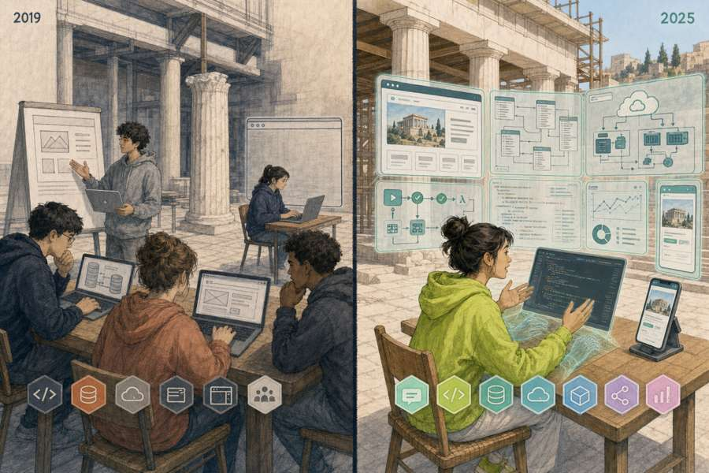
<b>2019</b>: a team of four declares five technologies · <b>2025</b>: one person with an agent, seven, by Sunday

Maillart et al., work in progress: every Devpost hackathon, 13,626 events, ~400,000 projects, 2014–2026.

**What changed, sharply**
- Generative AI in **53%** of projects, and growing by about **3 points every quarter**.
- Solo vs team of four: before AI, the team built with almost **twice as many technologies** (5.3 vs 2.9); with agentic AI, **the same** (7.4 vs 7.3).

**What did not**
- Going solo still lowers your **chance of winning by 22 points**, exactly as before AI.
- Teammates build something new together **62×**, and team up again **134×** more often than same-event strangers.

> AI made each person broader. **The team still wins, and the team outlasts the project.**

---

<!-- ====== CONTEXT 9 — How scientists use it today ======
Put the room's live results from the opening quiz (presenter view) next to
this list: where is the room ahead, where behind?
-->

How scientists use it today · and how this room does

## Six everyday uses

| Everyday use | What it does for you |
|---|---|
| **Literature** | find, summarise, compare papers |
| **Analysis code** | cleaning, statistics, figures, pipelines |
| **Modelling** | from a word model to a fitted model in hours |
| **Writing** | editing, restructuring, translating |
| **Learning** | explaining unfamiliar code or methods |
| **Tools** | small apps, dashboards, lab utilities |

 

> Compare with the room's answers to the opening quiz: which uses are we missing?

---

<!-- ====== CONTEXT 10 — At the frontier ======
Diagrams drawn for this deck, describing how each system works.
- AlphaFold 2 (Jumper et al., Nature 2021): predicts a protein's 3-D structure
  from its amino-acid sequence, with a per-residue confidence score (pLDDT,
  colours as in the AlphaFold database). Nobel Prize in Chemistry 2024 (Hassabis,
  Jumper; with Baker for protein design). Not a language model, but the same
  deep-learning family.
- AI co-scientist (Google, Feb 2025): several agents generate, review, debate,
  rank in a tournament and refine hypotheses for a scientist's goal.
- The AI Scientist (Lu et al., Sakana AI, 2024, arXiv 2408.06292): automates
  idea → code and experiments → paper → automated review, end to end. Its papers
  were of mixed quality.
-->

At the frontier

## Beyond the chat window

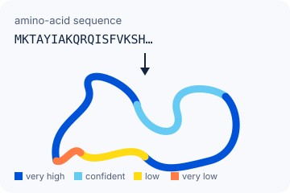
<b>AlphaFold</b> predicts protein structures from sequence · Nobel Prize in Chemistry 2024

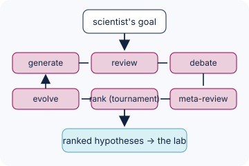
<b>AI "co-scientist"</b>: agents generate, debate and rank hypotheses · Google, 2025

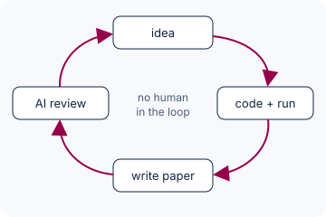
<b>The AI Scientist</b> drafts whole studies end to end, with mixed quality · Sakana AI, 2024

---

<!-- ====== CONTEXT 11 — BrainBench ======
Luo, X., …, Love, B. C. Large language models surpass human experts in
predicting neuroscience results. Nature Human Behaviour (2024).
doi:10.1038/s41562-024-02046-9 · arXiv 2403.03230. Numbers from arXiv v4.
Details cut from the slide (say if asked): 200 test cases from 2023 Journal of
Neuroscience abstracts, five subfields; experts wrote the altered versions
(background and methods unchanged); LLMs pick the abstract they find less
surprising (lower perplexity); 81.4% vs 63.4%; well calibrated (more confident
when right); no sign of memorisation.
Discussion prompt: predicting which result was published is not the same as
discovering; models learn the literature's patterns, including its biases.
-->

In neuroscience · Luo et al., <i>Nature Human Behaviour</i>, 2024

## Can an LLM predict a neuroscience result better than you?

- **BrainBench**: 200 real *J. Neurosci.* abstracts, each paired with a version whose results were altered. Which one is real?
- LLMs beat **171 neuroscience experts**, in every subfield.
- A small model further trained on neuroscience papers (**BrainGPT**) did ~3 points better still.

81%

LLMs

63%

human experts

doi.org/10.1038/s41562-024-02046-9 · Predicting what was published is not discovering: models learn the literature's patterns, biases included.

---

<!-- ====== CONTEXT 13 — A pipeline in a day: our example ======
Thomas's framing (22 Oct): we were stuck by our own lack of technical skills;
agentic AI let us pull in three state-of-the-art methods, for camera
synchronisation, camera calibration and triangulation (3-D reconstruction).
After years stuck, we can finally process hundreds of hours of 4K video in
storage since 2020.
Thomas's own work (AutismBrainBehavior, 4by4k-pipeline), Marie Schaer's group.
Facts from the repository's benchmarks and git history: whole pipeline built
on 18 Sep 2026 (10:46 → 18:29) with an agent; calibration solved before, in
situ with a checkerboard (Aug–Sep 2026); validated on a real 49-min session:
296,294 frames, 19.8 min from submission to 3-D, 99.89% agreement with the
reference pipeline; 2-D pose at 5.5× real time; audio sync 6–14 ms RMS.
Picture: stick figures from the room-4 reconstruction (gen_social), no video
frames, no faces. Do not name the session.
Governance point (bridge to pre-read 2): a guard in the code blocks the agent
from the participant data folders.
[CONFIRM] "hundreds of hours" (from Marie Schaer's crash course).
Figures behind the lighter slide (from the repositories, 22 Oct check):
footage from 2020, cameras unmoved since 2020 (gen_social/MULTIVIEW_CORPUS_PLAN.md);
"never turned into 3-D" is inferred [CONFIRM]. Agent build: 14 commits,
18 Sep 10:46 → 21 Sep 21:21, two working days (~7.7 h + ~6 h); groundwork in
gen_social Jun–Sep (calibration error ~60 px → 1.76 px). Set-ups benchmarked
(docs/benchmarks.md): 2 decoders, 2 person detectors, 3 pose models, 3+ runtime
settings, 2 sync methods, 3 identity-linking rules: ~20, variants of one tool
family. The slide follows Thomas's framing above (three state-of-the-art methods:
synchronisation, calibration, triangulation). Result: 49-min session in 19.8 min, 99.89% identity
agreement, 0 swaps, child coverage 0.68 → 0.89, ~2 cm error.
-->
<!-- _class: dense -->

Our own example · fast prototyping

## 3D autism diagnosis scene reconstruction: unstuck after years

- **Stuck for years**: our own lack of technical skills.
- **With an agent**: three state-of-the-art methods pulled in: camera **synchronisation**, camera **calibration**, **triangulation** to 3-D.
- **Outcome**: hundreds of hours of 4K video, in storage since 2020, can finally be processed.

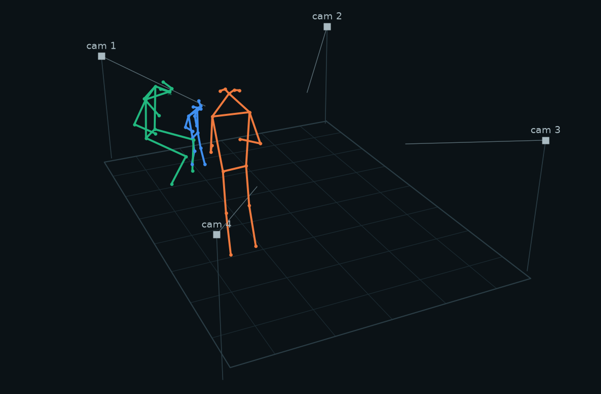
Four calibrated corner cameras → one metric 3-D scene · child (blue), clinician (orange), parent (green)

---

<!-- ====== CONTEXT 12 — Explore and reject fast: our example ======
Thomas's framing (22 Oct): rebuilding our envisioned approach fast let us test
many approaches, our own and other published ones; none gave satisfactory
results, and there is a lot of learning in failing.
Thomas's own work (AutismBrainBehavior, detection-repetitive-behaviors-asd,
June 2026). Unpublished: say "our work in progress"; no session IDs, no
clinical data on screen. The figure is the method schematic on a synthetic
signal. The point, with pre-read 1: when building and testing costs hours, you
find out fast whether an approach can work, and stop early.
Figures behind the lighter slide (from the repository, 22 Oct check): material
from 2022–2025 handed over (docs/project-summary.md), so "open since 2022" is
the earliest dated file [CONFIRM]. Agent work: 9 commits on 4 days, 10–26 June
2026. Audit: 48 of 51 sessions consistent, 3 where the stored file is a
different recording; over-detection vs. the manuscript traced to a later code
revision; scoring reproduces the 106 detectable events over 74 sessions.
Benchmark against ASDMotion (Barami 2024): scaffold only, not run.
The slide follows Thomas's framing above (many approaches tested, none
satisfactory); the repository itself documents the audit and one baseline.
-->
<!-- _class: dense -->

Our own example · fail fast, learn fast

## Detecting hand-flapping: many approaches tested, fast

- **Goal**: detect hand-flapping automatically in pose estimation of autistic children.
- **With an agent**: our approach rebuilt fast, then many others tested, ours and published ones.
- **Outcome**: no satisfactory result yet, but new research directions in sight. **There is a lot of learning in failing.**

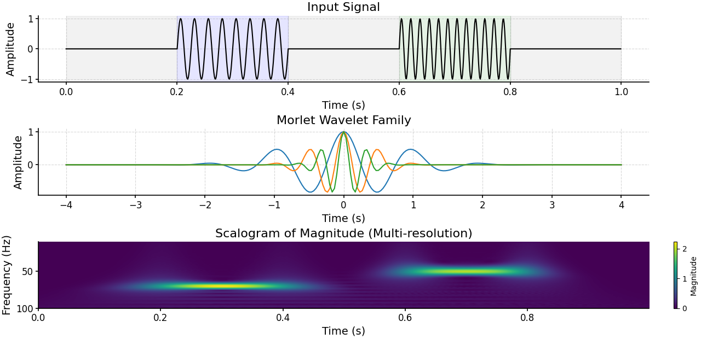
One of the approaches, on a synthetic signal: oscillation → wavelets → scalogram

---

<!-- ====== CONTEXT 14 — Live quiz · Where first ======
Opinion, no right answer. Live quiz app, multi-select (up to two). Show the
results right away. Push: ask someone who picked the least-chosen option to
defend it. Analysis and modelling is where the evidence of change is today
(pre-read 1, the two examples you just saw); automated labs are where the
money is going; writing and peer review are where the policy fights are.
-->

Poll 1 of 6 · Where first

## Where has agentic coding changed, or will it change, research practice most in the next five years? *Pick up to two.*

<b>A</b>Analysing data and building models

<b>B</b>Designing and running experiments: automated labs

<b>C</b>Reading and synthesising the literature

<b>D</b>Writing papers and grants

<b>E</b>Peer review and replication

<b>Vote live · {{QUIZ_PIN_LABEL}}</b>{{QUIZ_URL}}

---

<!-- ====== CONTEXT 15 — Opportunities ======
From module 01 ("Why it matters"), plus two lines for research.
-->

The opportunities

## Code was friction between a question and an answer

<h3>The plumbing stops being the bottleneck</h3>
Hours of searching forums and documentation become minutes.

<h3>Exploration gets cheap</h3>
Five model specifications, three plots, two normalisations, in the time of one.

<h3>The barrier drops for the whole lab</h3>
The student who "can't code" can build a working pipeline; experimentalists can model.

<h3>Scripts over clicks</h3>
An analysis written as code can be re-run, reviewed and shared: better for reproducibility.

 

> ⚠️ It is also trivially easy to produce **plausible · beautiful · wrong**.

---

<!-- ====== CONTEXT 16 — Pre-read 1: DePasquale, the opportunities ======
DePasquale (Boston University), The Transmitter, 16 June 2026. Starting point:
Larry Abbott's "Theoretical neuroscience rising" (Neuron, 2008): models can be
explored and rejected faster than experiments. In practice the engineering
(word model → equations → code → fit to data) throttled that speed. Agentic
coding removes much of the bottleneck, in four directions.
-->

Pre-read 1 · DePasquale, <i>Models at the speed of thought</i> · the opportunities

## *Models at the speed of thought*: four directions

<h3>1 · Experimentalists model</h3>
Fit a model to your own data without waiting months for a modelling collaborator.

<h3>2 · Theorists iterate</h3>
Try, test and reject new models in hours, at last at the speed theory promised.

<h3>3 · Search model space</h3>
AI-guided search (AlphaEvolve-style) explores many candidate models at scale.

<h3>4 · Maths opens up</h3>
Mathematically heavy models become reachable for people stronger at code than at the blackboard.

 

> *"Major new discoveries are likely to come from humans generating insights, just as they have always done…"* Larry Abbott, Columbia, in his response

---

<!-- ====== CONTEXT 17 — Pre-read 1: the challenges, and seven responses ======
Verbatim quotes from the essay and its seven responses (checked on the page).
Use this slide to open a two-minute discussion: which risk worries you most?
Cut from the slide, to quote if useful:
- DePasquale: AI-guided search will also produce "artifacts of the search
  process"; his advice: keep stepping away from the AI to exercise your own
  judgment.
- Dan Goodman (Imperial), on code that seems to test your idea but hides
  errors: "This isn't a theoretical risk; it's something that seems to crop up
  very regularly in practice."
- Julijana Gjorgjieva (TUM): expertise is needed "to recognize when an AI
  system is inventing concepts that do not actually exist."
- Kim Stachenfeld (DeepMind): LLMs are "a flashlight as opposed to a laser
  pointer".
- Anthony Zador (CSHL): "LLMs are like genies: They can grant you almost any
  wish, but you have to be very careful about what you ask for."
-->

Pre-read 1 · the challenges · and the field answers back

## "Prolific but shallow"?

> *"The field risks becoming prolific but shallow—generating models faster than we can generate insights."*
> Brian DePasquale

- **Thinking by struggling**: turning an idea into equations and code is *"a form of disciplined thinking"*, above all for trainees.
- **Hidden errors**: code that seems to test your idea but does not *"crop up very regularly in practice"* (Dan Goodman, Imperial).
- **Invented concepts**: only expertise recognises what *"does not actually exist"* (Julijana Gjorgjieva, TUM).

---

<!-- ====== CONTEXT 18 — Pitfalls ======
From module 02 ("Where it shines, where it bites" and "A 30-second horror
story") and module 09 (safety rules).
Cut from the slide, as examples: df.dropna() silently deletes 40% of rows;
test data leaks into training and a 0.98 evaporates; a hallucinated citation
nobody checked. Trust-but-skim also covers translating between languages.
Beyond the code: skills that never develop; a field that becomes "prolific but
shallow" (previous slide).
-->

The pitfalls

## Strongest on syntax, weakest on truth

- **Trust, but skim**: plotting, formatting, boilerplate, reading files, explaining code.
- **Slow down**: units, time zones, the statistical test, your specific method, citations.
- **It fails quietly**: a clean run with a wrong number, never a crash. `dropna()` drops 40% of rows; leakage gives a 0.98 that evaporates.
- **Beyond the code**: patient data pasted into cloud tools is a breach, whatever the answer.

---

<!-- ====== CONTEXT 19 — What the science says ======
From module 02 ("What the science says", both slides). Kosmyna et al. is a
preprint under active debate: cite as suggestive.
-->

What the science says

## The danger is a confident answer that switches your checking off

- **Automation bias &amp; complacency**: we over-trust automated output and stop checking it *(Parasuraman &amp; Manzey, 2010)*.
- **Cognitive offloading**: the more knowledge workers trust generative AI, the less critical thinking they report *(Lee et al., CHI 2025)*.
- **Illusion of explanatory depth**: fluent output makes you *feel* you understand what you couldn't rebuild *(Rozenblit &amp; Keil, 2002)*.

- **"Cognitive debt"**: heavy LLM use while writing went with weaker memory of one's own text and more homogeneous prose *(Kosmyna et al., 2025, preprint)*.
- **Generation effect**: you understand and retain what *you* produce far better than what you only read *(Slamecka &amp; Graf, 1978)*.

> Offload the typing. **Never offload the understanding** your name depends on.

---

<!-- ====== CONTEXT 20 — POLL 2 · Reality check ======
The one poll with an answer: D. Share the result right away, then the next
slide.
-->

Poll 2 of 6 · A reality check

## In a 2025 randomised trial, experienced open-source developers worked on their own projects with and without AI tools. With AI, they were…

<b>A</b>about 40% faster

<b>B</b>about 20% faster

<b>C</b>no faster and no slower

<b>D</b>about 19% slower

<b>Vote live · {{QUIZ_PIN_LABEL}}</b>{{QUIZ_URL}}

---

<!-- ====== CONTEXT 21 — The perception gap ======
Caveat to say out loud: early-2025 tools, experts in large mature repositories
they knew intimately. METR says the result may not hold for small new projects
or unfamiliar code, which is closer to a 32-hour hack. The lesson is the
perception gap.
-->

Poll 2 · the answer

## D: about 19% slower, while feeling 20% faster

+19%

time taken with AI tools, measured

 

−20%

time the same developers <i>believed</i> AI had saved them, afterwards

- 16 experienced developers, 246 real tasks on their own projects, early-2025 tools.
- METR's own caveat: experts in large codebases they knew by heart; it may not hold for small new projects, closer to a hackathon.
- **The lesson is the gap**: your feeling of speed is a poor measurement. That is thinking fast and slow, in one number.

METR (Model Evaluation &amp; Threat Research), "Measuring the impact of early-2025 AI on experienced open-source developer productivity", July 2025.

---

<!-- ====== CONTEXT 22 — The thesis ======
From module 00 ("The thesis"). Bridge to Part 2.
-->
<!-- _class: ink -->

The thesis we'll repeat

# You move from **author** of code to **director** of code.

Your job becomes **intent · judgment · verification**. The syntax is the agent's.

 

Next: how to do that job well.
