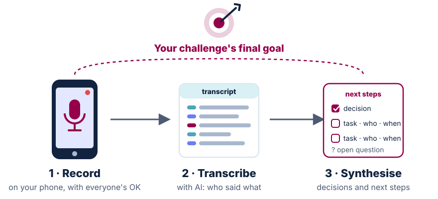

<!-- ====== HACK 1 — Divider ====== -->
<!-- _class: ink divider -->

10 min

18:28 · Part 6 of 7 · Objective 3 · Prepare

# The hack, concretely

How the 32 hours run, how each challenge is set up, and what our compute partner brings.

---

<!-- ====== HACK 2 — Hour by hour ======
Source: steering committee of 14 Oct (minutes, corp repo): Friday opening moved
to 12:30 (coffee, no lunch); challenge presentations 13:00–13:15; teams formed
beforehand from the votes, the session only kicks them off; a cross-pitch
before each dinner; proposed 1:1 peer review on Saturday ≈ 11:30; public finals
Sat 17:00–18:30 at Campus Biotech, in the presence of the Dean (moved from the
CMU, Thomas 22 Oct). Venue: Campus Biotech, auditorium and H8 floor.
[CONFIRM] against the run of show updated on 24 Oct.
-->

Friday 6 → Saturday 7 November · Campus Biotech

## 32 hours, hour by hour

Fri 12:30<h3>Opening</h3>
Coffee, no lunch. Challenges presented at 13:00; your team is already formed.

Fri afternoon<h3>Build</h3>
Explore, try, fail, keep what works: tonight's method.

Before dinner<h3>Cross-pitch</h3>
Each team shows its progress to the others; steal good ideas.

Night<h3>Optional</h3>
Sleep on site if you said yes: bring a mat and a sleeping bag.

Sat ≈ 11:30<h3>Peer review</h3>
Teams review each other in rotation, then tag the <code>demo</code>.

Sat 17:00<h3>Public finals</h3>
At Campus Biotech, 17:00 → 18:30, with the Dean: your pitch and your demo.

 

> **Before 6 November**: vote and confirm your place (23 → 28 Oct) · a GitHub account with two-factor authentication · Crash Course #3 on grant writing, Tue 3 Nov, 17:00 → 19:00.

---

<!-- ====== HACK 3 — One repository per challenge ======
Replaces "How your team works" and "What you leave with" (Thomas, 22 Oct).
Each challenge has a lead (PI level) and a runner (PhD or postdoc inside the
team), per the 14 Oct steering committee. Say "we do our best": data and
starter material depend on each runner. Data rule (resources report, 6 Oct):
only public, synthetic or anonymised data on the HPE environment during the
hack; nothing sensitive in git.
-->

How it works

## One GitHub repository per challenge

Ready before you arrive<h3>Data and methods</h3>
We do our best to prepare each challenge in advance, with its runner: the dataset (or a synthetic stand-in), the methods to start from, and the questions worth asking.

Everything documented<h3>In the repo, or online</h3>
The challenge repository holds the README, the data description and an <code>AGENTS.md</code> your agent reads. The rest is on <b>facmed-hack.sparkboard.com</b>.

How the team works in it<h3>Branches and pull requests</h3>
One branch per task (1 task = 1 agent), merged through pull requests, as in Part 3. Real data never goes into git.

 

> Each challenge has a **lead** (a PI) and a **runner** (a PhD student or postdoc) who knows the data and the repository.

---

<!-- ====== HACK 4 — What HPE brings ======
Sources (corp repo, hackathon folder): steering committee 14 Oct (HPE lends
compute during and after the hack, sends three engineers, brings privacy
layers);
vibe_coding_environment/implementation_plan.md (8 GPUs; open-weight models
served through NVIDIA NIM: a coding model and nemotron-3-nano-omni for audio
and video, English only, clips <= 2 min; browser VS Code with Cline on those
models; GPU jobs via Slurm or Ray; datasets mounted read-only); technical
resources report 6 Oct (only public, synthetic or anonymised data on HPE
during the hack; Protopia Stained Glass for sensitive text; for winners, an
HPE Private Cloud AI Developer System, 2x RTX PRO 6000 Blackwell: [CONFIRM]
before promising it). Also: UNIGE HPC (Baobab) grants weekend access to UNIGE
participants (minutes 14 Oct).
-->

Our compute partner · Hewlett Packard Enterprise (HPE)

## What HPE brings to the hack

**Resources**
- **8 NVIDIA GPUs** for the weekend, and compute after it for the projects that continue.
- **Open AI models served on them**: a coding model for your agent, and a model for audio and video.
- **A ready-made VS Code in the browser**, with an agent already set up: nothing to install.
- **Your challenge's data**, stored there and read-only; heavy analyses run as jobs on the GPUs.

**Expertise**
- **Three HPE engineers on site**, all weekend: compute, models, getting your job to run.
- **Privacy layers** for sensitive inputs, and advice on keeping data where it belongs.

Only public, synthetic or anonymised data on the HPE environment during the hack. UNIGE participants also get weekend access to the university's HPC cluster.

---

<!-- ====== HACK 5 — Tip: record the brainstorm ======
Added 22 Oct (Thomas). A habit for the first hour of the hack, when each team
shapes its challenge. Record on a phone (the voice memo app is enough), with
everyone's agreement; transcribe with AI (the phone's own transcription, or an
AI tool: the HPE audio model takes English clips of up to 2 minutes, so a long
recording is easier with another tool); then ask an agent for decisions, tasks
with owners, and open questions. The goal sentence is what keeps it useful:
say it at the start of the recording and give it to the AI with the
transcript, so it can flag what drifted. Same rule as the data: no patient
information in a recording that goes to a cloud AI.
-->

Tip · while you brainstorm your challenge

## Record the brainstorm; let AI write the next steps

1. **Record** the conversation on your phone, with everyone's OK.
2. **Transcribe** it with AI.
3. **Synthesise**: ask an agent for the decisions, the tasks (who, by when) and the open questions.

> **Stay pointed at your final goal.** Say it out loud when you start recording; give it to the AI with the transcript and ask what drifted away from it.

No patient information in a recording that goes to a cloud AI: same rule as the data.
