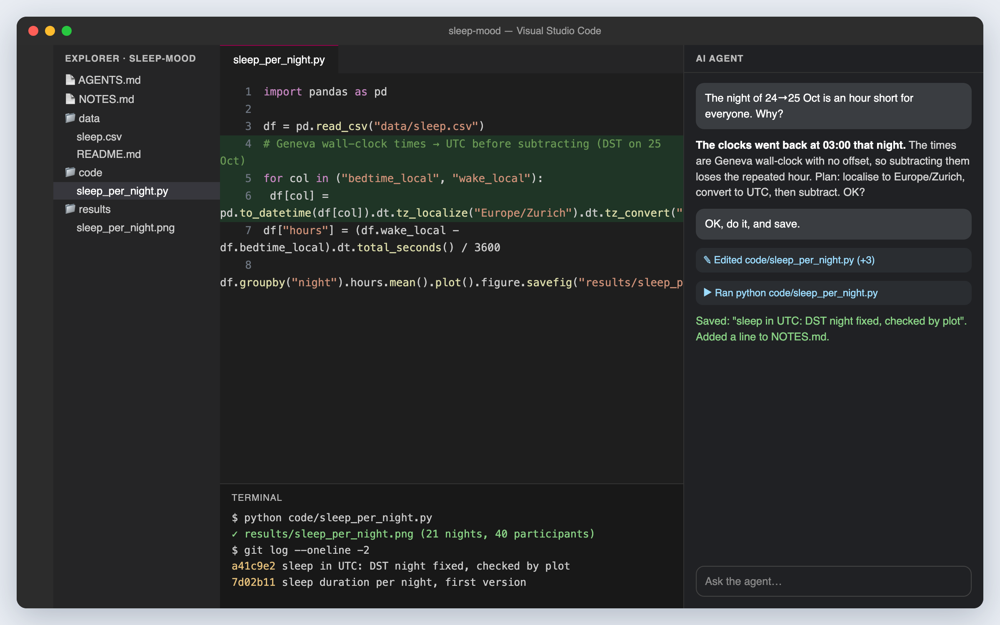

<!-- ====== OPENING 1 — Title ====== -->
<!-- _class: ink -->
<!-- _paginate: false -->
<!-- _footer: "" -->

<div class="cols" style="grid-template-columns: 1.6fr 1fr; align-items: center;">
<div>

<span class="kicker">Crash Course #2 · Thursday 22 October 2026 · 17:00 → 19:00 · on Zoom</span>

# Vibe coding &amp; AI-assisted development
## Direct the agent. Check the result.

Where AI agents come from, how they change research, and how to work with one: hands on, in pairs, on real data.

<span class="small">FacMed Hack #1 · Digital Phenotyping of Mental Health · Fri 6 – Sat 7 November 2026 · Campus Biotech · in English</span>

</div>
<div style="text-align:center">

<div class="card" style="text-align:left">
<h3>The road to 6 November</h3>
<p><b>Thu 8 Oct</b> · Crash Course #1 · Digital phenotyping &amp; the Swiss data rules</p>
<p><b>Today</b> · Crash Course #2 · Vibe coding &amp; AI-assisted development</p>
<p><b>Thu 29 Oct</b> · Crash Course #3 · Grant writing for pop-up projects, with the RGO</p>
<p><b>Fri 6 – Sat 7 Nov</b> · the hackathon, 32 hours</p>
</div>

</div>
</div>

<div class="logos" style="padding: 10px 16px;">

</div>

---

<!-- ====== OPENING 2 — Zador quote ======
Read it aloud, then pause. The frame for the evening: nobody in this room, nor
the people who build these tools, knows how this plays out for neuroscience,
which is why tonight starts with what you imagine and ends with a discussion.
Same quote closes the deck.
Source: A. Zador's response to DePasquale, The Transmitter, 16 June 2026.
-->
<!-- _class: ink quote -->
<!-- _paginate: false -->

> "AI is obviously going to have a massive impact on how we do science, and it's hard to know what the long run looks like."

<div class="who"><b>Anthony Zador</b> · Cold Spring Harbor Laboratory · <i>The Transmitter</i>, June 2026</div>

---

<!-- ====== OPENING 3 — Opening question ======
Facilitator: read the question aloud, then silence. 90 seconds for everyone to type
one or two lines in the Zoom chat (ask them to hold Enter until you say "send", so
early answers don't anchor the rest). Read 4–5 aloud, picking ones far apart
(clinic vs. theory vs. lab bench vs. publishing). Save the chat: at 18:47 we sort
the answers into what the session showed agents change today vs. what is still
imagination (Part 7, "the opening question, revisited").
-->
<!-- _class: ink -->

<span class="clock">3 min</span>

<span class="kicker">Before anything else · 90 seconds · one or two lines in the Zoom chat</span>

# Where do you imagine vibe coding and agentic coding will change science? Name one place, and what changes there.

<span class="small" style="display:block; margin-top: 10px;">Your own field or any other. A method, an instrument, a job in the lab, a stage of publishing: be specific.</span>

<br>

> *"What would you do if you had all the models of the brain you wanted?"*
> <span class="small">Grace Lindsay, NYU, responding to this week's pre-read (DePasquale, <i>The Transmitter</i>, June 2026)</span>

---

<!-- ====== OPENING 4 — Objectives ======
Objective 3 matters most for anyone who arrived without tools installed: say
explicitly that this is fine, and that the hack offers the HPE / NVIDIA
environment to everyone, with or without their own setup.
-->

<span class="kicker">Tonight · three objectives</span>

## By 19:00 you should…

<div class="cols3" style="margin-top: 8px;">
<div class="card">
<span class="qnum">1 · Imagine</span>
<h3>See your place in agentic science</h3>
<p>Where these tools come from, what they already do in research, and what becomes yours to do: your contribution, your career, your purpose.</p>
</div>
<div class="card">
<span class="qnum">2 · Understand</span>
<h3>Know how vibe coding works</h3>
<p>Think fast and slow. Try, fail and retry cheaply. Git as the safety net, run by the agent for you. Working as a team, with agents in the loop.</p>
</div>
<div class="card">
<span class="qnum">3 · Prepare</span>
<h3>Know how it runs at the hack</h3>
<p>Whether you already have the tools or not, both paths are covered: your own setup, or the HPE / NVIDIA environment, open to every team to build and test on.</p>
</div>
</div>

<br>

<span class="small">Built on the course <i>Vibe Coding for Scientists</i> (github.com/wazaahhh/vibe-coding-crash-course, CC BY-NC 4.0). Pre-reads: DePasquale (2026) and Schuck (2026), both in <i>The Transmitter</i>.</span>

---

<!-- ====== OPENING 5 — Programme ======
Seven live-quiz questions are spread through the evening (app at facmed-quiz.pages.dev,
presenter view at /present?key=…), each where its topic comes up. Show each
result right away and take one or two reactions; "the room's answers" in Part 7
recaps them. Zoom polls (zoom_polls.md) are the fallback.
-->

<span class="kicker">Tonight · 17:00 → 19:00</span>

## Seven parts, a live quiz along the way

| Time | Part | Poll | Obj. |
|---|---|---|---|
| 17:00 | Opening: a quote, a question, three objectives | — | 1 |
| 17:05 | **1 · Where this comes from**: from artificial neurons to coding agents; uses in science and neuroscience; opportunities and pitfalls (pre-read 1) | quiz · 1 · 2 | 1 |
| 17:30 | **2 · How vibe coding works**: four disciplines, how to ask, three dials | — | 2 |
| 17:36 | **3 · Git without the jargon**: save points, and how the agent runs git for you | 3 | 2 |
| 17:47 | **4 · Practical in pairs** (breakout rooms): synthetic sleep data, then a real EEG recording | 4 | 2 |
| 18:24 | **5 · Review hunt**: would you sign this AI-written analysis? | 5 | 2 |
| 18:31 | **6 · The hack**: where we are, how it runs, with or without your own tools | — | 3 |
| 18:41 | **7 · A future worth building**: AI governance in science (pre-read 2), your place | 6 | 1 |


---

<!-- ====== CONTEXT 1 — Divider ====== -->
<!-- _class: ink divider -->

<span class="clock">25 min</span>

<span class="kicker">17:05 · Part 1 · Objective 1 · Imagine</span>

# Where this comes from

From an artificial neuron in 1943 to an agent that edits your analysis code. What these tools are, what scientists do with them, and where they fail.

---

<!-- ====== CONTEXT 2 — It started in your field ======
For a neuroscience audience: the idea of artificial neural networks came from
neuroscience. Keep it to two minutes; the point is the lineage.
Definitions (say them only if asked):
- Artificial neuron (McCulloch & Pitts): a unit that adds up its weighted inputs
  and "fires" (outputs 1) when the sum passes a threshold.
- Perceptron (Rosenblatt): one layer of such units whose weights are LEARNED from
  labelled examples: wrong answer → nudge the weights.
- Neural network (multi-layer): layers of units, every connection a weight; the
  hidden layers build intermediate features the output layer combines.
- Hopfield network: a recurrent network in which memories are stable states
  (energy minima) the network settles into.
- Backpropagation: computes how much each weight contributed to the error and
  adjusts all weights, layer by layer, from the output backwards.
- Deep learning: neural networks with many layers, trained on large data with GPUs.
Sources: McCulloch & Pitts 1943 (Bull. Math. Biophys.); Rosenblatt 1958;
Hopfield 1982 (PNAS); Rumelhart, Hinton & Williams 1986 (Nature);
Krizhevsky, Sutskever & Hinton 2012 (AlexNet); Nobel Prize in Physics 2024.
Diagrams: drawn for this deck.
-->

<span class="kicker">A short history · part 1</span>

## It started in your field

<div class="cols" style="grid-template-columns: 1.25fr 1fr; gap: 26px; align-items: start;">
<div>

| Year | What happened |
|---|---|
| 1943 | **McCulloch &amp; Pitts** model a neuron as a logic unit: the first artificial neuron |
| 1958 | **Rosenblatt's perceptron** learns its weights from examples |
| 1982 | **Hopfield networks**: memories as stable states of a network |
| 1986 | **Backpropagation** (Rumelhart, Hinton &amp; Williams): how multi-layer networks learn |
| 2012 | **Deep learning** wins image recognition (AlexNet): GPUs + data + depth |
| 2024 | **Nobel Prize in Physics** to Hopfield and Hinton |

</div>
<div>

<div class="fig"><div class="cap">Perceptron: weighted inputs → sum → threshold</div></div>
<div class="fig" style="margin-top:8px"><div class="cap">Multi-layer network, trained by backpropagation</div></div>

</div>
</div>

---

<!-- ====== CONTEXT 3 — From next word to agents ======
Definitions:
- Token: a piece of text, a word or part of a word ("neur" + "on").
- Parameter (weight): a number learned in training; GPT-3 has 175 billion.
- Transformer: the architecture behind every modern language model: a stack of
  layers, each with self-attention and a feed-forward network; processes all
  tokens of a text in parallel.
- Self-attention: lets every token weigh every other token when building its
  representation ("it" looks back at "neuron").
- GPT: "generative pre-trained transformer".
- Reasoning model: trained to work through intermediate steps before answering.
- Coding agent: a language model in a loop with tools (files, terminal, tests).
Sources: Vaswani et al. 2017 "Attention is all you need"; Brown et al. 2020
(GPT-3, 175 billion parameters); GitHub Copilot preview June 2021; ChatGPT
30 Nov 2022; OpenAI o1, Sept 2024; Claude Code (Feb 2025 preview) and OpenAI
Codex (2025); Karpathy coins "vibe coding", Feb 2025.
-->

<span class="kicker">A short history · part 2</span>

## From predicting the next word to editing your code

<div class="cols" style="grid-template-columns: 1.3fr 1fr; gap: 24px; align-items: start;">
<div>

| Year | What happened |
|---|---|
| 2017 | **The Transformer** ("Attention is all you need") |
| 2020 | **GPT-3**: 175 billion parameters; scale brings surprising abilities |
| 2021 | **GitHub Copilot** autocompletes code in the editor |
| Nov 2022 | **ChatGPT**: language models reach everyone |
| 2023–24 | Claude, GPT-4, open-weight models; **"reasoning" models** |
| 2025 | **Coding agents** work inside your project; Karpathy names **"vibe coding"** |
| 2026 | Agents in research labs (this week's two pre-reads) |

</div>
<div>

<div class="fig"><div class="cap">A Transformer layer: each word attends to the others, then a feed-forward step; stacked dozens of times</div></div>

</div>
</div>

---

<!-- ====== CONTEXT 4 — How an LLM works ======
Walk through the five steps on the diagram. Then the four consequences: fluent
is not the same as true; it only knows its training data; it only "sees" what
fits in its context window; the same question can give different answers
(step 4 picks among probabilities).
-->

<span class="kicker">Under the hood, in plain words</span>

## How a large language model (LLM) writes, one token at a time

<div class="fig"></div>

<div class="cols" style="grid-template-columns: repeat(4, 1fr); gap: 12px; margin-top: 6px;">
<div class="card"><h3>Fluent ≠ true</h3><p>It writes the most plausible continuation; it can invent a method or a citation.</p></div>
<div class="card"><h3>Training cut-off</h3><p>It knows nothing after its training data.</p></div>
<div class="card"><h3>Context window</h3><p>It only "sees" what fits in its working memory.</p></div>
<div class="card"><h3>Not deterministic</h3><p>Same question, possibly a different answer.</p></div>
</div>

---

<!-- ====== CONTEXT 5 — Two environments ======
From module 03 (chat vs agent). The pictures are faithful mock-ups of the two
typical set-ups (replace assets/env_chat.png and assets/env_agent.png with real
screenshots if you prefer). Point out in the agent picture: the project's files
on the left, the code in the middle, the agent on the right, and the terminal
showing the run and the saved history (git) at the bottom.
-->

<span class="kicker">Module 03 · two environments</span>

## From chatbot to agent

<div class="cols" style="grid-template-columns: 1fr 1fr; gap: 22px; margin-top: 2px;">
<div class="fig">

<div class="cap"><b>Chat</b> (browser, app): you paste code, data and errors; it answers; <b>you</b> carry the context and copy the code back.</div>
</div>
<div class="fig">

<div class="cap"><b>Agent</b> (VS Code + your project folder): it reads your files, plans, edits, runs, sees the error, and saves; <b>you</b> approve.</div>
</div>
</div>

> An agent is an LLM **in a loop with tools**: goal → plan → act → look at the result → adjust → report.

---

<!-- ====== CONTEXT 6 — Why coding first ======
From module 00 ("What vibe coding means"). Source for the usage figures:
Anthropic Economic Index, launch report, 10 Feb 2025: "37.2% of queries sent to
Claude were in this category" (computer and mathematical, largely software
engineering); report of 24 Mar 2026: "Coding remains the most common use on our
platforms", 35% of Claude.ai conversations, and coding tasks "continue to
migrate ... to more automated workflows" in API traffic (incl. Claude Code).
Caveat (Anthropic's own): Claude is marketed as a coding model, so coding may be
over-represented.
-->

<span class="kicker">Module 00 · why coding came first</span>

## Software development is where agentic AI is used most

<div class="cols" style="grid-template-columns: 1fr 1fr; gap: 28px;">
<div>

**Why coding first**
- Code is text, and there is a vast public corpus of it.
- Code can be **run**: errors and tests give immediate feedback.
- The result can be **checked**, by the machine and by you.

<div class="card" style="margin-top:10px"><div style="font-size:2.3em; font-weight:800; color:var(--accent); line-height:1">37%</div><p>of conversations with one major assistant were software and maths tasks, by far the first use (Anthropic Economic Index, 2025); still first in 2026, and moving from chat to <b>autonomous agent workflows</b>.</p></div>

</div>
<div>

**"Vibe coding"** (Andrej Karpathy, 2025)
- You describe **what you want** in plain language; the model writes the code.
- Tool-agnostic: Claude Code, Codex, Copilot, Cline, or paste-into-chat.

> The honest version for scientists: the vibe is in **how you produce** code, never in whether it's correct.

</div>
</div>

---

<!-- ====== CONTEXT 7 — One sentence in ======
From module 00 ("In practice"). The EEG line speaks to most of the room.
-->

<span class="kicker">Module 00 · in practice</span>

## One sentence in, a working analysis out

- **Neuro / EEG**: *"Load this `.edf`, band-pass 8–12 Hz, plot alpha power per channel as a topomap."* → it wires up MNE, filters, renders the scalp map.
- **Genomics**: *"Here's my RNA-seq counts table: give me a volcano plot, label the top 10 genes by adjusted p-value."* → it reads the file, runs the statistics, returns a labelled figure **and** the code.
- **Climate / field data**: *"30 years of daily rainfall: fit a trend, test it, plot it with a 12-month rolling mean."*
- **Imaging**: *"Count the nuclei in every image in `data/dapi/`, one CSV row per file."* → it plans, writes, runs on 200 images. **You** notice the dense clusters look undercounted, ask for three overlays: touching nuclei had merged.

> The question stays yours. The **plumbing** stops being the bottleneck. Looking, doubting, correcting: that last step is the whole job.

---

<!-- ====== CONTEXT 8 — LIVE QUIZ · How do you use AI? ======
Live quiz app, question "uses" (multi-select). Show the QR and link, give 60 s,
then open the presenter view's live results; the next slide sets them against
how scientists use it today.
-->
<!-- _class: ink -->

<span class="kicker">Live quiz · on your phone or laptop</span>

## What have you already used AI for in your research? *Tick all that apply.*

<div class="cols" style="grid-template-columns: 1.2fr 1fr; gap: 30px; align-items: center; margin-top: 10px;">
<div>

Finding and summarising papers · analysis code · modelling · writing and editing · learning or explaining code and methods · building small tools · **nothing yet**

<br>

<span class="small">Anonymous. Results appear live; we look at them together on the next slide.</span>

</div>
<div>

<div class="quizbox big" style="position:static; display:inline-flex;"><div><b>Live quiz</b><span>facmed-quiz.pages.dev</span></div></div>

</div>
</div>

---

<!-- ====== CONTEXT 9 — How scientists use it today ======
Put the room's live results (presenter view) next to this list: where is the
room ahead, where behind?
-->

<span class="kicker">How scientists use it today · and how this room does</span>

## Six everyday uses

| Everyday use | What it does for you |
|---|---|
| **Literature** | find, summarise, compare papers |
| **Analysis code** | cleaning, statistics, figures, pipelines |
| **Modelling** | from a word model to a fitted model in hours |
| **Writing** | editing, restructuring, translating |
| **Learning** | explaining unfamiliar code or methods |
| **Tools** | small apps, dashboards, lab utilities |

<br>

> Compare with the room's answers on the quiz: which uses are we missing?

---

<!-- ====== CONTEXT 10 — At the frontier ======
Diagrams drawn for this deck, describing how each system works.
- AlphaFold 2 (Jumper et al., Nature 2021): predicts a protein's 3-D structure
  from its amino-acid sequence, with a per-residue confidence score (pLDDT,
  colours as in the AlphaFold database). Nobel Prize in Chemistry 2024 (Hassabis,
  Jumper; with Baker for protein design). Not a language model, but the same
  deep-learning family.
- AI co-scientist (Google, Feb 2025): several agents generate, review, debate,
  rank in a tournament and refine hypotheses for a scientist's goal.
- The AI Scientist (Lu et al., Sakana AI, 2024, arXiv 2408.06292): automates
  idea → code and experiments → paper → automated review, end to end. Its papers
  were of mixed quality.
-->

<span class="kicker">At the frontier</span>

## Beyond the chat window

<div class="cols3" style="margin-top: 4px;">
<div class="fig"><div class="cap" style="font-size:0.7em"><b>AlphaFold</b> predicts protein structures from sequence · Nobel Prize in Chemistry 2024</div></div>
<div class="fig"><div class="cap" style="font-size:0.7em"><b>AI "co-scientist"</b>: agents generate, debate and rank hypotheses · Google, 2025</div></div>
<div class="fig"><div class="cap" style="font-size:0.7em"><b>The AI Scientist</b> drafts whole studies end to end, with mixed quality · Sakana AI, 2024</div></div>
</div>

---

<!-- ====== CONTEXT 11 — BrainBench ======
Luo, X., …, Love, B. C. Large language models surpass human experts in
predicting neuroscience results. Nature Human Behaviour (2024).
doi:10.1038/s41562-024-02046-9 · arXiv 2403.03230. Numbers from arXiv v4.
Discussion prompt: predicting which result was published is not the same as
discovering; models learn the literature's patterns, including its biases.
-->

<span class="kicker">In neuroscience · Luo et al., <i>Nature Human Behaviour</i>, 2024</span>

## Can an LLM predict a neuroscience result better than you?

<div class="cols" style="grid-template-columns: 1fr 1fr; gap: 26px;">
<div>

**The approach: BrainBench**
- **200 test cases** from 2023 *Journal of Neuroscience* abstracts, across five fields.
- For each, experts wrote a **version with altered results**, coherent but wrong; background and methods unchanged.
- The task: **which abstract is the real one?**
- LLMs choose the version they find less surprising (lower perplexity); **171 neuroscience experts** took the same test.

</div>
<div>

**The results**

<div class="cols" style="grid-template-columns: 1fr 1fr; gap: 12px;">
<div class="card"><div style="font-size:2.2em; font-weight:800; color:var(--accent); line-height:1">81.4%</div><p>LLMs, on average</p></div>
<div class="card"><div style="font-size:2.2em; font-weight:800; color:var(--science); line-height:1">63.4%</div><p>human experts</p></div>
</div>

- Ahead in **every subfield**; well calibrated: more confident when right.
- **BrainGPT**, a small model further trained on neuroscience literature, did ~3 points better.
- No sign of memorisation; they integrate background and methods.

</div>
</div>

<span class="small">doi.org/10.1038/s41562-024-02046-9 · Predicting what was published is not discovering: models learn the literature's patterns, biases included.</span>

---

<!-- ====== CONTEXT 12 — Explore and reject fast: our example ======
Thomas's own work (AutismBrainBehavior, detection-repetitive-behaviors-asd,
June 2026). Unpublished: say "our work in progress"; no session IDs, no
clinical data on screen. The figure is the method schematic on a synthetic
signal. The point, with pre-read 1: when building and testing costs hours, you
find out fast whether an approach can work, and stop early.
[CONFIRM with Thomas: the slide follows what the repository shows (rebuild,
re-run, reproducibility audit, benchmark scaffold).]
-->
<!-- _class: dense -->

<span class="kicker">Models in an afternoon · our own example · pre-read 1: doi.org/10.53053/FVAU9567</span>

## Explore and reject fast: detecting repetitive movements in autism

<div class="cols" style="grid-template-columns: 1.15fr 1fr; gap: 26px; align-items: start;">
<div>

**The idea**: spot hand-flapping and rocking automatically in videos of free-play sessions (Geneva Autism Cohort), with a training-free kinematic method: body keypoints → joint angles along the arm → wavelet scalogram → episodes.

**With an agent, in a few working sessions**: the legacy code rebuilt as a tested package, re-run on the cohort, and a benchmark against a supervised deep-learning baseline (ASDMotion) scaffolded.

**What it showed, fast**: the method did not reproduce. Re-runs found extra episodes in every session checked; the recording behind the paper's figure was the wrong one; left and right arm signals were swapped. No easy path: fix the inputs before investing in the model.

</div>
<div>

<div class="fig"><div class="cap">The method on a synthetic signal: oscillation → wavelets → scalogram</div></div>

</div>
</div>

---

<!-- ====== CONTEXT 13 — A pipeline in a day: our example ======
Thomas's own work (AutismBrainBehavior, 4by4k-pipeline), Marie Schaer's group.
Facts from the repository's benchmarks and git history: whole pipeline built
on 18 Sep 2026 (10:46 → 18:29) with an agent; calibration solved before, in
situ with a checkerboard (Aug–Sep 2026); validated on a real 49-min session:
296,294 frames, 19.8 min from submission to 3-D, 99.89% agreement with the
reference pipeline; 2-D pose at 5.5× real time; audio sync 6–14 ms RMS.
Picture: stick figures from the room-4 reconstruction (gen_social), no video
frames, no faces. Do not name the session.
Governance point (bridge to pre-read 2): a guard in the code blocks the agent
from the participant data folders.
[CONFIRM] "hundreds of hours" (from Marie Schaer's crash course).
-->
<!-- _class: dense -->

<span class="kicker">A pipeline in a day · our own example · pre-read 2: doi.org/10.53053/NSSZ1001</span>

## Four 4K cameras, one 3-D scene, built in a day

<div class="cols" style="grid-template-columns: 1fr 1.05fr; gap: 24px; align-items: start;">
<div>

**Setting**: clinical assessment rooms, four 4K corner cameras, a child with a clinician (and a parent), 20–60 min sessions (Marie Schaer's group). Cameras calibrated beforehand, in the room, with a checkerboard.

**Day 1 with an agent** (18 Sep 2026): 2-D pose at 5.5× real time · audio sync across cameras (6–14 ms) · identities from geometry · metric 3-D · cluster automation · a quality-check app.

**Same day, a real 49-min session**: 296,294 frames → 3-D in **19.8 min**, **99.89%** agreement with the reference. Ready for the lab's archive: hundreds of hours (see Marie Schaer's crash course).

<span class="small">A guard in the code keeps the agent away from participant data.</span>

</div>
<div>

<div class="fig"><div class="cap">Four calibrated corner cameras → one metric 3-D scene · child (blue), clinician (orange), parent (green)</div></div>

</div>
</div>

---

<!-- ====== CONTEXT 14 — Live quiz · Where first ======
Opinion, no right answer. Live quiz app, multi-select (up to two). Show the
results right away. Push: ask someone who picked the least-chosen option to
defend it. Analysis and modelling is where the evidence of change is today
(pre-read 1, the two examples you just saw); automated labs are where the
money is going; writing and peer review are where the policy fights are.
-->

<span class="qnum">Poll 1 of 6 · Where first</span>

## Where has agentic coding changed, or will it change, research practice most in the next five years? *Pick up to two.*

<div class="opts" style="width: 64%;">
<div class="opt"><b>A</b>Analysing data and building models</div>
<div class="opt"><b>B</b>Designing and running experiments: automated labs</div>
<div class="opt"><b>C</b>Reading and synthesising the literature</div>
<div class="opt"><b>D</b>Writing papers and grants</div>
</div>
<div class="opts" style="grid-template-columns: 1fr; margin-top: 14px; width: 64%;">
<div class="opt"><b>E</b>Peer review and replication</div>
</div>

<div class="quizbox"><div><b>Vote live</b><span>facmed-quiz.pages.dev</span></div></div>

---

<!-- ====== CONTEXT 15 — Opportunities ======
From module 01 ("Why it matters"), plus two lines for research.
-->

<span class="kicker">Module 01 · the opportunities</span>

## Code was friction between a question and an answer

<div class="cols" style="grid-template-columns: 1fr 1fr; gap: 26px; margin-top: 6px;">
<div class="card"><h3>The plumbing stops being the bottleneck</h3><p>Hours of searching forums and documentation become minutes.</p></div>
<div class="card"><h3>Exploration gets cheap</h3><p>Five model specifications, three plots, two normalisations, in the time of one.</p></div>
<div class="card"><h3>The barrier drops for the whole lab</h3><p>The student who "can't code" can build a working pipeline; experimentalists can model.</p></div>
<div class="card"><h3>Scripts over clicks</h3><p>An analysis written as code can be re-run, reviewed and shared: better for reproducibility.</p></div>
</div>

<br>

> ⚠️ It is also trivially easy to produce **plausible · beautiful · wrong**.

---

<!-- ====== CONTEXT 16 — Pre-read 1: DePasquale, the opportunities ======
DePasquale (Boston University), The Transmitter, 16 June 2026. Starting point:
Larry Abbott's "Theoretical neuroscience rising" (Neuron, 2008): models can be
explored and rejected faster than experiments. In practice the engineering
(word model → equations → code → fit to data) throttled that speed. Agentic
coding removes much of the bottleneck, in four directions.
-->

<span class="kicker">Pre-read 1 · DePasquale, <i>Models at the speed of thought</i> · the opportunities</span>

## "Models at the speed of thought": four directions

<div class="cols" style="grid-template-columns: repeat(4, 1fr); gap: 14px; margin-top: 6px;">
<div class="card"><h3>1 · Experimentalists model</h3><p>Fit a model to your own data without waiting months for a modelling collaborator.</p></div>
<div class="card"><h3>2 · Theorists iterate</h3><p>Try, test and reject new models in hours, at last at the speed theory promised.</p></div>
<div class="card"><h3>3 · Search model space</h3><p>AI-guided search (AlphaEvolve-style) explores many candidate models at scale.</p></div>
<div class="card"><h3>4 · Maths opens up</h3><p>Mathematically heavy models become reachable for people stronger at code than at the blackboard.</p></div>
</div>

<br>

> *"Major new discoveries are likely to come from humans generating insights, just as they have always done…"* <span class="small">Larry Abbott, Columbia, in his response</span>

---

<!-- ====== CONTEXT 17 — Pre-read 1: the challenges, and seven responses ======
Verbatim quotes from the essay and its seven responses (checked on the page).
Use this slide to open a two-minute discussion: which risk worries you most?
-->

<span class="kicker">Pre-read 1 · the challenges · and the field answers back</span>

## "Prolific but shallow"?

<div class="cols" style="grid-template-columns: 1fr 1.25fr; gap: 26px;">
<div>

> *"The field risks becoming prolific but shallow—generating models faster than we can generate insights."*
> <span class="small">Brian DePasquale</span>

- The struggle of turning an idea into equations and code is *"a form of disciplined thinking"*, especially for trainees.
- AI-guided search will also produce *"artifacts of the search process"*.
- His advice: keep stepping away from the AI to exercise your own judgment.

</div>
<div>

| Respondent | The worry, in their words |
|---|---|
| **Dan Goodman**, Imperial | Code that seems to test your idea but hides errors: *"This isn't a theoretical risk; it's something that seems to crop up very regularly in practice."* |
| **Julijana Gjorgjieva**, TUM | Expertise is needed *"to recognize when an AI system is inventing concepts that do not actually exist."* |
| **Kim Stachenfeld**, DeepMind | LLMs are *"a flashlight as opposed to a laser pointer"* |
| **Anthony Zador**, CSHL | *"LLMs are like genies: They can grant you almost any wish, but you have to be very careful about what you ask for."* |

</div>
</div>

---

<!-- ====== CONTEXT 18 — Pitfalls ======
From module 02 ("Where it shines, where it bites" and "A 30-second horror
story") and module 09 (safety rules).
-->

<span class="kicker">Modules 02 &amp; 09 · the pitfalls</span>

## Strongest on syntax, weakest on truth

<div class="cols" style="grid-template-columns: 1fr 1fr; gap: 30px;">
<div>

| Trust, but skim | Slow down: it fails quietly here |
|---|---|
| Plotting, formatting | **Domain correctness**: units, time zones, scales |
| Boilerplate, file reading | **Statistics**: the wrong-but-plausible test, leakage |
| Explaining code | **Your specific method** |
| Translating languages | **Ground truth**: data meaning, citations |

</div>
<div>

**The failure is never a crash, it's a clean run with a wrong number:**
- `df.dropna()` silently deletes 40% of rows
- test data leaks into training → a 0.98 that evaporates
- a hallucinated citation nobody checked

**And beyond the code:** patient data pasted into cloud tools · skills that never develop · a field that becomes *"prolific but shallow"* (DePasquale)

</div>
</div>

---

<!-- ====== CONTEXT 19 — What the science says ======
From module 02 ("What the science says", both slides). Kosmyna et al. is a
preprint under active debate: cite as suggestive.
-->

<span class="kicker">Module 02 · what the science says</span>

## The danger is a confident answer that switches your checking off

<div class="cols" style="grid-template-columns: 1fr 1fr; gap: 26px;">
<div>

- **Automation bias &amp; complacency**: we over-trust automated output and stop checking it *(Parasuraman &amp; Manzey, 2010)*.
- **Cognitive offloading**: the more knowledge workers trust generative AI, the less critical thinking they report *(Lee et al., CHI 2025)*.
- **Illusion of explanatory depth**: fluent output makes you *feel* you understand what you couldn't rebuild *(Rozenblit &amp; Keil, 2002)*.

</div>
<div>

- **"Cognitive debt"**: heavy LLM use while writing went with weaker memory of one's own text and more homogeneous prose *(Kosmyna et al., 2025, preprint)*.
- **Generation effect**: you understand and retain what *you* produce far better than what you only read *(Slamecka &amp; Graf, 1978)*.

> Offload the typing. **Never offload the understanding** your name depends on.

</div>
</div>

---

<!-- ====== CONTEXT 20 — POLL 2 · Reality check ======
The one poll with an answer: D. Share the result right away, then the next
slide.
-->

<span class="qnum">Poll 2 of 6 · A reality check</span>

## In a 2025 randomised trial, experienced open-source developers worked on their own projects with and without AI tools. With AI, they were…

<div class="opts" style="width: 64%;">
<div class="opt"><b>A</b>about 40% faster</div>
<div class="opt"><b>B</b>about 20% faster</div>
<div class="opt"><b>C</b>no faster and no slower</div>
<div class="opt"><b>D</b>about 19% slower</div>
</div>

<div class="quizbox"><div><b>Vote live</b><span>facmed-quiz.pages.dev</span></div></div>

---

<!-- ====== CONTEXT 21 — The perception gap ======
Caveat to say out loud: early-2025 tools, experts in large mature repositories
they knew intimately. METR says the result may not hold for small new projects
or unfamiliar code, which is closer to a 32-hour hack. The lesson is the
perception gap.
-->

<span class="kicker">Poll 2 · the answer</span>

## D: about 19% slower, while feeling 20% faster

<div class="cols" style="grid-template-columns: 1fr 1.3fr; gap: 30px; align-items: center;">
<div>

<div class="card"><div style="font-size:2.6em; font-weight:800; color:var(--accent); line-height:1">+19%</div><p>time taken with AI tools, measured</p></div>
<br>
<div class="card"><div style="font-size:2.6em; font-weight:800; color:var(--science); line-height:1">−20%</div><p>time the same developers <i>believed</i> AI had saved them, afterwards</p></div>

</div>
<div>

- 16 experienced developers, 246 real tasks on their own projects, early-2025 tools.
- METR's own caveat: experts in large codebases they knew by heart; it may not hold for small new projects, closer to a hackathon.
- **The lesson is the gap**: your feeling of speed is a poor measurement. That is thinking fast and slow, in one number.

<span class="small">METR (Model Evaluation &amp; Threat Research), "Measuring the impact of early-2025 AI on experienced open-source developer productivity", July 2025.</span>

</div>
</div>

---

<!-- ====== CONTEXT 22 — The thesis ======
From module 00 ("The thesis"). Bridge to Part 2.
-->
<!-- _class: ink -->

<span class="kicker">Module 00 · the thesis we'll repeat</span>

# You move from **author** of code to **director** of code.

Your job becomes **intent · judgment · verification**. The syntax is the agent's.

<br>

<span class="small">Next: how to do that job well.</span>


---

<!-- ====== HOW 1 — Divider ====== -->
<!-- _class: ink divider -->

<span class="clock">6 min</span>

<span class="kicker">17:30 · Part 2 · Objective 2 · Understand</span>

# How vibe coding works

When you write code yourself, understanding comes for free. When you direct an agent, you have to *choose* to engage it. Four disciplines make the new loop safe.

---

<!-- ====== HOW 2 — Pillars 1 and 2 ======
From module 02 (pillars 1 and 2), as read in the pre-work.
-->

<span class="kicker">Module 02 · the four pillars · 1–2</span>

## Diverge first, then think critically

<div class="cols" style="margin-top: 6px;">
<div class="card">
<h3>1 · Divergence</h3>
<p>Science trains <b>convergence</b>: narrow to the one right method. Generation is now nearly free, so <b>diverge first</b>: <i>"Give me three approaches, with trade-offs."</i> Curate rather than produce; converge later, with more on the table.</p>
</div>
<div class="card">
<h3>2 · Critical thinking</h3>
<p>The model is confident, fluent and occasionally fabricating, in flawless prose. Treat every output as a pull request from a brilliant, overconfident intern. Ask <b>"How would I know if this is wrong?"</b> <i>before</i> trusting the pretty plot.</p>
</div>
</div>

<br>

> Trust the vibe to **write** it; never trust the vibe that it's **right**.

---

<!-- ====== HOW 3 — Pillars 3 and 4 ======
From module 02 (pillars 3 and 4). The METR poll just made pillar 3 concrete.
-->

<span class="kicker">Module 02 · the four pillars · 3–4</span>

## Think fast and slow; try and fail

<div class="cols" style="margin-top: 6px;">
<div class="card">
<h3>3 · Thinking fast / slow</h3>
<p>The AI is your <b>System 1</b>: fast, fluent, sometimes wrong. <b>You</b> supply System 2: slow, deliberate, checking. <i>"System 2 is in charge of doubting, but System 2 is often lazy"</i> (Kahneman).</p>
</div>
<div class="card">
<h3>4 · Try and fail</h3>
<p>Generation is cheap → more attempts, smaller stakes. Prototype to throw away. Failure costs <b>minutes, not a day</b>, so failure becomes the unit of search, as long as you can always go back (Part 3: git).</p>
</div>
</div>

<br>

> The more the result matters, the more slowly you must read it.

---

<!-- ====== HOW 4 — One project folder, one rule file ======
From module 03 ("Mode B, done right") and module 07 (CLAUDE.md conventions).
AGENTS.md is the cross-tool name (Codex, Copilot, Cline); Claude Code reads
CLAUDE.md, which can simply import AGENTS.md.
-->

<span class="kicker">Modules 03 &amp; 07 · set the agent up</span>

<div class="cols" style="grid-template-columns: 1.1fr 1fr; gap: 30px; align-items: start;">
<div>

## One project folder, one rule file

- Put **code · figures · notes · the paper** in one project folder: the agent sees the whole picture.
- Raw or private **data stays out of what gets shared** (Part 3).
- A rule file at the top, **`AGENTS.md`** (or `CLAUDE.md` for Claude Code), tells the agent your house rules, every time.

> Chat answers a question. A project folder lets the agent **work on your actual project**.

</div>
<div>

```text
my-project/
├── AGENTS.md    ← house rules for the agent
├── NOTES.md     ← what we verified / trusted
├── code/        ← analysis, notebooks
├── results/     ← figures, tables
└── data/        ← stays local, never shared
```

```markdown
# Rules
- Python, pandas. Figures go to results/.
- Never modify files in data/.
- Plan first and wait for my OK.
```

</div>
</div>

---

<!-- ====== HOW 5 — How to ask ======
From module 03 ("How to ask").
-->

<span class="kicker">Module 03 · the intent half of the job</span>

## How to ask: direct it like a capable new student

<div class="cols" style="grid-template-columns: 1.3fr 1fr; gap: 30px;">
<div>

- **Give context, not just the task**: the data, the goal, the constraints, what you've tried.
- **Ask for a plan before code**: *"outline your approach; I'll approve, then you write it."*
- **Constrain it**: language, libraries, *"match the style in this file"*, *"no new dependencies"*.
- **Make it show its work**: *"explain your reasoning; flag anything you assumed."*
- **Small steps**: one change, run, read, correct. Never accept a 300-line dump blind.

</div>
<div>

<div class="card">
<h3>Vague in → generic out</h3>
<p>❌ <i>"Analyse my sleep data."</i></p>
<br>
<p>✅ <i>"sleep.csv has bedtime and wake time in Geneva local time. Plan how you'd compute sleep duration per night and plot the nightly mean. Don't write code until I approve."</i></p>
</div>

</div>
</div>

---

<!-- ====== HOW 6 — Three dials ======
From module 06 (three dials + edit modes table). Tool-agnostic: Claude Code,
Codex, Copilot and Cline all have these, named differently.
-->

<span class="kicker">Module 06 · the controls</span>

## Three dials, whichever agent you use

| Dial | Settings | Use when |
|---|---|---|
| **1 · Edit mode**: how much rope | **Ask** (touches nothing) · **Plan first** (writes a plan, waits) · **Edit** (you accept each change) · **Auto** (edits and runs on its own) | Exploring → ask · anything big → plan · results that matter → edit · throwaway attempts → auto, **only because git makes it reversible** |
| **2 · Model**: the right brain | Frontier / "thinking" models · fast, small models | Statistics, study design, subtle bugs → frontier · boilerplate → fast · stuck → escalate |
| **3 · Steering**: hand on the wheel | Interrupt · correct with specifics · paste the error · clear a stale thread | The moment it drifts: a drifting agent rarely fixes itself. Stop it, re-aim, continue |

<br>

<span class="small">At the hack: your own agent (Claude Code, Codex, GitHub Copilot, Cline), or Cline on open models served on the HPE / NVIDIA environment.</span>

---

<!-- ====== HOW 7 — Putting it together ======
From module 06 ("Putting the three together"). This is the rhythm the
practical asks for.
-->

<span class="kicker">Module 06 · a worked rhythm</span>

## Right mode, right model, hand on the wheel

1. **Plan mode + a strong model** → *"plan how you'd test this; don't write code yet."*
2. Approve the plan → **save a starting point** (Part 3: the agent does it for you).
3. **Edit mode, small steps** → accept good changes, ask *"what changed?"* after each.
4. Stuck or slow? **Switch model** or **interrupt and re-aim**.
5. Mechanical follow-ups (tests, formatting, tidying) → **auto mode**, on a separate branch.

> That's directing.


---

<!-- ====== GIT 1 — Divider ======
Assume nobody knows git. Every word gets a plain meaning before it is used.
The promise to make early: you will rarely type a git command; you will say
what you want and the agent runs git for you.
-->
<!-- _class: ink divider -->

<span class="clock">11 min</span>

<span class="kicker">17:36 · Part 3 · Objective 2 · Understand</span>

# Git without the jargon

Why an agent needs a safety net, what git does in plain words, and how to hand 95% of it to the agent.

---

<!-- ====== GIT 2 — The problem ======
From module 05 ("The problem vibe coding creates").
-->

<span class="kicker">Module 05 · the problem vibe coding creates</span>

## An agent can edit ten files in thirty seconds, confidently, and sometimes wrong

<div class="cols" style="grid-template-columns: 1fr 1fr; gap: 30px; margin-top: 6px;">
<div>

- Without a safety net, a bad edit **silently overwrites** what worked yesterday.
- "Undo" in your editor won't save you across many files, runs and days.
- You need a **known-good state** you can always return to, and a **record** of what changed, when and why.

</div>
<div>

<div class="card">
<h3>You already know the problem</h3>
<p><code>analysis_v2_final_FINAL_really.py</code> · <code>thesis_comments_JM_v3.docx</code></p>
<br>
<p>Git replaces that with one folder that remembers every saved version.</p>
</div>

</div>
</div>

> Cheap experiments (pillar 4) are only safe if failure is **reversible**. That's git.

---

<!-- ====== GIT 3 — Save points ======
The core picture. A commit is a save point, like a video game. A branch is a
parallel line of save points. Draw attention to "main" staying safe.
-->

<span class="kicker">The whole idea in one picture</span>

## Git is a time machine for a project folder

<svg viewBox="0 0 1100 250" width="100%" role="img" aria-label="A main line of five save points, with a branch of two save points that splits off after the second and merges back before the fifth">
  <line x1="80" y1="80" x2="1000" y2="80" stroke="#11233F" stroke-width="4"/>
  <path d="M 340 80 C 400 80, 400 180, 470 180 L 660 180 C 730 180, 730 80, 790 80" fill="none" stroke="#96004B" stroke-width="4"/>
  <g fill="#11233F">
    <circle cx="120" cy="80" r="16"/><circle cx="330" cy="80" r="16"/><circle cx="560" cy="80" r="16"/><circle cx="800" cy="80" r="16"/><circle cx="980" cy="80" r="16"/>
  </g>
  <g fill="#96004B"><circle cx="490" cy="180" r="16"/><circle cx="650" cy="180" r="16"/></g>
  <g font-family="Inter, sans-serif" font-size="19" fill="#11233F" text-anchor="middle">
    <text x="120" y="45">load data</text><text x="330" y="45">clean data</text><text x="560" y="45">first figure</text><text x="800" y="45">merge: new model</text><text x="980" y="45">final figures</text>
  </g>
  <g font-family="Inter, sans-serif" font-size="19" fill="#96004B" text-anchor="middle">
    <text x="490" y="222">try a mixed model</text><text x="650" y="222">it works: keep it</text>
  </g>
  <text x="1040" y="86" font-family="Inter, sans-serif" font-size="20" font-weight="700" fill="#11233F">main</text>
  <text x="300" y="160" font-family="Inter, sans-serif" font-size="20" font-weight="700" fill="#96004B">a branch</text>
</svg>

<div class="cols3" style="margin-top: 4px;">
<div class="card"><h3>● Commit = a save point</h3><p>A snapshot of the whole folder, with a one-line note: <i>"clean data: removed non-wear days"</i>.</p></div>
<div class="card"><h3>Branch = a parallel line</h3><p>Try something risky without touching the version that works.</p></div>
<div class="card"><h3>Merge = bring it back</h3><p>If the attempt works, fold it into <b>main</b>; if not, drop the branch.</p></div>
</div>

---

<!-- ====== GIT 4 — The dictionary ======
The jargon, once, in plain English. Leave it up while people read it.
-->
<!-- _class: dense -->

<span class="kicker">The dictionary · ten words you will hear</span>

## Git and GitHub words, in plain English

| Word | Plain meaning | Everyday analogy |
|---|---|---|
| **Repository** ("repo") | A project folder that remembers its whole history | A lab notebook that never loses a page |
| **Commit** | A save point, with a note saying what changed | A dated, signed notebook entry |
| **Diff** | What changed since the last save point (removed in red, added in green) | Track changes in Word |
| **Branch** · **main** | A parallel line of work · the line that works | A draft copy · the published version |
| **Merge** | Fold a branch's changes back into main | Accepting tracked changes |
| **GitHub** | A website that hosts a copy of your repo: backup, sharing, review | Google Drive, for projects with history |
| **Push** · **pull** · **clone** | Send your save points to GitHub · get others' · download a whole repo | Upload · sync · download |
| **Pull request** ("PR") | A page asking "please review these changes and merge them into main" | Sending a draft to your supervisor |
| **`.gitignore`** | A list of files git must never save or share (data, passwords) | A "do not photocopy" stamp |

---

<!-- ====== GIT 5 — Laptop, GitHub, team ======
From module 05 ("Local git vs. GitHub").
-->

<span class="kicker">Module 05 · two different jobs</span>

## Git lives on your laptop; GitHub is the shared copy

<div class="cols3" style="grid-template-columns: 1fr 0.35fr 1fr 0.35fr 1fr; align-items: center; gap: 10px; margin-top: 10px;">
<div class="card"><h3>Your laptop</h3><p>The project folder with its save points. Works offline, private, no account needed. <b>Protects you from yourself.</b></p></div>
<div style="text-align:center; font-weight:700; color:var(--accent); font-size:0.8em">push →<br>← pull</div>
<div class="card"><h3>GitHub</h3><p>The online copy: survives a dead laptop; one place for the team; pull requests for review. <b>Protects you from the world.</b></p></div>
<div style="text-align:center; font-weight:700; color:var(--accent); font-size:0.8em">← pull<br>push →</div>
<div class="card"><h3>Your teammates</h3><p>Each has their own copy and their own branches; GitHub keeps everyone in sync.</p></div>
</div>

<br>

| **Private** repository | **Public** repository |
|---|---|
| Only you and invited collaborators | Anyone can read and copy it |
| **Start here** while the work is live | At publication, for reproducibility, after checking the history |

<span class="small">⚠️ Public is permanent: a password or a dataset pushed in public may be copied before you delete it. Data stays out of git either way.</span>

---

<!-- ====== GIT 6 — The one loop ======
From module 05 ("The one loop that makes it safe"), with the plain-English
request beside each command. The commands are what the agent runs.
-->

<span class="kicker">Module 05 · the loop that makes it safe</span>

## The vibe-coding loop *is* the git loop

<div class="cols" style="grid-template-columns: 1fr 1fr; gap: 30px;">
<div>

1. **The agent changes something** (you asked it to).
2. **You ask: "what changed?"** It summarises in plain words; the detailed diff is there if the result matters. *This is your System 2 checkpoint.*
3. **Good? "Save it."** A save point with a clear note.
4. **Bad? "Undo that."** Back to the last save point, nothing lost but the bad change.

> **Save before every big request**: a guaranteed way back.

</div>
<div>

| You say | The agent runs |
|---|---|
| *"What did you change?"* | `git status` · `git diff` |
| *"Save it: cleaned the units"* | `git add` · `git commit -m "…"` |
| *"Undo that"* | `git restore .` |
| *"Show me the history"* | `git log --oneline` |

<span class="small">You don't need to remember the right-hand column. You do need to know it exists, and to read what the agent tells you it did.</span>

</div>
</div>

---

<!-- ====== GIT 7 — Branches ======
From module 05 ("Branches — try the risky thing safely").
-->

<span class="kicker">Module 05 · branches</span>

## Try the risky thing on a branch

<div class="cols" style="grid-template-columns: 1fr 1fr; gap: 30px;">
<div>

- Want the agent to attempt a big refactor, or a second way of analysing the data? Ask for it **on a branch**.
- **main** stays known-good while the agent experiments.
- Bad attempt? **Drop the branch**: zero trace, zero regret. Good? **Merge it.**
- At the hack, each person works on their own branch: `firstname/topic`.

> Branches turn *"I hope this doesn't break everything"* into *"let's just try it."*

</div>
<div>

| You say | The agent runs |
|---|---|
| *"Try a mixed model on a separate branch"* | `git switch -c thomas/mixed-model` |
| *"Go back to the main version"* | `git switch main` |
| *"It works, keep it"* | `git merge thomas/mixed-model` |
| *"Forget it"* | `git branch -D thomas/mixed-model` |

</div>
</div>

---

<!-- ====== GIT 8 — Hand off 95% ======
From module 05 ("Connect the AI agent to GitHub"): one-time `gh auth login`,
then the agent drives git and GitHub. This slide is the handoff contract.
-->
<!-- _class: dense -->

<span class="kicker">Module 05 · let the agent drive</span>

## Hand off 95% of git: say what you want, in plain words

| You say | What the agent does for you |
|---|---|
| *"Start a branch for this task."* | Creates `firstname/topic` and explains it in one sentence |
| *"Save my work with a clear message."* | Commits, with a note saying what changed and how it was checked |
| *"What changed since this morning?"* | Summarises the save points and changes in plain language |
| *"Undo what you just did."* | Goes back to the last save point, after telling you what will be lost |
| *"Get my teammates' latest work."* | Pulls from GitHub; if two people changed the same lines, explains the conflict and asks which version to keep |
| *"Send it to GitHub and open a pull request."* | Pushes the branch, opens the PR, writes what was verified and what was trusted |

<span class="small">One-time setup: a GitHub account with two-factor authentication, then <code>gh auth login</code> once on your machine. From then on the agent can run <code>git</code> and <code>gh</code> (GitHub's command-line tool) on your behalf.</span>

---

<!-- ====== GIT 9 — The 5% that stays yours ======
From module 05 (agent drafts, you merge) and module 09 (data confidentiality).
-->

<span class="kicker">The 5% that stays yours</span>

## The agent runs git. You keep five decisions.

<div class="cols" style="grid-template-columns: repeat(5, 1fr); gap: 14px; margin-top: 8px;">
<div class="card"><h3>When to save</h3><p>Ask for a save point at each step that works, and before every big request.</p></div>
<div class="card"><h3>Read the summary</h3><p>Every change gets a plain-language summary; read the detailed diff for anything that reaches a result.</p></div>
<div class="card"><h3>Approve the merge</h3><p>Nothing reaches <b>main</b> without your OK. Never let auto mode push to main unreviewed.</p></div>
<div class="card"><h3>Keep data out</h3><p>No data files, passwords or keys in git. The agent refuses; <code>.gitignore</code> backs it up.</p></div>
<div class="card"><h3>Own the history</h3><p>Commits carry <b>your</b> name. For credit at the hack, the history is the evidence.</p></div>
</div>

<br>

> The agent drafts; **you merge**.

---

<!-- ====== GIT 10 — The rule file that does the handoff ======
Excerpt of practical/AGENTS.md, the file participants get tonight. Their agent
reads it at the start of every session.
-->

<span class="kicker">One file makes it work · <code>AGENTS.md</code> in tonight's practical</span>

<div class="cols" style="grid-template-columns: 1fr 1.25fr; gap: 30px; align-items: start;">
<div>

## Write the rules once; the agent follows them every time

- The agent reads `AGENTS.md` at the start of every session (Claude Code via `CLAUDE.md`).
- It tells the agent to **run git for you, explain each step in plain words, and wait for your OK** before anything irreversible.
- Every team repository at the hack ships with one.

</div>
<div>

```markdown
# Rules for the AI agent working in this folder
You are helping researchers who may not know git.
You run git and GitHub for them; they decide.
Explain every git step in one plain-English sentence.

- Starting a task: create a branch <firstname>/<topic>.
- Saving work: after each step that works, commit with a
  plain-English message. Tell the human "Saved: …".
- "Undo that": go back to the last saved state, after saying
  what will be lost.
- "Send it to GitHub": push and open a pull request saying
  what was verified and what was trusted.
- Never force-push, rewrite history, or merge into main
  without the human's explicit OK.
- Never commit data files, passwords or keys.
```

</div>
</div>

---

<!-- ====== GIT 11 — POLL 3 · The literature ======
Opinion. Ties to git: once every analysis lives in a repository with its
history, anyone (or any agent) can re-run it. Show the result right away.
Push: A and C are the same technology with opposite incentives. Who would pay
for the checking? Dan Goodman (DePasquale responses): incentives already
reward producing models over understanding them.
-->

<span class="qnum">Poll 3 of 6 · The literature</span>

## Soon an agent can re-run any published analysis from its repository in minutes. What happens to your field's literature?

<div class="opts" style="width: 64%;">
<div class="opt"><b>A</b>Replication becomes routine and the literature gets cleaner</div>
<div class="opt"><b>B</b>A wave of corrections and retractions, then a cleaner literature</div>
<div class="opt"><b>C</b>Little changes: nobody is rewarded for checking</div>
<div class="opt"><b>D</b>AI-generated papers multiply faster than anyone can check them</div>
</div>

<div class="quizbox"><div><b>Vote live</b><span>facmed-quiz.pages.dev</span></div></div>


---

<!-- ====== PRACTICAL 1 — Divider ======
Facilitator: before opening the rooms, paste in the chat the link to the
practical repository (the edition's practical/ folder, published without the
facilitator/ folder) and the two-line setup. Breakout rooms of two (Zoom:
assign automatically, 30 min, let participants return early off). Mix
seniorities where you can. Broadcast at 18:05 "Switch roles: round 2", and at
18:17 "Save your work and post your numbers in the main chat".
-->
<!-- _class: ink divider -->

<span class="clock">37 min</span>

<span class="kicker">17:47 · Part 4 · Objective 2 · Understand, by doing it</span>

# Practical in pairs

Zoom breakout rooms of two. Round 1 on synthetic sleep data, round 2 on a real, open EEG recording. One driver, one skeptic, and the agent runs git for you.

---

<!-- ====== PRACTICAL 2 — Roles and setup ======
From module 08 (working in a lab): pair on the prompts, one drives, one plays
skeptic. Insist on the skeptic role; it is the one people skip.
Nobody without tools is left out: all data here is synthetic or open, so
chat mode with file upload is allowed tonight (and only tonight).
-->

<span class="kicker">Module 08 · pair on the prompts</span>

## Two roles, switch at 18:05

<div class="cols" style="margin-top: 4px;">
<div class="card">
<h3>Driver</h3>
<p>Shares their screen and talks to the agent. Says out loud what they are about to ask, and why.</p>
</div>
<div class="card">
<h3>Skeptic</h3>
<p>Never touches the keyboard. After every answer: <i>how would we know if this is wrong?</i> Decides when to slow down.</p>
</div>
</div>

<br>

| You have… | Setup (2 min) |
|---|---|
| VS Code with an agent (Claude Code, Codex, GitHub Copilot, Cline) | Download the practical folder from the link in the chat (or ask your agent to clone it), open it in VS Code, open the agent. It reads `AGENTS.md` and runs git for you |
| Only a chat AI (ChatGPT, Claude, Gemini…) | Upload the CSV files and READMEs to the chat: tonight's data is synthetic or open, so this is allowed. Skip the git steps |
| Nothing working yet | Be the skeptic first; in round 2, drive from your partner's machine (Zoom remote control) or in chat mode |

---

<!-- ====== PRACTICAL 3 — Round 1 ======
The former live demo, now done by the pairs. The trap: sleep times are Geneva
wall-clock times; clocks went back at 03:00 on Sun 25 Oct, so subtracting
them gives one hour too little that night (5.9 h vs 6.9 h). Answer key:
facilitator/ANSWER_KEY.md.
-->

<span class="kicker">Round 1 · Driver A · 17:50 → 18:05 · <code>sleep-mood/</code></span>

## How long do people sleep each night?

<div class="cols" style="grid-template-columns: 1.35fr 1fr; gap: 30px;">
<div>

1. *"Brief me on `sleep-mood/` and its codebook. Don't change anything."*
2. *"Start a new branch for this task."* (It explains what a branch is in one sentence.)
3. *"Plan how you'd compute sleep duration per night and plot the average per night. Wait for my OK."*
4. Approve, let it run, **look at the plot together**. Skeptic: is anything strange?
5. If something is: find out **why**, and fix it with a precise instruction.
6. *"Save my work with a clear message, and add a line to NOTES.md."*

</div>
<div>

<div class="card">
<h3>The data</h3>
<p>Synthetic smartphone and wearable data: 40 participants, 21 nights from 12 October, a four-item mood questionnaire each evening. Codebook: <code>sleep-mood/data/README.md</code>.</p>
</div>
<br>
<div class="card">
<h3>Pillars to watch</h3>
<p>Fast (orient, run) · Diverge (plan) · <b>Slow</b> (the plot) · Critical (the fix) · Try and fail (save, or undo)</p>
</div>

</div>
</div>

---

<!-- ====== PRACTICAL 4 — Round 2 ======
Real data, real traps (facilitator/check_eeg.py):
1. Four samples with values up to 715,897 (median ~4,300): the raw plot looks
   flat until they are removed.
2. One continuous recording, 24 open/closed periods: a random train/test split
   puts near-identical neighbouring samples on both sides. kNN accuracy 0.96
   with a random split vs 0.46 with time blocks; always guessing "open" = 0.55.
-->

<span class="kicker">Switch! · Round 2 · Driver B · 18:05 → 18:19 · <code>eeg-eye-state/</code></span>

## Can EEG tell whether the eyes are closed, and how well, honestly?

<div class="cols" style="grid-template-columns: 1.35fr 1fr; gap: 30px;">
<div>

1. *"Load `eeg-eye-state/data/eeg_eye_state.csv`, describe it, and plot the 14 channels over time."* Skeptic: does that look like EEG?
2. *"Train a simple classifier to predict `eye_closed` and report its accuracy."*
3. Skeptic: *"Would it still work on the last part of the recording if we trained on the first part?"* Ask the agent to test exactly that, and compare.
4. *"Save my work, send it to GitHub and open a pull request saying what we verified and what we trusted."* (No GitHub account yet? Just save.)

</div>
<div>

<div class="card">
<h3>The data · real and open</h3>
<p>One continuous 117-second recording, Emotiv headset, 14 channels, eyes open or closed from video. Roesler (2013), UCI Machine Learning Repository, CC BY 4.0.</p>
</div>
<br>
<div class="card">
<h3>Bring back to the main room</h3>
<p>In the chat: (1) the strange thing from round 1 · (2) your two accuracy numbers from round 2.</p>
</div>

</div>
</div>

---

<!-- ====== PRACTICAL 5 — Prompts worth stealing ======
From module 03 and the course handout. Keep this slide shared in the main room
while the breakouts run, and paste the five prompts in the chat.
-->

<span class="kicker">Module 03 &amp; the course handout · keep these open</span>

## Five prompts worth stealing

1. *"Explain what this code does before you change anything."*
2. *"Outline your plan, then wait for my OK."*
3. *"Write a test that would fail if this result were wrong."*
4. *"What could make this conclusion wrong? Argue against yourself."*
5. *"Summarise in plain language what you changed and what you assumed."*

<br>

> And for git, just say it: *"start a branch"* · *"save my work"* · *"what changed?"* · *"undo that"* · *"send it to GitHub"*.

---

<!-- ====== PRACTICAL 6 — Debrief ======
Back at ~18:20. Read 3–4 chat posts first, then reveal. Numbers from
facilitator/check_answers.py and facilitator/check_eeg.py.
-->

<span class="kicker">Debrief · what the pairs found</span>

## Two clean runs, two wrong numbers

<div class="cols" style="grid-template-columns: 1fr 1fr; gap: 30px;">
<div class="card">
<h3>Round 1 · the night of 24 → 25 October</h3>
<p>Mean sleep <b>5.9 h</b> subtracting clock times, against <b>6.9 h</b> in UTC and on every other night. Clocks went back at 03:00 on Sunday: no error, no warning. Caught by a <b>plot</b> and the <b>calendar</b>: domain knowledge.</p>
</div>
<div class="card">
<h3>Round 2 · eyes closed from EEG</h3>
<p>Four artifact samples (up to 715,897 against ~4,300) flatten every plot. Then: <b>96%</b> accuracy with a random split, <b>46%</b> when tested on a later part of the recording, below the <b>55%</b> of always guessing "open". Neighbouring samples are near-copies.</p>
</div>
</div>

<br>

> Both agents were **mostly right**: the dangerous kind of wrong. What caught them was a skeptic asking one more question.

---

<!-- ====== PRACTICAL 7 — POLL 4 · Training ======
Opinion, and the one where PhD students and PIs tend to split. They have just
directed an agent: ask it now. Show the result, then ask in the chat: "PhD
students: does this match what you'd want? PIs: is this what you do?"
DePasquale: the struggle of turning an idea into code is "a form of
disciplined thinking". Schuck's lab policy: trainees do by hand the work that
builds core skills, hand off what they don't need to learn, and draft text
themselves before any AI editing.
-->

<span class="qnum">Poll 4 of 6 · Training</span>

## A first-year PhD student can now get working analysis code from an agent in minutes. In their first year, they should…

<div class="opts" style="width: 64%;">
<div class="opt"><b>A</b>Use agents freely: directing them is the skill that matters now</div>
<div class="opt"><b>B</b>Write their core analyses by hand first, agents later</div>
<div class="opt"><b>C</b>Use agents, but explain every line at lab meeting</div>
<div class="opt"><b>D</b>Keep agents away from thesis-critical analyses</div>
</div>

<div class="quizbox"><div><b>Vote live</b><span>facmed-quiz.pages.dev</span></div></div>


---

<!-- ====== REVIEW HUNT 1 — Task, with the output ======
Plenary, in the main room (no breakout): everyone has review-hunt/analysis.py
and sleep-mood/data/README.md from the practical folder. 5 minutes to read and
post in the chat everything they would not sign; then reveal. Answer key:
facilitator/ANSWER_KEY.md (five problems). Don't hint.
Output is verbatim from `python analysis.py` (seed 2026).
-->

<span class="clock">7 min</span>

<span class="kicker">18:24 · Part 5 · Review hunt · everyone, in the main room</span>

<div class="cols" style="grid-template-columns: 1fr 1.2fr; gap: 30px; align-items: start;">
<div>

## An agent wrote this. Would you sign it?

1. Open `review-hunt/analysis.py` and the codebook `sleep-mood/data/README.md`.
2. Read the output on the right (or run it).
3. Hunt: the code, the data, the method, the summary.
4. In the chat: every problem, and **what tipped you off**.

<span class="small">The prompt the agent got is at the top of the file. Allowed: plots, the codebook, a second AI, your judgment.</span>

</div>
<div>

```text
Analysed 743 participant-days from 40 participants.

1. Associations with next-day mood (Pearson r)
   sleep duration : r = +0.39
   daily steps    : r = +0.25

2. Low-mood day classifier (random forest,
   30% held-out test set)
   AUC = 0.77

Summary
   Physical activity is the stronger correlate
   of mood (r = +0.25 vs +0.39 for sleep).
   Wearable data flag low-mood days with high
   accuracy (AUC = 0.77), supporting passive
   sensing as an early-warning signal for
   depressive episodes.
```

</div>
</div>

---

<!-- ====== REVIEW HUNT 2 — Reveal ======
Show after reading 3–4 chat lists. Numbers from facilitator/check_answers.py.
Ask: which of these would a second AI have caught? (Usually 1 and 3 when given
the codebook; rarely 4 and 5.) Schuck (pre-read 2): "AI output sounds
confident even when wrong, so know how you can falsify what a model produces":
write scripts that check the output rather than asking the model to check
itself.
-->

<span class="kicker">The answer key</span>

## Five problems, and the headline flips

| # | Problem | Effect | What catches it |
|---|---|---|---|
| 1 | `mood_3` reverse-keyed, averaged as is | mood spread halves; r(sleep) +0.45 → +0.39 | the codebook |
| 2 | Non-wear days kept as 0 steps | fake steps–mood link: r +0.15 → +0.28 | a histogram: spike at 0 |
| 3 | Same participants in train and test | AUC 0.89 → **0.69** on new people | "would it work on a new patient?" |
| 4 | Summary contradicts its numbers | "activity is stronger": 0.25 < 0.39 | numbers before prose |
| 5 | Overclaim | a low-mood *day* is no depressive *episode* | what does the outcome measure? |

<span class="small">Fixed: sleep predicts next-day mood (r ≈ +0.45), steps add little (r ≈ +0.15), the classifier generalises modestly (AUC ≈ 0.69). Problem 3 is round 2's EEG trap, again.</span>

---

<!-- ====== REVIEW HUNT 3 — Peer review matters more ======
From module 08 ("How a lab works in the age of vibe coding" and "The shift, in
one line").
-->
<!-- _class: ink -->

<span class="kicker">Module 08 · working together in a lab</span>

## When code is cheap, review is the work

<div class="cols3" style="margin-top: 10px;">
<div class="card"><h3>Peer review matters more</h3><p>No AI-generated analysis reaches a paper without a second human reading the reasoning and the checks.</p></div>
<div class="card"><h3>Show how you checked</h3><p>Short sprints, visible demos: what you built <i>and how you verified it</i>. Pair on the prompts.</p></div>
<div class="card"><h3>Share the rules, track provenance</h3><p>A lab <code>AGENTS.md</code>, shared environments; whose prompt, which model, which data version.</p></div>
</div>

<br>

> The failure mode is **unreviewed AI code flowing straight into results**.

---

<!-- ====== REVIEW HUNT 4 — POLL 5 · The scarce skill ======
Opinion. They have just practised D. Show the result right away.
Push: if C or D wins, ask the PIs how they hire for it today, and how a PhD
student practises it. Voices: Stachenfeld ("a flashlight as opposed to a laser
pointer") for C; Gjorgjieva (recognising invented concepts) for D.
-->

<span class="qnum">Poll 5 of 6 · The scarce skill</span>

## In 2031, the scarcest skill in a neuroscience lab will be…

<div class="opts" style="width: 64%;">
<div class="opt"><b>A</b>Programming</div>
<div class="opt"><b>B</b>Statistics and methods</div>
<div class="opt"><b>C</b>Choosing the question worth asking</div>
<div class="opt"><b>D</b>Judging whether a result is true</div>
</div>
<div class="opts" style="grid-template-columns: 1fr; margin-top: 14px; width: 64%;">
<div class="opt"><b>E</b>Collecting good data from real people</div>
</div>

<div class="quizbox"><div><b>Vote live</b><span>facmed-quiz.pages.dev</span></div></div>


---

<!-- ====== HACK 1 — Divider ====== -->
<!-- _class: ink divider -->

<span class="clock">10 min</span>

<span class="kicker">18:31 · Part 6 · Objective 3 · Prepare</span>

# The hack: where we are

What your needs built, the challenges taking shape, what to do this week, and how it runs on 6–7 November, with or without your own tools.

---

<!-- ====== HACK 2 — Needs campaign ======
Figures from the steering-committee email of 14 Oct (181 needs, 30
contributors; call closed 15 Oct) and participants/demographics_2026-10-09.md
for the breakdowns (as of 9 Oct). [UPDATE before the session if a post-close
count exists.] Needs-campaign winners stay secret until the finals.
-->

<span class="kicker">The needs campaign · closed 15 October</span>

## Thank you: your needs became the hackathon

<div class="cols" style="grid-template-columns: 1fr 1fr 1fr; gap: 18px; margin-top: 4px;">
<div class="card"><div style="font-size:2.8em; font-weight:800; color:var(--accent); line-height:1">181</div><p>needs in the library when the call closed</p></div>
<div class="card"><div style="font-size:2.8em; font-weight:800; color:var(--science); line-height:1">30</div><p>contributors, from UNIGE, HUG, the Wyss Center, FCBG, Trieste and UNIL</p></div>
<div class="card"><div style="font-size:2.8em; font-weight:800; color:var(--energy); line-height:1">8</div><p>draft challenges distilled from them, aiming for 7</p></div>
</div>

<br>

<div class="cols" style="grid-template-columns: 1fr 1fr; gap: 26px;">
<div>

**What you asked for most**
- Domains: **mental health** (60 needs), **neurology** (30)
- Methods: **AI modelling** (54), **data platforms** (46), **smartphone sensing** (37)

</div>
<div>

**Prizes for the best needs**: a CHF 500 Synapsy voucher, and a CHF 500 Fondation Pôle Autisme voucher for child and adolescent development. Winners are announced at the finals.

</div>
</div>

---

<!-- ====== HACK 3 — Challenge preview ======
Draft list of 14 Oct (steering committee): 8 candidates, aiming for 7
(possible merge of 5 + 6). Final challenges go online by 23 Oct on
facmed-hack.sparkboard.com/challenges. Leads and runners are not shown here
on purpose: not final. [UPDATE if the list has changed.]
-->
<!-- _class: dense -->

<span class="kicker">A preview · draft of 14 October · final list online by 23 October</span>

## Eight challenges taking shape

| # | Challenge | In one line |
|---|---|---|
| 1 | **Between-visit deterioration** | Spot meaningful change from a person's own baseline, without alert fatigue |
| 2 | **Physiology you can trust** | Wearable signals usable day to day: quality, stress vs. exercise or coffee, biofeedback |
| 3 | **Behaviour annotation from video** | Validated behaviour labels from naturalistic video, models checked against human coders |
| 4 | **Clinical speech and language** | Who spoke when, French transcription, speech markers of memory and mood, anonymised voices |
| 5 | **Markerless movement, gaze and pupil** | Lab-grade measures from ordinary cameras and phones, checked against motion capture |
| 6 | **Linking digital markers to the brain** | EEG synchronised with gaze, speech and movement |
| 7 | **Cross-species behaviour and touch** | Mice and humans: pain and pleasure readouts, social scoring |
| 8 | **Interactive interventions** | XR, games and toys that engage and measure at the same time |

<span class="small">Notice tonight's datasets: sleep, wearables, mood questionnaires, EEG. You have just practised on the kind of data these challenges use.</span>

---

<!-- ====== HACK 4 — Sign up and confirm ======
From apps/facmed-hack (origin/main): the vote-invite email "choose your
challenges and confirm your place"; ranking 1st/2nd/3rd with a reason (100
words max); event form with diet, special needs and "Will you sleep on site?"
(Yes / Maybe / No; bring your own mat and sleeping bag). Answers are optional,
seen by organisers only, deleted after the event. [CONFIRM the ranking
deadline before the session.]
-->

<span class="kicker">This week · two clicks that decide your weekend</span>

## Choose your challenges, then confirm your place

<div class="cols3" style="margin-top: 6px;">
<div class="card">
<h3>1 · Rank three challenges</h3>
<p>From the email <i>"choose your challenges and confirm your place"</i>, or at <b>facmed-hack.sparkboard.com/challenges</b>: your 1st, 2nd and 3rd choice, each with a short reason (100 words at most).</p>
</div>
<div class="card">
<h3>2 · Confirm and tell us your needs</h3>
<p>Diet · accessibility and any special considerations · <b>Will you sleep on site on Friday night?</b> Yes, maybe or no: you may spend the night in the building, so bring a sleeping mat and a sleeping bag.</p>
</div>
<div class="card">
<h3>3 · Teams</h3>
<p>The organisers assign teams from your rankings and your research; you may decline. Ranking guarantees neither a challenge nor a seat, so do it now.</p>
</div>
</div>

<br>

<span class="small">Your answers are optional, seen by the organisers only, and deleted after the event. Places are limited to about 50–60 people including support staff.</span>

---

<!-- ====== HACK 5 — Two paths ======
The message to land: arriving without tools is fine. Both paths reach the same
team repository, and both can run work on the HPE / NVIDIA environment.
Source: vibe_coding_environment/implementation_plan.md (corp repo). HPE lends
at least 8 GPUs with served models, and sends three engineers.
-->

<span class="kicker">With or without your own tools</span>

## Two ways in, one team repository

<div class="cols" style="margin-top: 6px;">
<div class="card">
<h3>You already have the tools</h3>
<p>VS Code on your laptop with your own agent: Claude Code or Codex on your own plan, GitHub Copilot, or Cline. Get your team's repository and work as tonight.</p>
</div>
<div class="card">
<h3>You don't, or you'd rather not install</h3>
<p>A ready-made VS Code in the browser on the HPE / NVIDIA environment: nothing to install, an agent already set up on open models served there, your team's repository already in place.</p>
</div>
</div>

<br>

> **Either way, every team can build and test on the HPE / NVIDIA environment**: GPUs for heavy jobs, the challenge datasets (which stay there), and HPE engineers on site.

---

<!-- ====== HACK 6 — How a team works ======
The rules of the team repository, in the words of Part 3. For credit
candidates, the contribution history is the assessment (LNDS syllabus, A2;
learning-track grade = GitHub history + a 5-minute pitch).
-->

<span class="kicker">The workflow you rehearsed tonight</span>

## How your team works together

| What happens | In plain words |
|---|---|
| One **repository** per team, in the hack's GitHub organisation | One shared project folder, with its history |
| Your own **branch** per task: `firstname/topic` | Your own line of work; the version that works stays safe |
| **Save small and often**, under your own name | For credit candidates, that history is the evidence |
| Changes reach main through a **pull request**, with `NOTES.md` updated | A teammate sees what changed, what was verified, what was trusted |
| Tag `demo` before the finals | The jury looks at exactly what you showed |
| **Data never goes into git**; real data stays on the HPE / NVIDIA environment | Laptops get small synthetic samples; agents see structure, never records |

<span class="small">Each team repository comes with an <code>AGENTS.md</code> like tonight's: your agent already knows these rules.</span>

---

<!-- ====== HACK 7 — Before 6 November ======
[CONFIRM before the session] the Friday start time: the 14 Oct steering
committee moved the opening to 12:30; the public programme still says 11:00.
Also where GitHub usernames are collected.
-->

<span class="kicker">Final preparation</span>

## Before 6 November

| | What | When |
|---|---|---|
| 1 | **Rank your challenges and confirm your place**, with your needs (diet, access, sleeping on site) | This week |
| 2 | A **GitHub account** with two-factor authentication | This week |
| 3 | *Optional:* VS Code + one agent; redo tonight's practical on your own | Before 6 Nov |
| 4 | **Crash Course #3**: grant writing for pop-up projects, with the UNIGE Research &amp; Grants Office | Thu 29 Oct, 17:00 |
| 5 | Bring one idea for your challenge, a sleeping mat if you stay, and your curiosity | Fri 6 Nov, Campus Biotech |

---

<!-- ====== HACK 8 — What's at stake ======
Finals: Sat 7 Nov 17:00–18:30 at the CMU, part of the Faculty of Medicine's
150th anniversary, with philanthropic funders. Team prizes: research-aligned
(compute credits, equipment, resources); winners first in line for support
after the weekend. Expected outcome (steering committee): a proof of concept
or preliminary results that can seed a research project and a grant
application, plus an inspiring pitch.
-->
<!-- _class: ink -->

<span class="kicker">Saturday 7 November · 17:00 → 18:30 · public finals</span>

## 32 hours to seed a research project

<div class="cols3" style="margin-top: 8px;">
<div class="card"><h3>The goal</h3><p>A proof of concept or preliminary results that can seed a research project and a grant application, and an inspiring pitch. A working prototype is a bonus.</p></div>
<div class="card"><h3>The audience</h3><p>Public finals at the CMU, part of the Faculty of Medicine's 150th anniversary, in front of researchers, clinicians and philanthropic funders.</p></div>
<div class="card"><h3>The prizes</h3><p>Research-aligned: compute credits, equipment and resources. Winning teams are first in line for support after the weekend.</p></div>
</div>


---

<!-- ====== FUTURE 1 — Divider ====== -->
<!-- _class: ink divider -->

<span class="clock">19 min</span>

<span class="kicker">18:41 · Part 7 · Objective 1 · Imagine</span>

# A future worth building

How a lab, and a field, can govern agentic AI. What becomes possible if we do. And your place in it.

---

<!-- ====== FUTURE 2 — Pre-read 2: Schuck, a lab policy ======
Schuck (University of Hamburg), The Transmitter, 24 August 2026. After a
Claude Code demo and a lab retreat where the team prototyped a decoding
pipeline in a day, he wrote a lab AI policy. Quotes verbatim from the page.
His lab's policy is public: schucklab.gitlab.io/ai-policy.html
-->

<span class="kicker">Pre-read 2 · Schuck, <i>How, when and why to use agentic AI in our neuroscience labs</i></span>

## Governance starts in the lab: one lab's AI policy

<div class="cols3" style="margin-top: 4px;">
<div class="card"><h3>Learning first</h3><p>Do by hand the work that builds core skills: questions, models, arguments. Hand off what you don't need to learn.</p></div>
<div class="card"><h3>Draft before AI</h3><p><i>"You must always draft a text yourself before handing it to AI."</i></p></div>
<div class="card"><h3>Verify by falsifying</h3><p><i>"AI output sounds confident even when wrong, so know how you can falsify what a model produces."</i> Scripts that check, rather than asking the model.</p></div>
<div class="card"><h3>Limit the risks</h3><p><i>"Participant data should not be shared with AI tools, and agents only get access to the folders they need."</i></p></div>
<div class="card"><h3>Learn the tools</h3><p>Output quality depends on how well you scope and prompt: invest the time.</p></div>
<div class="card"><h3>You own it</h3><p>AI is a tool, never a co-author. "The model said so" is no defence: you own everything you make public.</p></div>
</div>

---

<!-- ====== FUTURE 3 — From the lab to the field ======
Schuck's field-level call, and module 09's five rules as the individual
minimum. Quotes verbatim from the Schuck piece.
-->

<span class="kicker">Pre-read 2 · from the lab to the field · and module 09</span>

<div class="cols" style="grid-template-columns: 1fr 1fr; gap: 30px;">
<div>

## Talk about it openly, then set norms together

> *"Our lab policy's biggest effect wasn't any single rule, but rather creating a culture in which we discuss AI use rather than hide it."*

> *"We should not only have lab policies but decide as a field where we stand on the shifts in money, priorities and agenda that come with AI."*

<span class="small">Nicolas Schuck, University of Hamburg</span>

</div>
<div>

**Five rules for each of us** (module 09: your name is on the paper)
1. **Confidentiality**: no patient, unpublished or embargoed data in uncleared tools.
2. **Provenance**: commit the code, pin versions, keep the prompts.
3. **Correctness is yours**: verify anything that reaches a result.
4. **Disclosure**: say how AI was used; AI is no author; check the journal's and funder's policy.
5. **Keep your skills**: enough fluency to review what it writes.

</div>
</div>

---

<!-- ====== FUTURE 4 — A bright, sustainable, safe future ======
Make room for optimism here: ask people to add their own line in the chat.
The "what it takes" column keeps it honest. Energy is real: right-size
models (dial 2) and don't burn compute on throwaway runs.
-->
<!-- _class: ink dense -->

<span class="kicker">What becomes possible · and what it takes</span>

## A bright, sustainable, safe future with AI in science

<div class="cols" style="grid-template-columns: 1.15fr 1fr; gap: 30px; margin-top: 4px;">
<div>

**What becomes possible**
- **More time for the questions**, and for patients: the plumbing shrinks.
- **Science for more people**: clinicians build their own tools, small labs model like big ones, students contribute from week one.
- **A cleaner literature**: every analysis in a repository, re-runnable by anyone.
- **Open by default**: open models, open data (tonight's EEG), shared code.
- **Faster from need to answer**: a clinical need on Monday, a working prototype by Friday.

</div>
<div>

**What it takes**
- **Judgment kept sharp**: you stay the System 2.
- **Norms**, set openly, in labs and as a field.
- **Safe infrastructure**: sensitive data stays where it belongs; the hack's HPE / NVIDIA environment is one example.
- **Sustainable use**: the right-sized model for the task, no compute wasted on throwaway runs.
- **Communities that practise together**: like the one meeting on 6 November.

</div>
</div>

<span class="small">In the chat: one thing you would build, or fix, in your field if the plumbing were free.</span>

---

<!-- ====== FUTURE 5 — POLL 6 · Depth ======
Opinion, and the last poll: after the "future worth building" slide, so the
room weighs hope against DePasquale's warning. Show the result right away.
B is Dan Goodman's point (incentives); C is the hopeful reading.
-->

<span class="qnum">Poll 6 of 6 · Depth</span>

## Pre-read 1 warns that AI coding could make theoretical neuroscience *"prolific but shallow"*. For your own field, you think…

<div class="opts" style="width: 64%;">
<div class="opt"><b>A</b>It is already happening</div>
<div class="opt"><b>B</b>It will happen unless incentives change</div>
<div class="opt"><b>C</b>The opposite: faster coding frees time to think</div>
<div class="opt"><b>D</b>Too early to say</div>
</div>

<div class="quizbox"><div><b>Vote live</b><span>facmed-quiz.pages.dev</span></div></div>

---

<!-- ====== FUTURE 6 — The room vs. the field ======
Recap of the six polls (results were shown as the evening went). Put the
room's majority in each row; the row where the room most disagrees with the
voice gets the remaining minutes.
-->

<span class="kicker">The room's answers · all six polls</span>

## What you imagined, and voices to argue with

| Poll | The room | A voice from the field |
|---|---|---|
| 1 · Where first | *majority* | Agentic coding is already removing the engineering bottleneck in modelling (DePasquale) |
| 2 · Reality check | **D** · 19% slower | …while feeling 20% faster (METR, 2025) |
| 3 · Literature | *majority* | Incentives already reward producing models over understanding them (Dan Goodman, Imperial) |
| 4 · Training | *majority* | Trainees do by hand the work that builds core skills (Schuck's lab policy) |
| 5 · Scarce skill | *majority* | LLMs are *"a flashlight as opposed to a laser pointer"* (Kim Stachenfeld, DeepMind) |
| 6 · Depth | *majority* | *"Prolific but shallow—generating models faster than we can generate insights"* (DePasquale) |

---

<!-- ====== FUTURE 7 — Back to the opening question ======
Facilitator: paste back 6–8 answers from the 17:00 chat and sort them live
into the two columns, asking the room. Then the last prompt, in the chat.
Save the chat: it is the record for objective 1.
-->

<span class="kicker">The opening question, revisited</span>

## Where will agentic coding change science?

<div class="cols" style="margin-top: 6px;">
<div class="card">
<h3>What we saw tonight</h3>
<p>Analysis in minutes · a plan before the code · git run by the agent · two clean runs with wrong numbers, caught by a skeptic · review as the real work</p>
</div>
<div class="card">
<h3>Still imagination</h3>
<p>Your answers from 17:00 that nothing tonight showed yet: where your own research, career or field could go</p>
</div>
</div>

<br>

> **Last line in the chat:** *"When agents write the code, the part of my research that stays mine is …"*

---

<!-- ====== FUTURE 8 — Close ======
From module 11 (close) and module 09 ("Start Monday"). End on time.
-->
<!-- _class: ink -->
<!-- _footer: "" -->

<span class="kicker">See you on 6 November</span>

# Director, not author.

The agent brings **speed and breadth**. You bring **the question, the judgment and the responsibility**. That division of labour is the skill.

<div class="cols3" style="margin-top: 16px;">
<div class="card"><h3>Start this week</h3><p>One low-stakes task: let an agent into one real analysis; keep the prompt, verify the number (module 09).</p></div>
<div class="card"><h3>Read</h3><p>DePasquale, <i>Models at the speed of thought</i> · Schuck, <i>How, when and why to use agentic AI in our neuroscience labs</i> · <i>The Transmitter</i>, 2026</p></div>
<div class="card"><h3>The course</h3><p>github.com/wazaahhh/vibe-coding-crash-course · fork it, star it, open a pull request</p></div>
</div>

<span class="small">Vibe Coding for Scientists · CC BY-NC 4.0 · Thomas Maillart</span>

---

<!-- ====== FUTURE 9 — Closing quote ======
The bookend: the quote that opened the evening, still true at 19:00. Leave it
on screen while people leave the call.
-->
<!-- _class: ink quote -->
<!-- _paginate: false -->
<!-- _footer: "" -->

<span class="kicker" style="padding-left: 40px;">Still true at 19:00</span>

> "AI is obviously going to have a massive impact on how we do science, and it's hard to know what the long run looks like."

<div class="who"><b>Anthony Zador</b> · Cold Spring Harbor Laboratory · <i>The Transmitter</i>, June 2026</div>

<div class="who" style="margin-top: 22px;">So keep the conversation going: in your lab, and on 6 November.</div>
