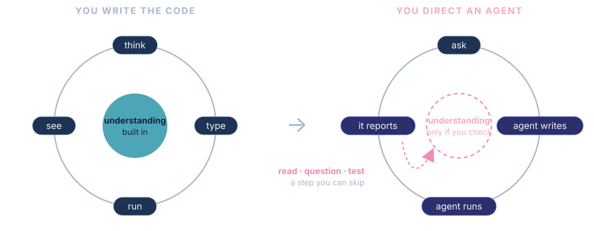
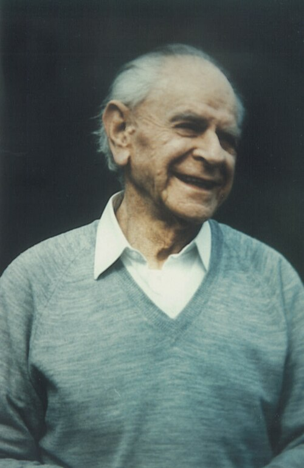
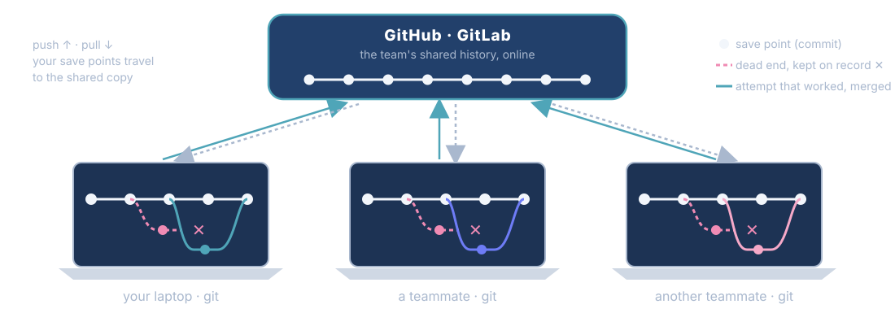

<!-- ====== OPENING 1 — Title ====== -->
<!-- _class: ink -->
<!-- _paginate: false -->
<!-- _footer: "" -->

<div>

<span class="kicker">Crash Course #2 · Thursday 22 October 2026 · 17:00 → 19:00 · on Zoom</span>

# Vibe coding &amp; AI-assisted development
## Direct the agent. Check the result.

Where AI agents come from, how they change research, and how to work with one: quizzes and discussion, on real data.

<span class="small">FacMed Hack #1 · Digital Phenotyping of Mental Health · Fri 6 – Sat 7 November 2026 · Campus Biotech · in English</span>

</div>

<div class="logos" style="padding: 10px 16px;">

</div>

---

<!-- ====== OPENING 1b — Celebration: the needs library ======
30 seconds, with energy: before anything else, thank the room. The needs call
aimed for 100 needs and the library holds 188 (Thomas, 22 Oct), almost twice
the goal. Plots: the "Where the needs are so far" panel of the needs page,
captured 22 Oct (topic bubbles sum to 188; biggest: data sharing tools 39,
mental health analysis 28; thin: research participation 7, data pipelines 3). These needs became the challenges you will rank from tomorrow
(Part 6 has the details).
-->
<!-- _class: ink -->

<span class="kicker">Before anything else · thank you</span>

## You built the needs library

<div class="cols" style="grid-template-columns: 0.72fr 1.28fr; gap: 26px; align-items: center; margin-top: 4px;">
<div>

<div style="font-size: 5.6em; font-weight: 800; line-height: 0.95; color: #F6A9C8; letter-spacing: -0.03em;">188</div>
<div style="font-size: 1em; color: var(--on-ink);">needs, against a goal of <b>100</b></div>

<div style="height: 18px; width: 53%; background: rgba(255,255,255,0.22); border-radius: 6px; margin: 18px 0 8px;"></div>
<div style="height: 18px; width: 100%; background: linear-gradient(90deg, #F08BB4, #6E7CF6); border-radius: 6px; margin: 0 0 16px;"></div>

**Almost twice the goal**, from **30 contributors** at UNIGE, HUG, the Wyss Center, FCBG, Trieste and UNIL. Prizes for the best needs are announced at the finals.

</div>
<div style="display:grid; grid-template-columns: 1fr 1fr; gap: 12px;">
<div style="background:#fff; border-radius: 12px; padding: 8px;"></div>
<div style="background:#fff; border-radius: 12px; padding: 8px;"></div>
<div class="small" style="grid-column: 1 / 3; text-align:center;">Where the needs are: topics (left) · domains × methods (right) · facmed-hack.sparkboard.com/needs, 22 Oct</div>
</div>
</div>

---

<!-- ====== HOUSEKEEPING 1 — The road to 6 November ======
30 seconds. Where tonight sits: the second of three crash courses before the
hack. The picture: Campus Biotech at dusk, from the hackathon's own campaign
illustrations (communication/visual/illustrations/04, corp repo). Challenge voting runs 23 → 28 Oct (final list online on the 23rd):
say it aloud; it is on the tile and in Part 6.
-->

<span class="kicker">Housekeeping · the calendar</span>

## The road to 6 November

<div style="display:grid; grid-template-columns: repeat(5, 1fr); gap: 14px; margin-top: 14px; font-size: 0.92em;">
<div class="card"><span class="qnum" style="color: var(--fg-faint);">Thu 8 Oct</span><h3>Crash Course #1</h3><p>Digital phenotyping &amp; the Swiss data rules</p></div>
<div class="card" style="border: 2px solid var(--accent); background: var(--accent-soft);"><span class="qnum">Today</span><h3>Crash Course #2</h3><p>Vibe coding &amp; AI-assisted development</p></div>
<div class="card" style="border-top: 5px solid var(--accent);"><span class="qnum">23 → 28 Oct</span><h3>Challenge voting</h3><p>Rank your three favourite challenges and confirm your place</p></div>
<div class="card"><span class="qnum" style="color: var(--science);">Thu 29 Oct</span><h3>Crash Course #3</h3><p>Grant writing for pop-up projects, with the Research and Grants Office (RGO)</p></div>
<div class="card" style="border-top: 5px solid var(--energy);"><span class="qnum" style="color: var(--energy);">6 – 7 Nov</span><h3>The hackathon</h3><p>32 hours at Campus Biotech, in English</p></div>
</div>


---

<!-- ====== OPENING 1c — From needs to challenges ======
40 seconds. How the needs become the hackathon's challenges (source: corp repo,
docs/pipeline/FacMed/.../challenges/README.md and method/). Clustering groups
needs by the technical problem a team would work on, balanced for diversity of
contributors and institutions. The steering committee of 14 Oct kept 8
candidates, aiming for about 7. Each challenge gets a sheet, a postdoc challenge
runner, stand-in data, and its equipment, compute and privacy route. Then you
vote (23 → 28 Oct) and teams are formed from your rankings. Details in Part 6.
The eight challenges (draft of 14 Oct, aiming for about 7; possible merge of
5 + 6): 1 between-visit deterioration (change from a person's own baseline,
without alert fatigue); 2 physiology you can trust (wearables: quality,
stress vs exercise or coffee, biofeedback); 3 behaviour annotation from video
(validated against human coders); 4 clinical speech and language (who spoke
when, French transcription, markers of memory and mood); 5 markerless
movement, gaze and pupil (vs motion capture); 6 digital markers and the brain
(EEG synchronised with gaze, speech, movement); 7 cross-species behaviour and
touch (mice and humans); 8 interactive interventions (XR, games, toys).
[UPDATE] if the final list of 23 Oct differs.
-->

<span class="kicker">From here to 6 November</span>

## From your needs to the challenges

<div style="display:grid; grid-template-columns: repeat(5, 1fr); gap: 12px; margin-top: 14px; font-size: 0.92em;">
<div class="card" style="border-top: 5px solid var(--accent);"><span class="qnum">1 · Needs</span><h3>188 needs</h3><p>Posted by researchers and clinicians; call closed 15 October.</p></div>
<div class="card" style="border-top: 5px solid var(--energy);"><span class="qnum" style="color: var(--energy);">2 · Clusters</span><h3>Grouped</h3><p>By the technical problem a team would work on, across labs and institutions.</p></div>
<div class="card" style="border-top: 5px solid var(--science);"><span class="qnum" style="color: var(--science);">3 · Selection</span><h3>Steering committee</h3><p>14 October: 8 candidate challenges, aiming for about 7.</p></div>
<div class="card" style="border-top: 5px solid var(--science);"><span class="qnum" style="color: var(--science);">4 · Shaping</span><h3>Challenge sheets</h3><p>A postdoc runner, data ready on day 1, compute and privacy routes.</p></div>
<div class="card" style="border: 2px solid var(--accent); background: var(--accent-soft);"><span class="qnum">5 · You</span><h3>Vote and teams</h3><p>23 → 28 Oct: rank three challenges; teams are formed from your rankings.</p></div>
</div>

<div style="margin-top: 14px; font-size: 0.62em; letter-spacing: 0.08em; text-transform: uppercase; font-weight: 700; color: var(--fg-faint);">Eight challenges taking shape · draft of 14 October · final list online on 23 October</div>
<div style="display:grid; grid-template-columns: repeat(4, 1fr); gap: 8px 12px; margin-top: 6px; font-size: 0.72em;">
<div class="card" style="padding: 8px 12px;"><b>1</b> · Between-visit deterioration</div>
<div class="card" style="padding: 8px 12px;"><b>2</b> · Physiology you can trust</div>
<div class="card" style="padding: 8px 12px;"><b>3</b> · Behaviour annotation from video</div>
<div class="card" style="padding: 8px 12px;"><b>4</b> · Clinical speech and language</div>
<div class="card" style="padding: 8px 12px;"><b>5</b> · Markerless movement, gaze, pupil</div>
<div class="card" style="padding: 8px 12px;"><b>6</b> · Digital markers ↔ the brain</div>
<div class="card" style="padding: 8px 12px;"><b>7</b> · Cross-species behaviour and touch</div>
<div class="card" style="padding: 8px 12px;"><b>8</b> · Interactive interventions</div>
</div>

---

<!-- ====== HOUSEKEEPING 2 — Tonight on Zoom ======
30 seconds. The picture: a Zoom gallery view supplied by Thomas (22 Oct), a web
image thumbnail (Bing "OIP" file, low resolution); likely Zoom marketing or stock,
rights unknown: fine for the live session, replace before publishing the deck. Invite cameras on: it makes the discussions work.
[CONFIRM] whether tonight is recorded; if so, say it here, before
anyone speaks (and that the recording goes to registered participants only).
Paste in the chat now: the quiz PIN, and the link to the course folder (data and the review-hunt file used at 18:20).
-->

<span class="kicker">Housekeeping · tonight</span>

## Tonight on Zoom

<div class="cols" style="grid-template-columns: 1fr 1.05fr; gap: 26px; margin-top: 4px; align-items: center; font-size: 0.9em;">
<div>

- **Camera on** if you can; **microphone off** unless you speak.
- **Questions in the chat**, any time.
- **Live quiz** on your phone or laptop: next slide.
- **Quizzes and discussion** all evening: unmute and argue.
- **Course folder and slides**: link in the chat.
- **We end at 19:00** sharp.

</div>
<div>


</div>
</div>

---

<!-- ====== OPENING 2 — LIVE QUIZ · How do you use AI? ======
First thing on the quiz app: everyone joins now (QR or link + PIN), so the later
questions run without friction. Paste the PIN in the Zoom chat as well, for
those on the same device as Zoom. Question "uses" (multi-select). Give 60 s,
then open the presenter view's live results and read them aloud in one
sentence; we come back to them in Part 1 ("Six everyday uses").
-->

<span class="qnum">Live quiz · first question · join now</span>

## What have you already used AI for in your research? *Tick all that apply.*

<div class="opts" style="width: 58%;">
<div class="opt"><b>A</b>Finding and summarising papers</div>
<div class="opt"><b>B</b>Analysis code</div>
<div class="opt"><b>C</b>Modelling</div>
<div class="opt"><b>D</b>Writing and editing</div>
<div class="opt"><b>E</b>Learning or explaining code and methods</div>
<div class="opt"><b>F</b>Building small tools</div>
</div>
<div class="opts" style="grid-template-columns: 1fr; margin-top: 14px; width: 28%;">
<div class="opt"><b>G</b>Nothing yet</div>
</div>

<div class="quizbox"><div><b>Vote live · PIN in the Zoom chat</b><span>facmed-quiz.pages.dev</span></div></div>

---

<!-- ====== OPENING 3 — Opening question (live quiz, free text) ======
Read Grace Lindsay's question first, then the opening question. Second question
on the quiz app; everyone is already in. Live quiz question "opening" (free
text, one or two lines). 90 seconds; keep the results hidden until time is up, so early answers
don't anchor the rest. Then show the answers on the presenter view and read 4–5
aloud, picking ones far apart (clinic vs. theory vs. lab bench vs. publishing).
Export them: at 18:47 we sort them into what the session showed agents change
today vs. what is still imagination (Part 7, "the opening question, revisited").
-->
<!-- _class: ink -->

> *"What would you do if you had all the models of the brain you wanted?"*
> <span class="small">Grace Lindsay, NYU, responding to this week's pre-read (DePasquale, <i>The Transmitter</i>, June 2026)</span>

<span class="kicker">Live quiz · 90 seconds · one or two lines</span>

<div class="cols" style="grid-template-columns: 1.35fr 1fr; gap: 30px; align-items: center;">
<div>

## Where do you imagine vibe coding and agentic coding will change science?

Name **one place, and what changes there**. Your own field or any other: a method, an instrument, a job in the lab, a stage of publishing. Be specific.

</div>
<div>

<div class="quizbox big" style="position:static; display:inline-flex;"><div><b>Live quiz · scan, or open</b><span>facmed-quiz.pages.dev</span><span class="pin">PIN in the Zoom chat</span></div></div>

</div>
</div>

---

<!-- ====== OPENING 4 — Objectives ======
Objective 3 matters most for anyone who arrived without tools installed: say
explicitly that this is fine, and that the hack offers the HPE / NVIDIA
environment to everyone, with or without their own setup.
Live quiz (moved from the dropped programme slide): Ten live-quiz questions are spread through the evening (the second, "opening", is free text; "dst" and "leakage" in Part 4 have a correct answer; app at facmed-quiz.pages.dev,
presenter view at /present?key=…), each where its topic comes up. Show each
result right away and take one or two reactions; "the room's answers" in Part 7
recaps them. Zoom polls (zoom_polls.md) are the fallback.
-->

<span class="kicker">Tonight · three objectives</span>

## By 19:00 you should…

<div class="cols3" style="margin-top: 8px;">
<div class="card">
<span class="qnum">1 · Imagine</span>
<h3>See your place in agentic science</h3>
<p>Where these tools come from, what they already do in research, and what becomes yours to do: your contribution, your career, your purpose.</p>
</div>
<div class="card">
<span class="qnum">2 · Understand</span>
<h3>Know how vibe coding works</h3>
<p>Think fast and slow. Try, fail and retry cheaply. Git as the safety net, run by the agent for you. Working as a team, with agents in the loop.</p>
</div>
<div class="card">
<span class="qnum">3 · Prepare</span>
<h3>Know how it runs at the hack</h3>
<p>Whether you already have the tools or not, both paths are covered: your own setup, or the HPE / NVIDIA environment, open to every team to build and test on.</p>
</div>
</div>

<br>

<span class="small">Built on the course <i>Vibe Coding for Scientists</i> (github.com/wazaahhh/vibe-coding-crash-course, CC BY-NC 4.0). Pre-reads: DePasquale (2026) and Schuck (2026), both in <i>The Transmitter</i>.</span>


---

<!-- ====== CONTEXT 1 — Divider ====== -->
<!-- _class: ink divider -->

<span class="clock">25 min</span>

<span class="kicker">17:10 · Part 1 of 7 · Objective 1 · Imagine</span>

# Where this comes from

From an artificial neuron in 1943 to an agent that edits your analysis code. What these tools are, what scientists do with them, and where they fail.

---

<!-- ====== CONTEXT 2 — It started in your field ======
For a neuroscience audience: the idea of artificial neural networks came from
neuroscience. Keep it to two minutes; the point is the lineage.
Definitions (say them only if asked):
- Artificial neuron (McCulloch & Pitts): a unit that adds up its weighted inputs
  and "fires" (outputs 1) when the sum passes a threshold.
- Perceptron (Rosenblatt): one layer of such units whose weights are LEARNED from
  labelled examples: wrong answer → nudge the weights.
- Neural network (multi-layer): layers of units, every connection a weight; the
  hidden layers build intermediate features the output layer combines.
- Hopfield network: a recurrent network in which memories are stable states
  (energy minima) the network settles into.
- Backpropagation: computes how much each weight contributed to the error and
  adjusts all weights, layer by layer, from the output backwards.
- Deep learning: neural networks with many layers, trained on large data with GPUs.
Sources: McCulloch & Pitts 1943 (Bull. Math. Biophys.); Rosenblatt 1958;
Hopfield 1982 (PNAS); Rumelhart, Hinton & Williams 1986 (Nature);
Krizhevsky, Sutskever & Hinton 2012 (AlexNet); Nobel Prize in Physics 2024.
Diagrams: drawn for this deck.
-->

<span class="kicker">A short history · part 1</span>

## It started in your field

<div class="cols" style="grid-template-columns: 1.25fr 1fr; gap: 26px; align-items: start;">
<div>

| Year | What happened |
|---|---|
| 1943 | **McCulloch &amp; Pitts** model a neuron as a logic unit: the first artificial neuron |
| 1958 | **Rosenblatt's perceptron** learns its weights from examples |
| 1982 | **Hopfield networks**: memories as stable states of a network |
| 1986 | **Backpropagation** (Rumelhart, Hinton &amp; Williams): how multi-layer networks learn |
| 2012 | **Deep learning** wins image recognition (AlexNet): GPUs + data + depth |
| 2024 | **Nobel Prize in Physics** to Hopfield and Hinton |

</div>
<div>

<div class="fig"><div class="cap">Perceptron: weighted inputs → sum → threshold</div></div>
<div class="fig" style="margin-top:8px"><div class="cap">Multi-layer network, trained by backpropagation</div></div>

</div>
</div>

---

<!-- ====== CONTEXT 3 — From next word to agents ======
Definitions:
- Token: a piece of text, a word or part of a word ("neur" + "on").
- Parameter (weight): a number learned in training; GPT-3 has 175 billion.
- Transformer: the architecture behind every modern language model: a stack of
  layers, each with self-attention and a feed-forward network; processes all
  tokens of a text in parallel.
- Self-attention: lets every token weigh every other token when building its
  representation ("it" looks back at "neuron").
- GPT: "generative pre-trained transformer".
- Reasoning model: trained to work through intermediate steps before answering.
- Coding agent: a language model in a loop with tools (files, terminal, tests).
Sources: Vaswani et al. 2017 "Attention is all you need"; Brown et al. 2020
(GPT-3, 175 billion parameters); GitHub Copilot preview June 2021; ChatGPT
30 Nov 2022; OpenAI o1, Sept 2024; Claude Code (Feb 2025 preview) and OpenAI
Codex (2025); Karpathy coins "vibe coding", Feb 2025.

ATTENTION, in more detail (say as much as the room wants, 1–2 min):
- The paper: Vaswani, Shazeer, Parmar, Uszkoreit, Jones, Gomez, Kaiser &
  Polosukhin (Google), "Attention is all you need", NeurIPS 2017,
  arXiv:1706.03762. Built for machine translation; it dropped the recurrent
  networks (which read a sentence word by word) and kept only attention, so a
  whole text is processed in parallel on GPUs. That is what made training on
  internet-scale text possible.
- The mechanism: each token produces three vectors, a query ("what am I looking
  for?"), a key ("what do I contain?") and a value ("what do I pass on?"). The
  query of one token is compared with the keys of all others (dot product);
  a softmax turns the scores into weights that sum to 1; the token's new
  representation is the weighted sum of the values.
  Formula: Attention(Q, K, V) = softmax(Q·Kᵀ / √d) · V.
- Multi-head: several attention patterns run side by side (one may track
  grammar, another which noun "it" refers to, another the variable name defined
  forty lines up). Positions are added to the tokens, since attention itself
  ignores order.
- Self-attention cost grows with the square of the text length: this is why
  the context window is finite, and why very long contexts dilute attention
  (models use the start and the end of a long context better than the middle:
  Liu et al., "Lost in the middle", TACL 2024).
- Analogy for neuroscientists: soft, content-addressable retrieval, closer to
  a Hopfield-style associative memory than to biological visual attention
  (Ramsauer et al., "Hopfield networks is all you need", ICLR 2021).

WHY IT MATTERS FOR VIBE CODING (the hint on the slide): everything the model
writes is a weighted reading of what is in its context. Your question, your
codebook, your constraints, the error you paste: these are what it attends to.
A vague request gets the most generic, most plausible answer; a precise one
moves its attention to what matters. The scientist's attention steers the
model's attention. Bridge to the next slide: same data, different questions.
-->

<span class="kicker">A short history · part 2</span>

## From predicting the next word to editing your code

<div class="cols" style="grid-template-columns: 1.3fr 1fr; gap: 24px; align-items: start;">
<div>

| Year | What happened |
|---|---|
| 2017 | **The Transformer**: Vaswani et al., "Attention is all you need", <i>NeurIPS</i> · arXiv:1706.03762 |
| 2020 | **GPT-3**: 175 billion parameters; scale brings surprising abilities |
| 2021 | **GitHub Copilot** autocompletes code in the editor |
| Nov 2022 | **ChatGPT**: language models reach everyone |
| 2023–24 | Claude, GPT-4, open-weight models; **"reasoning" models** |
| 2025 | **Coding agents** work inside your project; Karpathy names **"vibe coding"** |
| 2026 | Agents in research labs (this week's two pre-reads) |

</div>
<div>

<div class="fig"><div class="cap">A Transformer layer: each word attends to the others, then a feed-forward step; stacked dozens of times</div></div>

<div class="card" style="margin-top:8px"><h3>Why "attention" matters to you</h3><p>To write each token, the model weighs every token in its context. Your question, codebook and constraints are what it attends to: <b>your attention steers its attention.</b></p></div>

</div>
</div>

---

<!-- ====== CONTEXT 3a — Einstein & Infeld: new questions ======
Read it, pause, then go to the exercise. Full passage: A. Einstein & L. Infeld,
The Evolution of Physics (Simon & Schuster, 1938), p. 92: "The formulation of a
problem is often more essential than its solution, which may be merely a matter
of mathematical or experimental skill. To raise new questions, new
possibilities, to regard old problems from a new angle, requires creative
imagination and marks real advance in science."
Companion, on confronting results: J. S. Mill, On Liberty (1859), ch. 2: "He who
knows only his own side of the case, knows little of that."
Portrait: Oren Jack Turner, 1947; public domain (US), via Wikimedia Commons.
-->
<!-- _class: ink quote -->
<!-- _footer: "" -->

<div style="display:grid; grid-template-columns: 220px 1fr; gap: 44px; align-items: center;">
<div></div>
<div>

> "To raise new questions, new possibilities, to regard old problems from a new angle, requires creative imagination and marks real advance in science."

<div class="who" style="padding-left:40px;"><b>Albert Einstein</b> &amp; Leopold Infeld · <i>The Evolution of Physics</i>, 1938</div>

</div>
</div>

<span class="small" style="position:absolute; bottom: 30px; left: 64px; font-size:0.5em;">Portrait: Oren Jack Turner, 1947 · public domain, via Wikimedia Commons</span>

---

<!-- ====== CONTEXT 3b — EXERCISE · Same data, your question ======
3 minutes. The dataset is fictional but real files: practical/phone-study/data/
(generated by facilitator/generate_phone_study.py; codebook in the folder's
README.md). It looks like the hack's digital-phenotyping data on purpose.
Live quiz question "explore" (free text, short), shown as a word cloud. 60
seconds; keep results hidden until time is up so early answers don't anchor
the rest. Then show the cloud and read 6–8 answers aloud, chosen far apart,
sorting them out loud into families:
- describe (how much do they sleep? how does mood vary over the term?)
- predict (can phone data predict a PHQ-9 rise?)
- explain / cause (does less roaming come before low mood, or after?)
- data quality (who stops answering, and when? who drops out?)
- subgroups and fairness (faculties, genders?)
- ethics and privacy (should we be collecting GPS at all?)
Things built into the data that good questions find: exam weeks (7, 12) with
shorter sleep, more screen time, less roaming and lower mood; weekends; mood
answers thinning out over the term and on bad days; ~12% dropouts; the clock
change on 25 Oct (an extra hour in bed); PHQ-9 rising by week 12, most in
Medicine and Law.
Point: one dataset, a room of different questions. Each question leads to a
different analysis, with different blind spots. That diversity is the strength:
science advances by looking at a problem from several angles and confronting
the results (previous slide).
Save the export: the families come back at the hack (challenge shaping, team
formation).
-->
<!-- _class: ink -->

<span class="kicker">Exercise · 3 minutes · live quiz</span>

## Same data, your question

<div class="cols" style="grid-template-columns: 1.15fr 1fr; gap: 28px; align-items: center;">
<div>

<div class="card">
<h3>The phone study (fictional data, real files)</h3>
<p><b>150 students, 12 weeks</b>, one phone app, consent on file.<br>
<b>Every day, passively:</b> steps · how far they roam (GPS radius) · screen-on minutes · phone-estimated sleep · number of calls and messages (counts only, no content).<br>
<b>Every evening:</b> one-tap mood, 1 to 7.<br>
<b>Weeks 0, 6, 12:</b> PHQ-9 depression questionnaire.<br>
<b>Also:</b> age, gender, faculty; exam weeks flagged.</p>
</div>

<br>

**What would you find worth exploring in this data?** A few words, in the live quiz.

</div>
<div>

<div class="quizbox big" style="position:static; display:inline-flex;"><div><b>Live quiz</b><span>facmed-quiz.pages.dev</span><span class="pin">PIN in the Zoom chat</span></div></div>

<span class="small" style="display:block; margin-top: 12px;">Then we look at the word cloud: how many different questions did one dataset raise? The files are in the course folder, <code>phone-study/</code>.</span>

</div>
</div>

---

<!-- ====== CONTEXT 4 — How an LLM works ======
Key reference: T. Brown et al., "Language models are few-shot learners",
NeurIPS 2020, arXiv:2005.14165 (GPT-3: next-token prediction at scale, 175
billion parameters, tasks learned from a few examples in the prompt).
Walk through the five steps on the diagram. Then the five consequences: fluent
is not the same as true; it only knows its training data; it only "sees" what
fits in its context window; the same question can give different answers
(step 4 picks among probabilities); and temperature sets how adventurous that
pick is.
Temperature: the scores for every possible next token are divided by T before
they become probabilities. T near 0: the top token almost always wins (focused,
repeatable, good for code and extraction). T around 1 or above: lower-ranked
tokens get picked more often (more varied and surprising, good for
brainstorming, and more errors). In coding agents the temperature is usually
fixed for you; to diverge, ask instead for "five different ways to analyse
this" (pillar 1, Divergence, in Part 2).
-->

<span class="kicker">Under the hood, in plain words · Brown et al., "Language models are few-shot learners", <i>NeurIPS</i> 2020</span>

## How a large language model (LLM) writes, one token at a time

<div class="fig"></div>

<div class="cols" style="grid-template-columns: 1fr 1fr 1fr 1fr 1.35fr; gap: 10px; margin-top: 2px; font-size: 0.86em;">
<div class="card"><h3>Fluent ≠ true</h3><p>Most plausible, not proven: it can invent a citation.</p></div>
<div class="card"><h3>Cut-off</h3><p>Knows nothing after its training data.</p></div>
<div class="card"><h3>Context</h3><p>Only "sees" what fits in its window.</p></div>
<div class="card"><h3>Not deterministic</h3><p>Same question, maybe another answer.</p></div>
<div class="card" style="border-color: var(--accent); background: var(--accent-soft);"><h3>Temperature</h3><p>The dial on step 4. Low: safe, repeatable. High: bolder, more creative, more errors.</p></div>
</div>

---

<!-- ====== CONTEXT 4b — VLM in a nutshell ======
Key reference: H. Liu, C. Li, Q. Wu & Y. J. Lee, "Visual instruction tuning",
NeurIPS 2023, arXiv:2304.08485 (LLaVA: a vision encoder whose outputs are
projected into an LLM's token space, exactly the diagram).
1 minute. Vision-language model (VLM): an LLM that also takes images. The
image is cut into patches (e.g. 14 × 14 or 16 × 16 pixels); a vision encoder
(a transformer for images, ViT: Dosovitskiy et al., "An image is worth 16x16
words", ICLR 2021), often pre-trained to match images with captions (CLIP:
Radford et al. 2021), turns each patch into a vector; a small projection maps
these into the LLM's token space; the LLM attends over image and text tokens
together (LLaVA: Liu et al., NeurIPS 2023). Today's assistants (Claude, GPT,
Gemini, open Qwen-VL) are all VLMs.
For tonight: agents can look at the figures they make (did the plot come out
right?), read a screenshot of an error, or turn a whiteboard sketch into code.
Limits: weak at counting and exact measurement, small print, fine detail; they
describe plausibly what they expect to see. And an image of a participant is
personal data (Crash Course #1, the Swiss data rules).
-->

<span class="kicker">Under the hood · when the model can see · Liu et al., "Visual instruction tuning", <i>NeurIPS</i> 2023</span>

## Vision-language models (VLM) in a nutshell

<div class="fig"></div>

<div class="cols3" style="gap: 14px; margin-top: 4px;">
<div class="card"><h3>What it adds</h3><p>Reads EEG traces, brain scans, histology, figures and screenshots of errors, next to your text.</p></div>
<div class="card"><h3>Why agents use it</h3><p>An agent can <b>look at the figure it just made</b> and fix the axis, the colours, the missing panel.</p></div>
<div class="card"><h3>Where it fails</h3><p>Counting, exact values, small print: it describes what it <i>expects</i> to see. And a face is personal data.</p></div>
</div>

---

<!-- ====== CONTEXT 5 — Three environments ======
Three steps in how people code with AI, in the order they arrived (see the
history slide): chat (2022), completion in the editor (Copilot, 2021, spread
with the chat era), agents (2025). The pictures are faithful mock-ups (replace
assets/env_chat.png, env_completion.svg and env_agents.svg with real
screenshots if you prefer, e.g. the Claude Code desktop app or the Codex app
with several sessions open).
- Chat: you carry the context and copy the code back.
- Completion: the editor suggests the next lines in grey as you type; Tab
  accepts. Fast for the code you already know how to write; you still drive
  every line.
- Agents: you give a goal; each agent works in its own copy of the project (its
  own branch), plans, edits, runs the tests, saves, and comes back for review.
  Point out the list on the left: several agents in parallel, two waiting for
  you. Your job shifts to dispatching and reviewing (the git part, Part 3, is
  what makes this safe).
-->

<span class="kicker">Three environments · from chat to agents</span>

## From chatbot, to code completion, to agentic coding

<div class="cols3" style="grid-template-columns: 0.72fr 1fr 1.42fr; gap: 14px; margin-top: 0; align-items: end;">
<div class="fig">

<div class="cap"><b>1 · Chatbot</b> (browser, app): you paste code, data and errors; <b>you</b> carry the context and copy the code back.</div>
</div>
<div class="fig">

<div class="cap"><b>2 · Code completion</b> (VS Code): it suggests the next lines as you type; Tab accepts. <b>You</b> still drive every line.</div>
</div>
<div class="fig">

<div class="cap"><b>3 · Agentic coding</b> (e.g. Claude Code, Codex): several agents in parallel, each reads, plans, edits, runs and saves on its own branch; <b>you</b> review and merge.</div>
</div>
</div>

> An agent is an LLM **in a loop with tools**: goal → plan → act → look at the result → adjust → report.

---

<!-- ====== CONTEXT 6 — Why coding first ======
From module 00 ("What vibe coding means"). Source for the usage figures:
Anthropic Economic Index, launch report, 10 Feb 2025: "37.2% of queries sent to
Claude were in this category" (computer and mathematical, largely software
engineering); report of 24 Mar 2026: "Coding remains the most common use on our
platforms", 35% of Claude.ai conversations, and coding tasks "continue to
migrate ... to more automated workflows" in API traffic (incl. Claude Code).
Caveat (Anthropic's own): Claude is marketed as a coding model, so coding may be
over-represented.
-->

<span class="kicker">Why coding came first</span>

## Software development is where agentic AI is used most

<div class="cols" style="grid-template-columns: 1fr 1fr; gap: 28px;">
<div>

**Why coding first**
- Code is text, and there is a vast public corpus of it.
- Code can be **run**: errors and tests give immediate feedback.
- The result can be **checked**, by the machine and by you.

<div class="card" style="margin-top:10px"><div style="font-size:2.3em; font-weight:800; color:var(--accent); line-height:1">37%</div><p>of conversations with one major assistant were software and maths tasks, by far the first use (Anthropic Economic Index, 2025); still first in 2026, and moving from chat to <b>autonomous agent workflows</b>.</p></div>

</div>
<div>

**"Vibe coding"** (Andrej Karpathy, 2025)
- You describe **what you want** in plain language; the model writes the code.
- Tool-agnostic: Claude Code, Codex, Copilot, Cline, or paste-into-chat.

> The honest version for scientists: the vibe is in **how you produce** code, never in whether it's correct.

</div>
</div>

---

<!-- ====== CONTEXT 6b — What a hackathon is ======
Pedagogy, 1 minute. The FacMed Hack is not a coding contest: it is a
time-bounded sprint that combines three things that are hard to get together
in a normal research week.
- Creativity: people from different labs, clinics and disciplines on a fresh
  problem; the needs campaign (Part 6) gave the problems, the mix of people
  gives the angles (the exercise a few slides back: one dataset, many questions).
- Learning by doing: you learn a method, a dataset or a tool by building with
  it, with someone next to you who knows the part you don't.
- A pinch of challenge: the deadline. On Saturday at 17:00 each team shows a
  prototype or proof of concept, not a plan. The deadline forces choices, and
  choices are where teams learn the most.
Then: what vibe coding did to this recipe (next slide).
-->

<span class="kicker">Why this matters for the hack · 1 of 2</span>

## A hackathon is a sprint with a deadline

<div class="cols3" style="margin-top: 6px;">
<div class="card" style="border-top: 5px solid var(--energy);">
<span class="qnum" style="color: var(--energy);">Creativity</span>
<h3>Think out of the box</h3>
<p>People from different labs, clinics and fields on one fresh problem. Every background brings another angle on the same data.</p>
</div>
<div class="card" style="border-top: 5px solid var(--science);">
<span class="qnum" style="color: var(--science);">Learning by doing</span>
<h3>Build to understand</h3>
<p>You learn a method, a dataset or a tool by making something with it, next to someone who knows the part you don't.</p>
</div>
<div class="card" style="border-top: 5px solid var(--accent);">
<span class="qnum">A pinch of challenge</span>
<h3>Ship by the deadline</h3>
<p>At the end, each team shows a working <b>prototype or proof of concept</b>, not a plan. The clock forces the choices.</p>
</div>
</div>

<br>

> **Time-bounded sprint = creativity × learning by doing × a deadline.** FacMed Hack: 32 hours, Friday 6 → Saturday 7 November.

---

<!-- ====== CONTEXT 6c — What vibe coding changed in hackathons ======
From Thomas's talk at Hack the Hackathon 6 (20–22 Oct 2026), agentic-hacks
repository, talks/2026-10-hack-the-hackathon (talk.md, slides S15, S18, S22,
S20). Data: every Devpost hackathon, 13,626 events, ~400,000 projects,
1.2 million team memberships; 217,000 projects linked to GitHub; four eras
(pre-AI, Copilot, ChatGPT, agentic from mid-2024).
- Adoption: generative AI declared in 53% of projects, ~3 points a quarter
  since 2023.
- Scope: before AI, a solo project declared 2.9 technologies, a team of four
  or more 5.3 (gap 2.4). In the agentic era: 7.3 vs 7.4 (gap 0.07). Without the
  partial 2026 data, the scope–team elasticity still falls 75%.
- But: going solo cost 22 points of win probability before AI (same person,
  solo vs team), and 22 points now (−0.221 vs −0.216). Say "did not close",
  never "rose".
- Ties: teammates (vs strangers from the same event) later build something
  unrelated together 62× more often, team up again at a later hackathon 134×
  more often; unchanged across AI eras. Upper bounds: teams are chosen.
- Unpublished, work in progress: say so if asked; no causal claim on the
  mechanism.
Message for the hack: one person with an agent can now build what took a team
of four; the team still wins, and the team is what outlasts the weekend. Agents
are a teammate's multiplier, not a substitute for a teammate.
Image: from the same talk (illustration).
-->
<!-- _class: dense -->

<span class="kicker">Why this matters for the hack · 2 of 2</span>

## Vibe coding changed hackathons. It did not replace the team.

<div class="cols" style="grid-template-columns: 1fr 1.05fr; gap: 26px; align-items: start;">
<div>

<div class="fig"><div class="cap"><b>2019</b>: a team of four declares five technologies · <b>2025</b>: one person with an agent, seven, by Sunday</div></div>

<span class="small">Maillart et al., work in progress: every Devpost hackathon, 13,626 events, ~400,000 projects, 2014–2026.</span>

</div>
<div>

**What changed, sharply**
- Generative AI in **53%** of projects, and growing by about **3 points every quarter**.
- Solo vs team of four: before AI, the team built with almost **twice as many technologies** (5.3 vs 2.9); with agentic AI, **the same** (7.4 vs 7.3).

**What did not**
- Going solo still lowers your **chance of winning by 22 points**, exactly as before AI.
- Teammates build something new together **62×**, and team up again **134×** more often than same-event strangers.

> AI made each person broader. **The team still wins, and the team outlasts the project.**

</div>
</div>

---

<!-- ====== CONTEXT 9 — How scientists use it today ======
Put the room's live results from the opening quiz (presenter view) next to
this list: where is the room ahead, where behind?
-->

<span class="kicker">How scientists use it today · and how this room does</span>

## Six everyday uses

| Everyday use | What it does for you |
|---|---|
| **Literature** | find, summarise, compare papers |
| **Analysis code** | cleaning, statistics, figures, pipelines |
| **Modelling** | from a word model to a fitted model in hours |
| **Writing** | editing, restructuring, translating |
| **Learning** | explaining unfamiliar code or methods |
| **Tools** | small apps, dashboards, lab utilities |

<br>

> Compare with the room's answers to the opening quiz: which uses are we missing?

---

<!-- ====== CONTEXT 10 — At the frontier ======
Diagrams drawn for this deck, describing how each system works.
- AlphaFold 2 (Jumper et al., Nature 2021): predicts a protein's 3-D structure
  from its amino-acid sequence, with a per-residue confidence score (pLDDT,
  colours as in the AlphaFold database). Nobel Prize in Chemistry 2024 (Hassabis,
  Jumper; with Baker for protein design). Not a language model, but the same
  deep-learning family.
- AI co-scientist (Google, Feb 2025): several agents generate, review, debate,
  rank in a tournament and refine hypotheses for a scientist's goal.
- The AI Scientist (Lu et al., Sakana AI, 2024, arXiv 2408.06292): automates
  idea → code and experiments → paper → automated review, end to end. Its papers
  were of mixed quality.
-->

<span class="kicker">At the frontier</span>

## Beyond the chat window

<div class="cols3" style="margin-top: 4px;">
<div class="fig"><div class="cap" style="font-size:0.7em"><b>AlphaFold</b> predicts protein structures from sequence · Nobel Prize in Chemistry 2024</div></div>
<div class="fig"><div class="cap" style="font-size:0.7em"><b>AI "co-scientist"</b>: agents generate, debate and rank hypotheses · Google, 2025</div></div>
<div class="fig"><div class="cap" style="font-size:0.7em"><b>The AI Scientist</b> drafts whole studies end to end, with mixed quality · Sakana AI, 2024</div></div>
</div>

---

<!-- ====== CONTEXT 11 — BrainBench ======
Luo, X., …, Love, B. C. Large language models surpass human experts in
predicting neuroscience results. Nature Human Behaviour (2024).
doi:10.1038/s41562-024-02046-9 · arXiv 2403.03230. Numbers from arXiv v4.
Details cut from the slide (say if asked): 200 test cases from 2023 Journal of
Neuroscience abstracts, five subfields; experts wrote the altered versions
(background and methods unchanged); LLMs pick the abstract they find less
surprising (lower perplexity); 81.4% vs 63.4%; well calibrated (more confident
when right); no sign of memorisation.
Discussion prompt: predicting which result was published is not the same as
discovering; models learn the literature's patterns, including its biases.
-->

<span class="kicker">In neuroscience · Luo et al., <i>Nature Human Behaviour</i>, 2024</span>

## Can an LLM predict a neuroscience result better than you?

<div class="cols" style="grid-template-columns: 1.1fr 1fr; gap: 30px; align-items: center; margin-top: 10px;">
<div>

- **BrainBench**: 200 real *J. Neurosci.* abstracts, each paired with a version whose results were altered. Which one is real?
- LLMs beat **171 neuroscience experts**, in every subfield.
- A small model further trained on neuroscience papers (**BrainGPT**) did ~3 points better still.

</div>
<div>

<div class="cols" style="grid-template-columns: 1fr 1fr; gap: 14px;">
<div class="card"><div style="font-size:2.6em; font-weight:800; color:var(--accent); line-height:1">81%</div><p>LLMs</p></div>
<div class="card"><div style="font-size:2.6em; font-weight:800; color:var(--science); line-height:1">63%</div><p>human experts</p></div>
</div>

</div>
</div>

<span class="small">doi.org/10.1038/s41562-024-02046-9 · Predicting what was published is not discovering: models learn the literature's patterns, biases included.</span>

---

<!-- ====== CONTEXT 13 — A pipeline in a day: our example ======
Thomas's framing (22 Oct): we were stuck by our own lack of technical skills;
agentic AI let us pull in three state-of-the-art methods, for camera
synchronisation, camera calibration and triangulation (3-D reconstruction).
After years stuck, we can finally process hundreds of hours of 4K video in
storage since 2020.
Thomas's own work (AutismBrainBehavior, 4by4k-pipeline), Marie Schaer's group.
Facts from the repository's benchmarks and git history: whole pipeline built
on 18 Sep 2026 (10:46 → 18:29) with an agent; calibration solved before, in
situ with a checkerboard (Aug–Sep 2026); validated on a real 49-min session:
296,294 frames, 19.8 min from submission to 3-D, 99.89% agreement with the
reference pipeline; 2-D pose at 5.5× real time; audio sync 6–14 ms RMS.
Picture: stick figures from the room-4 reconstruction (gen_social), no video
frames, no faces. Do not name the session.
Governance point (bridge to pre-read 2): a guard in the code blocks the agent
from the participant data folders.
[CONFIRM] "hundreds of hours" (from Marie Schaer's crash course).
Figures behind the lighter slide (from the repositories, 22 Oct check):
footage from 2020, cameras unmoved since 2020 (gen_social/MULTIVIEW_CORPUS_PLAN.md);
"never turned into 3-D" is inferred [CONFIRM]. Agent build: 14 commits,
18 Sep 10:46 → 21 Sep 21:21, two working days (~7.7 h + ~6 h); groundwork in
gen_social Jun–Sep (calibration error ~60 px → 1.76 px). Set-ups benchmarked
(docs/benchmarks.md): 2 decoders, 2 person detectors, 3 pose models, 3+ runtime
settings, 2 sync methods, 3 identity-linking rules: ~20, variants of one tool
family. The slide follows Thomas's framing above (three state-of-the-art methods:
synchronisation, calibration, triangulation). Result: 49-min session in 19.8 min, 99.89% identity
agreement, 0 swaps, child coverage 0.68 → 0.89, ~2 cm error.
-->
<!-- _class: dense -->

<span class="kicker">Our own example · fast prototyping</span>

## 3D autism diagnosis scene reconstruction: unstuck after years

<div class="cols" style="grid-template-columns: 1fr 1.05fr; gap: 26px; align-items: center;">
<div>

- **Stuck for years**: our own lack of technical skills.
- **With an agent**: three state-of-the-art methods pulled in: camera **synchronisation**, camera **calibration**, **triangulation** to 3-D.
- **Outcome**: hundreds of hours of 4K video, in storage since 2020, can finally be processed.

</div>
<div>

<div class="fig"><div class="cap">Four calibrated corner cameras → one metric 3-D scene · child (blue), clinician (orange), parent (green)</div></div>

</div>
</div>

---

<!-- ====== CONTEXT 12 — Explore and reject fast: our example ======
Thomas's framing (22 Oct): rebuilding our envisioned approach fast let us test
many approaches, our own and other published ones; none gave satisfactory
results, and there is a lot of learning in failing.
Thomas's own work (AutismBrainBehavior, detection-repetitive-behaviors-asd,
June 2026). Unpublished: say "our work in progress"; no session IDs, no
clinical data on screen. The figure is the method schematic on a synthetic
signal. The point, with pre-read 1: when building and testing costs hours, you
find out fast whether an approach can work, and stop early.
Figures behind the lighter slide (from the repository, 22 Oct check): material
from 2022–2025 handed over (docs/project-summary.md), so "open since 2022" is
the earliest dated file [CONFIRM]. Agent work: 9 commits on 4 days, 10–26 June
2026. Audit: 48 of 51 sessions consistent, 3 where the stored file is a
different recording; over-detection vs. the manuscript traced to a later code
revision; scoring reproduces the 106 detectable events over 74 sessions.
Benchmark against ASDMotion (Barami 2024): scaffold only, not run.
The slide follows Thomas's framing above (many approaches tested, none
satisfactory); the repository itself documents the audit and one baseline.
-->
<!-- _class: dense -->

<span class="kicker">Our own example · fail fast, learn fast</span>

## Detecting hand-flapping: many approaches tested, fast

<div class="cols" style="grid-template-columns: 1.1fr 1fr; gap: 28px; align-items: center;">
<div>

- **Goal**: detect hand-flapping automatically in pose estimation of autistic children.
- **With an agent**: our approach rebuilt fast, then many others tested, ours and published ones.
- **Outcome**: no satisfactory result yet, but new research directions in sight. **There is a lot of learning in failing.**

</div>
<div>

<div class="fig"><div class="cap">One of the approaches, on a synthetic signal: oscillation → wavelets → scalogram</div></div>

</div>
</div>

---

<!-- ====== CONTEXT 14 — Live quiz · Where first ======
Opinion, no right answer. Live quiz app, multi-select (up to two). Show the
results right away. Push: ask someone who picked the least-chosen option to
defend it. Analysis and modelling is where the evidence of change is today
(pre-read 1, the two examples you just saw); automated labs are where the
money is going; writing and peer review are where the policy fights are.
-->

<span class="qnum">Poll 1 of 6 · Where first</span>

## Where has agentic coding changed, or will it change, research practice most in the next five years? *Pick up to two.*

<div class="opts" style="width: 58%;">
<div class="opt"><b>A</b>Analysing data and building models</div>
<div class="opt"><b>B</b>Designing and running experiments: automated labs</div>
<div class="opt"><b>C</b>Reading and synthesising the literature</div>
<div class="opt"><b>D</b>Writing papers and grants</div>
</div>
<div class="opts" style="grid-template-columns: 1fr; margin-top: 14px; width: 58%;">
<div class="opt"><b>E</b>Peer review and replication</div>
</div>

<div class="quizbox"><div><b>Vote live · PIN in the Zoom chat</b><span>facmed-quiz.pages.dev</span></div></div>

---

<!-- ====== CONTEXT 15 — Opportunities ======
From module 01 ("Why it matters"), plus two lines for research.
-->

<span class="kicker">The opportunities</span>

## Code was friction between a question and an answer

<div class="cols" style="grid-template-columns: 1fr 1fr; gap: 26px; margin-top: 6px;">
<div class="card"><h3>The plumbing stops being the bottleneck</h3><p>Hours of searching forums and documentation become minutes.</p></div>
<div class="card"><h3>Exploration gets cheap</h3><p>Five model specifications, three plots, two normalisations, in the time of one.</p></div>
<div class="card"><h3>The barrier drops for the whole lab</h3><p>The student who "can't code" can build a working pipeline; experimentalists can model.</p></div>
<div class="card"><h3>Scripts over clicks</h3><p>An analysis written as code can be re-run, reviewed and shared: better for reproducibility.</p></div>
</div>

<br>

> ⚠️ It is also trivially easy to produce **plausible · beautiful · wrong**.

---

<!-- ====== CONTEXT 16 — Pre-read 1: DePasquale, the opportunities ======
DePasquale (Boston University), The Transmitter, 16 June 2026. Starting point:
Larry Abbott's "Theoretical neuroscience rising" (Neuron, 2008): models can be
explored and rejected faster than experiments. In practice the engineering
(word model → equations → code → fit to data) throttled that speed. Agentic
coding removes much of the bottleneck, in four directions.
-->

<span class="kicker">Pre-read 1 · DePasquale, <i>Models at the speed of thought</i> · the opportunities</span>

## *Models at the speed of thought*: four directions

<div class="cols" style="grid-template-columns: repeat(4, 1fr); gap: 14px; margin-top: 6px;">
<div class="card"><h3>1 · Experimentalists model</h3><p>Fit a model to your own data without waiting months for a modelling collaborator.</p></div>
<div class="card"><h3>2 · Theorists iterate</h3><p>Try, test and reject new models in hours, at last at the speed theory promised.</p></div>
<div class="card"><h3>3 · Search model space</h3><p>AI-guided search (AlphaEvolve-style) explores many candidate models at scale.</p></div>
<div class="card"><h3>4 · Maths opens up</h3><p>Mathematically heavy models become reachable for people stronger at code than at the blackboard.</p></div>
</div>

<br>

> *"Major new discoveries are likely to come from humans generating insights, just as they have always done…"* <span class="small">Larry Abbott, Columbia, in his response</span>

---

<!-- ====== CONTEXT 17 — Pre-read 1: the challenges, and seven responses ======
Verbatim quotes from the essay and its seven responses (checked on the page).
Use this slide to open a two-minute discussion: which risk worries you most?
Cut from the slide, to quote if useful:
- DePasquale: AI-guided search will also produce "artifacts of the search
  process"; his advice: keep stepping away from the AI to exercise your own
  judgment.
- Dan Goodman (Imperial), on code that seems to test your idea but hides
  errors: "This isn't a theoretical risk; it's something that seems to crop up
  very regularly in practice."
- Julijana Gjorgjieva (TUM): expertise is needed "to recognize when an AI
  system is inventing concepts that do not actually exist."
- Kim Stachenfeld (DeepMind): LLMs are "a flashlight as opposed to a laser
  pointer".
- Anthony Zador (CSHL): "LLMs are like genies: They can grant you almost any
  wish, but you have to be very careful about what you ask for."
-->

<span class="kicker">Pre-read 1 · the challenges · and the field answers back</span>

## "Prolific but shallow"?

> *"The field risks becoming prolific but shallow—generating models faster than we can generate insights."*
> <span class="small">Brian DePasquale</span>

- **Thinking by struggling**: turning an idea into equations and code is *"a form of disciplined thinking"*, above all for trainees.
- **Hidden errors**: code that seems to test your idea but does not *"crop up very regularly in practice"* (Dan Goodman, Imperial).
- **Invented concepts**: only expertise recognises what *"does not actually exist"* (Julijana Gjorgjieva, TUM).

---

<!-- ====== CONTEXT 18 — Pitfalls ======
From module 02 ("Where it shines, where it bites" and "A 30-second horror
story") and module 09 (safety rules).
Cut from the slide, as examples: df.dropna() silently deletes 40% of rows;
test data leaks into training and a 0.98 evaporates; a hallucinated citation
nobody checked. Trust-but-skim also covers translating between languages.
Beyond the code: skills that never develop; a field that becomes "prolific but
shallow" (previous slide).
-->

<span class="kicker">The pitfalls</span>

## Strongest on syntax, weakest on truth

- **Trust, but skim**: plotting, formatting, boilerplate, reading files, explaining code.
- **Slow down**: units, time zones, the statistical test, your specific method, citations.
- **It fails quietly**: a clean run with a wrong number, never a crash. `dropna()` drops 40% of rows; leakage gives a 0.98 that evaporates.
- **Beyond the code**: patient data pasted into cloud tools is a breach, whatever the answer.

---

<!-- ====== CONTEXT 19 — What the science says ======
From module 02 ("What the science says", both slides). Kosmyna et al. is a
preprint under active debate: cite as suggestive.
-->

<span class="kicker">What the science says</span>

## The danger is a confident answer that switches your checking off

<div class="cols" style="grid-template-columns: 1fr 1fr; gap: 26px;">
<div>

- **Automation bias &amp; complacency**: we over-trust automated output and stop checking it *(Parasuraman &amp; Manzey, 2010)*.
- **Cognitive offloading**: the more knowledge workers trust generative AI, the less critical thinking they report *(Lee et al., CHI 2025)*.
- **Illusion of explanatory depth**: fluent output makes you *feel* you understand what you couldn't rebuild *(Rozenblit &amp; Keil, 2002)*.

</div>
<div>

- **"Cognitive debt"**: heavy LLM use while writing went with weaker memory of one's own text and more homogeneous prose *(Kosmyna et al., 2025, preprint)*.
- **Generation effect**: you understand and retain what *you* produce far better than what you only read *(Slamecka &amp; Graf, 1978)*.

> Offload the typing. **Never offload the understanding** your name depends on.

</div>
</div>

---

<!-- ====== CONTEXT 20 — POLL 2 · Reality check ======
The one poll with an answer: D. Share the result right away, then the next
slide.
-->

<span class="qnum">Poll 2 of 6 · A reality check</span>

## In a 2025 randomised trial, experienced open-source developers worked on their own projects with and without AI tools. With AI, they were…

<div class="opts" style="width: 58%;">
<div class="opt"><b>A</b>about 40% faster</div>
<div class="opt"><b>B</b>about 20% faster</div>
<div class="opt"><b>C</b>no faster and no slower</div>
<div class="opt"><b>D</b>about 19% slower</div>
</div>

<div class="quizbox"><div><b>Vote live · PIN in the Zoom chat</b><span>facmed-quiz.pages.dev</span></div></div>

---

<!-- ====== CONTEXT 21 — The perception gap ======
Caveat to say out loud: early-2025 tools, experts in large mature repositories
they knew intimately. METR says the result may not hold for small new projects
or unfamiliar code, which is closer to a 32-hour hack. The lesson is the
perception gap.
-->

<span class="kicker">Poll 2 · the answer</span>

## D: about 19% slower, while feeling 20% faster

<div class="cols" style="grid-template-columns: 1fr 1.3fr; gap: 30px; align-items: center;">
<div>

<div class="card"><div style="font-size:2.6em; font-weight:800; color:var(--accent); line-height:1">+19%</div><p>time taken with AI tools, measured</p></div>
<br>
<div class="card"><div style="font-size:2.6em; font-weight:800; color:var(--science); line-height:1">−20%</div><p>time the same developers <i>believed</i> AI had saved them, afterwards</p></div>

</div>
<div>

- 16 experienced developers, 246 real tasks on their own projects, early-2025 tools.
- METR's own caveat: experts in large codebases they knew by heart; it may not hold for small new projects, closer to a hackathon.
- **The lesson is the gap**: your feeling of speed is a poor measurement. That is thinking fast and slow, in one number.

<span class="small">METR (Model Evaluation &amp; Threat Research), "Measuring the impact of early-2025 AI on experienced open-source developer productivity", July 2025.</span>

</div>
</div>

---

<!-- ====== CONTEXT 22 — The thesis ======
From module 00 ("The thesis"). Bridge to Part 2.
-->
<!-- _class: ink -->

<span class="kicker">The thesis we'll repeat</span>

# You move from **author** of code to **director** of code.

Your job becomes **intent · judgment · verification**. The syntax is the agent's.

<br>

<span class="small">Next: how to do that job well.</span>


---

<!-- ====== HOW 1 — Divider ======
The picture: on the left, the old loop, where understanding sits in the middle
because you think, type, run and see every step. On the right, the agent does
the middle of the loop; understanding only comes back in if you choose to read,
question and test (the pink dashed step, the one that is easy to skip).
-->
<!-- _class: ink divider -->

<span class="clock">15 min</span>

<span class="kicker">17:35 · Part 2 of 7 · Objective 2 · Understand</span>

# How vibe coding works

When you write code yourself, understanding comes (almost) for free. When you direct an agent, you have to *choose* to engage it. Four disciplines make the new loop safe.



---

<!-- ====== HOW 2 — Pillars 1 and 2 ======
From module 02 (pillars 1 and 2), as read in the pre-work.
-->

<span class="kicker">The four pillars · 1–2</span>

## Diverge first, then think critically

<div class="cols" style="margin-top: 6px;">
<div class="card">
<h3>1 · Divergence</h3>
<p>Science trains <b>convergence</b>: narrow to the one right method. Generation is now nearly free, so <b>diverge first</b>: <i>"Give me three approaches, with trade-offs."</i> Curate rather than produce; converge later, with more on the table.</p>
</div>
<div class="card">
<h3>2 · Critical thinking</h3>
<p>The model is confident, fluent and occasionally fabricating, in flawless prose. Treat every output as a pull request from a brilliant, overconfident intern. Ask <b>"How would I know if this is wrong?"</b> <i>before</i> trusting the pretty plot.</p>
</div>
</div>

<br>

> Trust the vibe to **write** it; never trust the vibe that it's **right**.

---

<!-- ====== HOW 3 — Pillars 3 and 4 ======
From module 02 (pillars 3 and 4). The METR poll just made pillar 3 concrete.
Faces: Daniel Kahneman (1934–2024) and Amos Tversky (1937–1996), whose work on
heuristics and biases from the 1970s grounds System 1 / System 2 (Kahneman,
Thinking, Fast and Slow, 2011; Nobel Memorial Prize in Economics 2002, which
Tversky did not live to share).
PILLAR 4, take your time here (1–2 min). "Fail fast" sounds like a start-up
slogan; it is far older than Silicon Valley. Science advances by proposing
guesses and trying hard to prove them wrong (Popper, conjectures and
refutations). Feynman, The Character of Physical Law (1965): first we guess a
law, compute its consequences, compare with experiment; "if it disagrees with
experiment, it is wrong". Most experiments fail; a negative result rules
something out. What was scarce was the number of attempts: each analysis, each
model, each pipeline cost days or weeks to build, so we tried few, and chose
them conservatively. Agents cut that cost to minutes, so a lab can test more
hypotheses, and more severely (the two examples in Part 1: many methods tried,
one unstuck after years, one that failed and taught us). The scientific
virtue that matters is unchanged: design the attempt that could prove you
wrong, keep a record of what failed (git, NOTES.md), and don't stop at the
first attempt that looks good.
Kahneman photo: NRKbeta.no (Flickr 3283955327), cropped, CC BY-SA (Commons
lists BY-SA 2.0; the photo's own notice says BY-SA 3.0 Norway).
Tversky photo: supplied by Thomas (22 Oct); it is the non-free image from
Wikipedia (copyrighted, author unknown, via nndb.com). Fine for a live
lecture; replace it before the deck or its PDF is published, and note that
the course repository is CC BY-NC.
-->

<span class="kicker">The four pillars · 3–4</span>

## Think fast and slow; try and fail

<div class="cols" style="margin-top: 6px;">
<div class="card">
<h3>3 · Thinking fast / slow</h3>
<div style="display:flex; gap: 14px; align-items: center; margin: 4px 0 10px;">
<div style="text-align:center;"><span class="small" style="font-size:0.55em; display:block; line-height:1.15; margin-top:4px;">Daniel<br>Kahneman</span></div>
<div style="text-align:center;"><span class="small" style="font-size:0.55em; display:block; line-height:1.15; margin-top:4px;">Amos<br>Tversky</span></div>
<p style="font-size:0.72em;">Heuristics and biases, from the 1970s: the work behind <i>Thinking, Fast and Slow</i> (2011).</p>
</div>
<p>The AI is your <b>System 1</b>: fast, fluent, sometimes wrong. <b>You</b> supply System 2: slow, deliberate, checking. <i>"System 2 is in charge of doubting, but System 2 is often lazy"</i> (Kahneman).</p>
</div>
<div class="card">
<h3>4 · Try and fail</h3>
<p>Not a Silicon Valley motto: <b>the method of science</b>. A hypothesis is a guess you try to break; an experiment that fails tells you something (Popper, next slide).</p>
<p style="margin-top: 10px;">What changes: a failed attempt now costs <b>minutes, not weeks</b>. More guesses, tested harder, as long as you can always go back (Part 3: git).</p>
</div>
</div>

<br>

> The more the result matters, the more slowly you must read it.

<span class="small" style="font-size:0.55em;">Photo of D. Kahneman: NRKbeta.no, CC BY-SA, via Wikimedia Commons (cropped).</span>

---

<!-- ====== HOW 3b — Popper: conjectures and refutations ======
Replaces the Descartes slide (Thomas, 22 Oct). Ten seconds of silence after
reading it. The bridge from pillar 4: try and fail is not a start-up motto,
it is how science works; agents make attempts cheap, so we can make more of
them, and test them harder.
Quote: K. R. Popper, Objective Knowledge: An Evolutionary Approach (Oxford,
Clarendon Press, 1972), p. 81.
Portrait: "Photo of Karl Popper" (1987), Wikimedia Commons, CC BY-SA 4.0
(cropped).
-->
<!-- _class: ink quote -->
<!-- _footer: "" -->

<div style="display:grid; grid-template-columns: 220px 1fr; gap: 44px; align-items: center;">
<div></div>
<div>

> "The method of science is the method of bold conjectures and ingenious and severe attempts to refute them."

<div class="who" style="padding-left:40px;"><b>Karl Popper</b> · <i>Objective Knowledge</i>, 1972</div>

</div>
</div>

<span class="small" style="position:absolute; bottom: 30px; left: 64px; font-size:0.5em;">Photo of Karl Popper, 1987 · CC BY-SA 4.0, via Wikimedia Commons (cropped)</span>

---

<!-- ====== HOW 3c — Section break: getting concrete ======
A breath after the principles and Popper. From here, the practical set-up:
the project folder and its rule file, how to ask, the three dials, a worked
rhythm. Then git, then spotting traps together.
-->
<!-- _class: ink divider -->

<span class="kicker">Part 2 of 7 · from principles to practice</span>

# Now, let's get concrete

How to set up a vibe-coding project, how to ask, and which dials to turn: the moves you will use at the hack, and in your lab.

<div style="display:grid; grid-template-columns: repeat(5, 1fr); gap: 14px; margin-top: 26px;">
<div class="card"><span class="qnum" style="color:#F6A9C8; font-size:0.9em;">1</span><h3>One folder, one rule file</h3></div>
<div class="card"><span class="qnum" style="color:#F6A9C8; font-size:0.9em;">2</span><h3>How to ask</h3></div>
<div class="card"><span class="qnum" style="color:#F6A9C8; font-size:0.9em;">3</span><h3>1 task = 1 agent</h3></div>
<div class="card"><span class="qnum" style="color:#F6A9C8; font-size:0.9em;">4</span><h3>Three dials</h3></div>
<div class="card"><span class="qnum" style="color:#F6A9C8; font-size:0.9em;">5</span><h3>A worked rhythm</h3></div>
</div>

---

<!-- ====== HOW 4 — One project folder, one rule file ======
From module 03 ("Mode B, done right") and module 07 (CLAUDE.md conventions).
AGENTS.md is the cross-tool name (Codex, Copilot, Cline); Claude Code reads
CLAUDE.md, which can simply import AGENTS.md.
Patient and participant data: the rule file names the folder (participants/)
and the file types that identify people (video, audio, raw recordings,
consent forms, ID or contact lists) and tells the agent to stop and ask.
Say it clearly: a rule file is an instruction the agent follows, not a lock.
For identifiable data, add a real barrier: keep it outside the project folder
altogether, and/or deny it in the agent's permission settings (e.g. Claude
Code .claude/settings.json: "deny": ["Read(./participants/**)",
"Read(**/*.edf)", "Read(**/*.mp4)"]), as in our 4-camera pipeline, where a
guard in the code blocks the agent from participant folders. Crash Course #1
covered the Swiss data rules.
-->

<span class="kicker">Set the agent up</span>

<div class="cols" style="grid-template-columns: 1.1fr 1fr; gap: 30px; align-items: start;">
<div>

## One project folder, one rule file

- Put **code · figures · notes · the paper** in one project folder: the agent sees the whole picture.
- Raw or private **data stays out of what gets shared** (Part 3), and **identifiable participant data stays out of the agent's reach**.
- A rule file at the top, **`AGENTS.md`** (or `CLAUDE.md` for Claude Code), tells the agent your house rules, every time.

> Chat answers a question. A project folder lets the agent **work on your actual project**.

</div>
<div>

```text
my-project/
├── AGENTS.md      ← house rules for the agent
├── NOTES.md       ← what we verified / trusted
├── code/          ← analysis, notebooks
├── results/       ← figures, tables
├── data/          ← de-identified only; read, never modify
└── participants/  ← identifiable: OUT OF REACH
```

```markdown
# Rules
- Python, pandas. Figures go to results/.
- Never modify files in data/.
- NEVER open, read, list or search participants/,
  or any copy of it, anywhere.
- Never open video (.mp4 .mov), audio (.wav .m4a),
  raw recordings (.edf .bdf), consent forms (.pdf),
  or files whose name contains "id", "name" or "contact".
- If a task needs them: stop and ask me.
- Plan first and wait for my OK.
```

</div>
</div>

---

<!-- ====== HOW 5 — How to ask ======
From module 03 ("How to ask").
-->

<span class="kicker">The intent half of the job</span>

## How to ask: direct it like a capable new student

<div class="cols" style="grid-template-columns: 1.3fr 1fr; gap: 30px;">
<div>

- **Give context, not just the task**: the data, the goal, the constraints, what you've tried.
- **Ask for a plan before code**: *"outline your approach; I'll approve, then you write it."*
- **Constrain it**: language, libraries, *"match the style in this file"*, *"no new dependencies"*.
- **Make it show its work**: *"explain your reasoning; flag anything you assumed."*
- **Small steps**: one change, run, read, correct. Never accept a 300-line dump blind.

</div>
<div>

<div class="card">
<h3>Vague in → generic out</h3>
<p>❌ <i>"Analyse my sleep data."</i></p>
<br>
<p>✅ <i>"sleep.csv has bedtime and wake time in Geneva local time. Plan how you'd compute sleep duration per night and plot the nightly mean. Don't write code until I approve."</i></p>
</div>

</div>
</div>

---

<!-- ====== HOW 5b — Modular work: 1 task = 1 agent ======
The habit that makes agents manageable. A long session that does everything
fills its context window (slide on the LLM: it only "sees" what fits), mixes
goals, and makes failures hard to undo. Cut the work into tasks small enough
to state in two sentences and to check in two minutes. Each task gets a fresh
agent session and its own branch (Part 3), so a bad attempt is thrown away
without touching the rest, and several tasks can run in parallel (the agent
app on the "three environments" slide). Your job becomes the one of a PI with
a team of capable students: split, brief, review, merge. At the hack: one task
per person-plus-agent, merged into the team repository.
-->

<span class="kicker">Organise the work</span>

## Work in modules: 1 task = 1 agent

<div class="cols" style="grid-template-columns: 1.05fr 1fr; gap: 30px; align-items: center;">
<div>

- **Cut the project into small tasks**, each with a clear goal and a check: *"load and clean"*, *"sleep per night"*, *"figure 2"*.
- **One agent per task**: a fresh session, its own branch. Small context, fewer confusions; a failed task is thrown away alone.
- **You coordinate**, like a PI with capable students: brief, review, merge (Part 3).

</div>
<div>

<div class="card" style="text-align:center; padding: 10px;"><h3 style="margin:0;">my-project</h3></div>
<div style="text-align:center; color: var(--fg-faint); line-height: 1.1;">↓ &nbsp; ↓ &nbsp; ↓</div>
<div class="cols3" style="gap: 10px;">
<div class="card" style="border-top: 4px solid var(--science); padding: 10px 12px;"><span class="qnum" style="color: var(--science);">Task 1</span><p><b>agent A</b><br>load &amp; clean<br><code>branch clean</code></p></div>
<div class="card" style="border-top: 4px solid var(--energy); padding: 10px 12px;"><span class="qnum" style="color: var(--energy);">Task 2</span><p><b>agent B</b><br>sleep per night<br><code>branch sleep</code></p></div>
<div class="card" style="border-top: 4px solid var(--accent); padding: 10px 12px;"><span class="qnum">Task 3</span><p><b>agent C</b><br>figure 2<br><code>branch fig2</code></p></div>
</div>
<div style="text-align:center; color: var(--fg-faint); line-height: 1.1;">↓ &nbsp; ↓ &nbsp; ↓</div>
<div class="card" style="text-align:center; padding: 10px; border: 2px solid var(--accent); background: var(--accent-soft);"><h3 style="margin:0;">You: review → merge</h3></div>

</div>
</div>

---

<!-- ====== HOW 6 — Three dials ======
From module 06 (three dials + edit modes table). Tool-agnostic: Claude Code,
Codex, Copilot and Cline all have these, named differently.
-->

<span class="kicker">The controls</span>

## Three dials, whichever agent you use

| Dial | Settings | Use when |
|---|---|---|
| **1 · Edit mode**: how much rope | **Ask** (touches nothing) · **Plan first** (writes a plan, waits) · **Edit** (you accept each change) · **Auto** (edits and runs on its own) | Exploring → ask · anything big → plan · results that matter → edit · throwaway attempts → auto, **only because git makes it reversible** |
| **2 · Model**: the right brain | Frontier / "thinking" models · fast, small models | Statistics, study design, subtle bugs → frontier · boilerplate → fast · stuck → escalate |
| **3 · Steering**: hand on the wheel | Interrupt · correct with specifics · paste the error · clear a stale thread | The moment it drifts: a drifting agent rarely fixes itself. Stop it, re-aim, continue |

<br>

<span class="small">At the hack: your own agent (Claude Code, Codex, GitHub Copilot, Cline), or Cline on open models served on the HPE / NVIDIA environment.</span>

---

<!-- ====== HOW 7 — Putting it together ======
From module 06 ("Putting the three together"). This is the rhythm the
hack asks for.
-->

<span class="kicker">A worked rhythm</span>

## Right mode, right model, hand on the wheel

1. **Plan mode + a strong model** → *"plan how you'd test this; don't write code yet."*
2. Approve the plan → **save a starting point** (Part 3: the agent does it for you).
3. **Edit mode, small steps** → accept good changes, ask *"what changed?"* after each.
4. Stuck or slow? **Switch model** or **interrupt and re-aim**.
5. Mechanical follow-ups (tests, formatting, tidying) → **auto mode**, on a separate branch.

> That's directing.


---

<!-- ====== GIT 1 — Divider ======
Assume nobody knows git. Every word gets a plain meaning before it is used.
The frame for the whole part: directing an agent means exploring (pillar 4,
try and fail), and exploration needs a lab book. Git is that lab book.
The promise to make early: you will rarely type a git command; you will say
what you want and the agent runs git for you.
-->
<!-- _class: ink divider -->

<span class="clock">10 min</span>

<span class="kicker">17:50 · Part 3 of 7 · Objective 2 · Understand</span>

# Git &amp; GitHub, without the jargon

**Git is version control**: every version of your project, dead ends included: your lab book, written by the agent. **GitHub or GitLab is where most of it happens**: online, shared with your team.



---

<!-- ====== GIT 2 — A lab book for directing ======
Reframed (Thomas, 22 Oct): version control matters less because agents edit
fast, and more because directing IS exploring. You try an approach, it fails,
you try another, and at some point you want the good solution from two days
ago back, together with the record of what did not work and why. In the lab,
that is the lab book: dated, signed, pages never torn out. With agents, the
number of attempts explodes, so the lab book has to be automatic: git, run by
the agent, one entry per attempt. Bonus: the failed branches are the negative
results you can show, and the history is what makes the work reproducible.
Make the two words unmistakable: GIT is version control (a program, on your
laptop, offline); GITHUB (owned by Microsoft) and GITLAB (also
self-hosted by many universities and hospitals, useful when data rules keep
code in-house) are websites that host git projects online, and in practice
where most of the version-control work happens for a team: sharing, backup, review (pull requests), and at the hack,
the team repositories. Paper lab book vs git: paper is dated and signed but
written by hand, so few entries; git notes every save point, written by the
agent, so every attempt is recorded. Cheap experiments (pillar 4) become
science only if you can trace them and go back.
-->

<span class="kicker">Why version control, when you direct an agent</span>

## Git is the lab book of the agentic era

<div class="cols" style="grid-template-columns: 1.1fr 1fr; gap: 30px; margin-top: 6px;">
<div>

- **Directing is exploring**: try an approach, let it fail, try another. Dead ends are part of the work.
- **Every attempt is an entry**: what was tried, why, what came out, dated.
- **Go back in one sentence**: *"the Tuesday version was better: return to it"*, without losing what you learned since.

</div>
<div>

<div class="card" style="border-left: 5px solid var(--accent);">
<span class="qnum">Git = version control</span>
<p>The software that records <b>every version</b> of your project folder, as dated save points with a note. It runs on your laptop. <b>The lab book itself.</b></p>
</div>
<div class="card" style="border-left: 5px solid var(--science); margin-top: 12px;">
<span class="qnum" style="color: var(--science);">GitHub · GitLab = where most of it happens</span>
<p>The websites that keep your project's history <b>online</b>: shared with your team, backed up, reviewed. GitLab is often the university's own server. At the hack, every team works in a GitHub repository.</p>
</div>

</div>
</div>

> **Git is your lab book; GitHub or GitLab is the shelf where the team's lab books live.**

---

<!-- ====== GIT 3 — Save points ======
The core picture. A commit is a save point, like a video game. A branch is a
parallel line of save points. Draw attention to "main" staying safe.
-->

<span class="kicker">The whole idea in one picture</span>

## Git is a time machine for a project folder

<svg viewBox="0 0 1100 250" width="100%" role="img" aria-label="A main line of five save points, with a branch of two save points that splits off after the second and merges back before the fifth">
  <line x1="80" y1="80" x2="1000" y2="80" stroke="#11233F" stroke-width="4"/>
  <path d="M 340 80 C 400 80, 400 180, 470 180 L 660 180 C 730 180, 730 80, 790 80" fill="none" stroke="#96004B" stroke-width="4"/>
  <g fill="#11233F">
    <circle cx="120" cy="80" r="16"/><circle cx="330" cy="80" r="16"/><circle cx="560" cy="80" r="16"/><circle cx="800" cy="80" r="16"/><circle cx="980" cy="80" r="16"/>
  </g>
  <g fill="#96004B"><circle cx="490" cy="180" r="16"/><circle cx="650" cy="180" r="16"/></g>
  <g font-family="Inter, sans-serif" font-size="19" fill="#11233F" text-anchor="middle">
    <text x="120" y="45">load data</text><text x="330" y="45">clean data</text><text x="560" y="45">first figure</text><text x="800" y="45">merge: new model</text><text x="980" y="45">final figures</text>
  </g>
  <g font-family="Inter, sans-serif" font-size="19" fill="#96004B" text-anchor="middle">
    <text x="490" y="222">try a mixed model</text><text x="650" y="222">it works: keep it</text>
  </g>
  <text x="1040" y="86" font-family="Inter, sans-serif" font-size="20" font-weight="700" fill="#11233F">main</text>
  <text x="300" y="160" font-family="Inter, sans-serif" font-size="20" font-weight="700" fill="#96004B">a branch</text>
</svg>

<div class="cols3" style="margin-top: 4px;">
<div class="card"><h3>● Commit = a save point</h3><p>A snapshot of the whole folder, with a one-line note: <i>"clean data: removed non-wear days"</i>.</p></div>
<div class="card"><h3>Branch = a parallel line</h3><p>Try something risky without touching the version that works.</p></div>
<div class="card"><h3>Merge = bring it back</h3><p>If the attempt works, fold it into <b>main</b>; if not, drop the branch.</p></div>
</div>

---

<!-- ====== GIT 4 — The dictionary ======
The jargon, once, in plain English. Leave it up while people read it.
-->
<!-- _class: dense -->

<span class="kicker">The dictionary · ten words you will hear</span>

## Git and GitHub words, in plain English

| Word | Plain meaning | Everyday analogy |
|---|---|---|
| **Repository** ("repo") | A project folder that remembers its whole history | A lab notebook that never loses a page |
| **Commit** | A save point, with a note saying what changed | A dated, signed notebook entry |
| **Diff** | What changed since the last save point (removed in red, added in green) | Track changes in Word |
| **Branch** · **main** | A parallel line of work · the line that works | A draft copy · the published version |
| **Merge** | Fold a branch's changes back into main | Accepting tracked changes |
| **GitHub** | A website that hosts a copy of your repo: backup, sharing, review | Google Drive, for projects with history |
| **Push** · **pull** · **clone** | Send your save points to GitHub · get others' · download a whole repo | Upload · sync · download |
| **Pull request** ("PR") | A page asking "please review these changes and merge them into main" | Sending a draft to your supervisor |
| **`.gitignore`** | A list of files git must never save or share (data, passwords) | A "do not photocopy" stamp |

---

<!-- ====== GIT 5 — Laptop, GitHub, team ======
From module 05 ("Local git vs. GitHub").
-->

<span class="kicker">Two different jobs</span>

## Git lives on your laptop; GitHub is the shared copy

<div class="cols3" style="grid-template-columns: 1fr 0.35fr 1fr 0.35fr 1fr; align-items: center; gap: 10px; margin-top: 10px;">
<div class="card"><h3>Your laptop</h3><p>The project folder with its save points. Works offline, private, no account needed. <b>Protects you from yourself.</b></p></div>
<div style="text-align:center; font-weight:700; color:var(--accent); font-size:0.8em">push →<br>← pull</div>
<div class="card"><h3>GitHub</h3><p>The online copy: survives a dead laptop; one place for the team; pull requests for review. <b>Protects you from the world.</b></p></div>
<div style="text-align:center; font-weight:700; color:var(--accent); font-size:0.8em">← pull<br>push →</div>
<div class="card"><h3>Your teammates</h3><p>Each has their own copy and their own branches; GitHub keeps everyone in sync.</p></div>
</div>

<br>

| **Private** repository | **Public** repository |
|---|---|
| Only you and invited collaborators | Anyone can read and copy it |
| **Start here** while the work is live | At publication, for reproducibility, after checking the history |

<span class="small">⚠️ Public is permanent: a password or a dataset pushed in public may be copied before you delete it. Data stays out of git either way.</span>

---

<!-- ====== GIT 6 — The one loop ======
From module 05 ("The one loop that makes it safe"), with the plain-English
request beside each command. The commands are what the agent runs.
-->

<span class="kicker">The loop that makes it safe</span>

## The vibe-coding loop *is* the git loop

<div class="cols" style="grid-template-columns: 1fr 1fr; gap: 30px;">
<div>

1. **The agent changes something** (you asked it to).
2. **You ask: "what changed?"** It summarises in plain words; the detailed diff is there if the result matters. *This is your System 2 checkpoint.*
3. **Good? "Save it."** A save point with a clear note.
4. **Bad? "Undo that."** Back to the last save point, nothing lost but the bad change.

> **Save before every big request**: a guaranteed way back.

</div>
<div>

| You say | The agent runs |
|---|---|
| *"What did you change?"* | `git status` · `git diff` |
| *"Save it: cleaned the units"* | `git add` · `git commit -m "…"` |
| *"Undo that"* | `git restore .` |
| *"Show me the history"* | `git log --oneline` |

<span class="small">You don't need to remember the right-hand column. You do need to know it exists, and to read what the agent tells you it did.</span>

</div>
</div>

---

<!-- ====== GIT 7 — Branches ======
From module 05 ("Branches — try the risky thing safely").
-->

<span class="kicker">Branches</span>

## Try the risky thing on a branch

<div class="cols" style="grid-template-columns: 1fr 1fr; gap: 30px;">
<div>

- Want the agent to attempt a big refactor, or a second way of analysing the data? Ask for it **on a branch**.
- **main** stays known-good while the agent experiments.
- Bad attempt? **Drop the branch**: zero trace, zero regret. Good? **Merge it.**
- At the hack, each person works on their own branch: `firstname/topic`.

> Branches turn *"I hope this doesn't break everything"* into *"let's just try it."*

</div>
<div>

| You say | The agent runs |
|---|---|
| *"Try a mixed model on a separate branch"* | `git switch -c thomas/mixed-model` |
| *"Go back to the main version"* | `git switch main` |
| *"It works, keep it"* | `git merge thomas/mixed-model` |
| *"Forget it"* | `git branch -D thomas/mixed-model` |

</div>
</div>

---

<!-- ====== GIT 8 — Hand off 95% ======
From module 05 ("Connect the AI agent to GitHub"): one-time `gh auth login`,
then the agent drives git and GitHub. This slide is the handoff contract.
-->
<!-- _class: dense -->

<span class="kicker">Let the agent drive</span>

## Hand off 95% of git: say what you want, in plain words

| You say | What the agent does for you |
|---|---|
| *"Start a branch for this task."* | Creates `firstname/topic` and explains it in one sentence |
| *"Save my work with a clear message."* | Commits, with a note saying what changed and how it was checked |
| *"What changed since this morning?"* | Summarises the save points and changes in plain language |
| *"Undo what you just did."* | Goes back to the last save point, after telling you what will be lost |
| *"Get my teammates' latest work."* | Pulls from GitHub; if two people changed the same lines, explains the conflict and asks which version to keep |
| *"Send it to GitHub and open a pull request."* | Pushes the branch, opens the PR, writes what was verified and what was trusted |

<span class="small">One-time setup: a GitHub account with two-factor authentication, then <code>gh auth login</code> once on your machine. From then on the agent can run <code>git</code> and <code>gh</code> (GitHub's command-line tool) on your behalf.</span>

---

<!-- ====== GIT 9 — The 5% that stays yours ======
From module 05 (agent drafts, you merge) and module 09 (data confidentiality).
-->

<span class="kicker">The 5% that stays yours</span>

## The agent runs git. You keep five decisions.

<div class="cols" style="grid-template-columns: repeat(5, 1fr); gap: 14px; margin-top: 8px;">
<div class="card"><h3>When to save</h3><p>Ask for a save point at each step that works, and before every big request.</p></div>
<div class="card"><h3>Read the summary</h3><p>Every change gets a plain-language summary; read the detailed diff for anything that reaches a result.</p></div>
<div class="card"><h3>Approve the merge</h3><p>Nothing reaches <b>main</b> without your OK. Never let auto mode push to main unreviewed.</p></div>
<div class="card"><h3>Keep data out</h3><p>No data files, passwords or keys in git. The agent refuses; <code>.gitignore</code> backs it up.</p></div>
<div class="card"><h3>Own the history</h3><p>Commits carry <b>your</b> name. For credit at the hack, the history is the evidence.</p></div>
</div>

<br>

> The agent drafts; **you merge**.

---

<!-- ====== GIT 10 — The rule file that does the handoff ======
Excerpt of practical/AGENTS.md, the file participants get tonight. Their agent
reads it at the start of every session.
-->

<span class="kicker">One file makes it work · <code>AGENTS.md</code> in every hack repository</span>

<div class="cols" style="grid-template-columns: 1fr 1.25fr; gap: 30px; align-items: start;">
<div>

## Write the rules once; the agent follows them every time

- The agent reads `AGENTS.md` at the start of every session (Claude Code via `CLAUDE.md`).
- It tells the agent to **run git for you, explain each step in plain words, and wait for your OK** before anything irreversible.
- Every team repository at the hack ships with one.

</div>
<div>

```markdown
# Rules for the AI agent working in this folder
You are helping researchers who may not know git.
You run git and GitHub for them; they decide.
Explain every git step in one plain-English sentence.

- Starting a task: create a branch <firstname>/<topic>.
- Saving work: after each step that works, commit with a
  plain-English message. Tell the human "Saved: …".
- "Undo that": go back to the last saved state, after saying
  what will be lost.
- "Send it to GitHub": push and open a pull request saying
  what was verified and what was trusted.
- Never force-push, rewrite history, or merge into main
  without the human's explicit OK.
- Never commit data files, passwords or keys.
```

</div>
</div>

---

<!-- ====== GIT 11 — POLL 3 · The literature ======
Opinion. Ties to git: once every analysis lives in a repository with its
history, anyone (or any agent) can re-run it. Show the result right away.
Push: A and C are the same technology with opposite incentives. Who would pay
for the checking? Dan Goodman (DePasquale responses): incentives already
reward producing models over understanding them.
-->

<span class="qnum">Poll 3 of 6 · The literature</span>

## Soon an agent can re-run any published analysis from its repository in minutes. What happens to your field's literature?

<div class="opts" style="width: 58%;">
<div class="opt"><b>A</b>Replication becomes routine and the literature gets cleaner</div>
<div class="opt"><b>B</b>A wave of corrections and retractions, then a cleaner literature</div>
<div class="opt"><b>C</b>Little changes: nobody is rewarded for checking</div>
<div class="opt"><b>D</b>AI-generated papers multiply faster than anyone can check them</div>
</div>

<div class="quizbox"><div><b>Vote live · PIN in the Zoom chat</b><span>facmed-quiz.pages.dev</span></div></div>


---

<!-- ====== SPOT 1 — Divider ======
Replaces the practical in pairs (Thomas, 22 Oct): small quizzes on the live
quiz app, each followed by a short discussion. Both traps come from the
practical's data (sleep-mood/, eeg-eye-state/; numbers from
facilitator/check_answers.py and check_eeg.py). The course folder stays
available for anyone who wants to redo them hands on.
-->
<!-- _class: ink divider -->

<span class="clock">20 min</span>

<span class="kicker">18:00 · Part 4 of 7 · Objective 2 · Understand</span>

# Spot the trap

Two analyses an agent ran cleanly: no error, a plausible number. Vote on what went wrong, then talk: where would the same trap hide in your data?

---

<!-- ====== SPOT 2 — QUIZ · The sleep trap ======
Live quiz question "dst" (single choice, correct = C). 45 seconds, then show
the result. Don't comment before the reveal.
-->

<span class="qnum">Spot the trap · 1 of 2 · sleep</span>

## An agent computes hours slept per night for 40 people from bedtime and wake-up times (Geneva clock). Everyone seems to sleep about **1 hour less** on the night of 24 → 25 October. Most likely?

<div class="opts" style="width: 58%;">
<div class="opt"><b>A</b>Exam stress that week</div>
<div class="opt"><b>B</b>The sleep app crashed that night</div>
<div class="opt"><b>C</b>The clocks went back at 03:00: subtracting clock times loses an hour</div>
<div class="opt"><b>D</b>Random noise</div>
</div>

<div class="quizbox"><div><b>Vote live · PIN in the Zoom chat</b><span>facmed-quiz.pages.dev</span></div></div>

---

<!-- ====== SPOT 3 — Reveal and discuss: time ======
2–3 minutes of discussion: ask two or three people to unmute. Typical answers:
device clocks drifting, sampling rates, recordings that cross midnight,
participants travelling, time zones in multi-site data.
-->

<span class="kicker">Spot the trap · 1 of 2 · the answer</span>

## C: no error, no warning, one hour lost

<div class="cols" style="grid-template-columns: 1fr 1fr; gap: 30px; margin-top: 6px;">
<div>

- Mean sleep **5.9 h** that night with clock times, against **6.9 h** in UTC, as on every other night.
- Caught by **a plot per night** and **the calendar**: domain knowledge, not code.
- Ask the agent: *"convert to UTC before subtracting, then plot one value per night."*

</div>
<div>

<div class="card" style="border-left: 5px solid var(--accent);">
<h3>Discuss · 2 minutes</h3>
<p>Where does <b>time</b> hide in your data? Device clocks, sampling rates, recordings across midnight, time zones in multi-site studies… Unmute, or write it in the chat.</p>
</div>

</div>
</div>

---

<!-- ====== SPOT 4 — QUIZ · The EEG trap ======
Live quiz question "leakage" (single choice, correct = C). 45 seconds.
Data: Roesler (2013), EEG Eye State, UCI, CC BY 4.0: one continuous
117-second recording, 14 channels.
-->

<span class="qnum">Spot the trap · 2 of 2 · EEG</span>

## An agent trains a classifier on one continuous 2-minute EEG recording to tell eyes open from closed. Random train/test split: **96% accuracy**. Tested on the **last part** of the recording instead, accuracy is about…

<div class="opts" style="width: 58%;">
<div class="opt"><b>A</b>95%: the model is solid</div>
<div class="opt"><b>B</b>80%: a bit worse, as expected</div>
<div class="opt"><b>C</b>46%: below the 55% of always guessing "open"</div>
<div class="opt"><b>D</b>100%: more data, better model</div>
</div>

<div class="quizbox"><div><b>Vote live · PIN in the Zoom chat</b><span>facmed-quiz.pages.dev</span></div></div>

---

<!-- ====== SPOT 5 — Reveal and discuss: leakage ======
2–3 minutes of discussion. Typical answers: the same patient in train and
test, the same session or day, repeated measures, augmented copies, features
computed on the whole dataset before the split. Bridge to the hack: several
challenges use continuous signals (wearables, EEG, video).
-->

<span class="kicker">Spot the trap · 2 of 2 · the answer</span>

## C: neighbouring samples are near-copies

<div class="cols" style="grid-template-columns: 1fr 1fr; gap: 30px; margin-top: 6px;">
<div>

- A random split puts each test sample next to its **twin in training**: the model recognises, it does not predict.
- On a later part of the recording: **46%**, worse than always guessing "open" (**55%**).
- Ask the agent: *"would it still work on data recorded later, or on another person? Test exactly that."*

</div>
<div>

<div class="card" style="border-left: 5px solid var(--accent);">
<h3>Discuss · 2 minutes</h3>
<p>Where could <b>leakage</b> hide in your field? The same patient in train and test, the same session, repeated measures, features computed before the split… Unmute, or write it in the chat.</p>
</div>

</div>
</div>

> Both agents were **mostly right**: the dangerous kind of wrong. What catches them is a skeptic asking one more question.

---

<!-- ====== SPOT 6 — Prompts worth stealing ======
From module 03 and the course handout. Keep this slide shared in the main room
while the breakouts run, and paste the five prompts in the chat.
-->

<span class="kicker">From the course handout · keep these open</span>

## Five prompts worth stealing

1. *"Explain what this code does before you change anything."*
2. *"Outline your plan, then wait for my OK."*
3. *"Write a test that would fail if this result were wrong."*
4. *"What could make this conclusion wrong? Argue against yourself."*
5. *"Summarise in plain language what you changed and what you assumed."*

<br>

> And for git, just say it: *"start a branch"* · *"save my work"* · *"what changed?"* · *"undo that"* · *"send it to GitHub"*.

---

<!-- ====== SPOT 7 — POLL 4 · Training ======
Opinion, and the one where PhD students and PIs tend to split. They have just
seen two agents go quietly wrong: ask it now. Show the result, then ask in the chat: "PhD
students: does this match what you'd want? PIs: is this what you do?"
DePasquale: the struggle of turning an idea into code is "a form of
disciplined thinking". Schuck's lab policy: trainees do by hand the work that
builds core skills, hand off what they don't need to learn, and draft text
themselves before any AI editing.
-->

<span class="qnum">Poll 4 of 6 · Training</span>

## A first-year PhD student can now get working analysis code from an agent in minutes. In their first year, they should…

<div class="opts" style="width: 58%;">
<div class="opt"><b>A</b>Use agents freely: directing them is the skill that matters now</div>
<div class="opt"><b>B</b>Write their core analyses by hand first, agents later</div>
<div class="opt"><b>C</b>Use agents, but explain every line at lab meeting</div>
<div class="opt"><b>D</b>Keep agents away from thesis-critical analyses</div>
</div>

<div class="quizbox"><div><b>Vote live · PIN in the Zoom chat</b><span>facmed-quiz.pages.dev</span></div></div>


---

<!-- ====== REVIEW HUNT 0 — Divider ====== -->
<!-- _class: ink divider -->

<span class="clock">8 min</span>

<span class="kicker">18:20 · Part 5 of 7 · Objective 2 · Understand</span>

# Review hunt

An agent wrote an analysis that runs cleanly. Would you sign it? Find what is wrong, together.

---

<!-- ====== REVIEW HUNT 1 — Task, with the output ======
Plenary: everyone has review-hunt/analysis.py and sleep-mood/data/README.md
from the course folder (link in the chat), or reads the output on the slide. 5 minutes to read and
post in the chat everything they would not sign; then reveal. Answer key:
facilitator/ANSWER_KEY.md (five problems). Don't hint.
Output is verbatim from `python analysis.py` (seed 2026).
-->

<span class="kicker">Review hunt · everyone together</span>

<div class="cols" style="grid-template-columns: 1fr 1.2fr; gap: 30px; align-items: start;">
<div>

## An agent wrote this. Would you sign it?

1. Open `review-hunt/analysis.py` and the codebook `sleep-mood/data/README.md`.
2. Read the output on the right (or run it).
3. Hunt: the code, the data, the method, the summary.
4. In the chat: every problem, and **what tipped you off**.

<span class="small">The prompt the agent got is at the top of the file. Allowed: plots, the codebook, a second AI, your judgment.</span>

</div>
<div>

```text
Analysed 743 participant-days from 40 participants.

1. Associations with next-day mood (Pearson r)
   sleep duration : r = +0.39
   daily steps    : r = +0.25

2. Low-mood day classifier (random forest,
   30% held-out test set)
   AUC = 0.77

Summary
   Physical activity is the stronger correlate
   of mood (r = +0.25 vs +0.39 for sleep).
   Wearable data flag low-mood days with high
   accuracy (AUC = 0.77), supporting passive
   sensing as an early-warning signal for
   depressive episodes.
```

</div>
</div>

---

<!-- ====== REVIEW HUNT 2 — Reveal ======
Show after reading 3–4 chat lists. Numbers from facilitator/check_answers.py.
Ask: which of these would a second AI have caught? (Usually 1 and 3 when given
the codebook; rarely 4 and 5.) Schuck (pre-read 2): "AI output sounds
confident even when wrong, so know how you can falsify what a model produces":
write scripts that check the output rather than asking the model to check
itself.
-->

<span class="kicker">The answer key</span>

## Five problems, and the headline flips

| # | Problem | Effect | What catches it |
|---|---|---|---|
| 1 | `mood_3` reverse-keyed, averaged as is | mood spread halves; r(sleep) +0.45 → +0.39 | the codebook |
| 2 | Non-wear days kept as 0 steps | fake steps–mood link: r +0.15 → +0.28 | a histogram: spike at 0 |
| 3 | Same participants in train and test | AUC 0.89 → **0.69** on new people | "would it work on a new patient?" |
| 4 | Summary contradicts its numbers | "activity is stronger": 0.25 < 0.39 | numbers before prose |
| 5 | Overclaim | a low-mood *day* is no depressive *episode* | what does the outcome measure? |

<span class="small">Fixed: sleep predicts next-day mood (r ≈ +0.45), steps add little (r ≈ +0.15), the classifier generalises modestly (AUC ≈ 0.69). Problem 3 is round 2's EEG trap, again.</span>

---

<!-- ====== REVIEW HUNT 3 — Peer review matters more ======
From module 08 ("How a lab works in the age of vibe coding" and "The shift, in
one line").
-->
<!-- _class: ink -->

<span class="kicker">Working together in a lab</span>

## When code is cheap, review is the work

<div class="cols3" style="margin-top: 10px;">
<div class="card"><h3>Peer review matters more</h3><p>No AI-generated analysis reaches a paper without a second human reading the reasoning and the checks.</p></div>
<div class="card"><h3>Show how you checked</h3><p>Short sprints, visible demos: what you built <i>and how you verified it</i>. Pair on the prompts.</p></div>
<div class="card"><h3>Share the rules, track provenance</h3><p>A lab <code>AGENTS.md</code>, shared environments; whose prompt, which model, which data version.</p></div>
</div>

<br>

> The failure mode is **unreviewed AI code flowing straight into results**.

---

<!-- ====== REVIEW HUNT 4 — POLL 5 · The scarce skill ======
Opinion. They have just practised D. Show the result right away.
Push: if C or D wins, ask the PIs how they hire for it today, and how a PhD
student practises it. Voices: Stachenfeld ("a flashlight as opposed to a laser
pointer") for C; Gjorgjieva (recognising invented concepts) for D.
-->

<span class="qnum">Poll 5 of 6 · The scarce skill</span>

## In 2031, the scarcest skill in a neuroscience lab will be…

<div class="opts" style="width: 58%;">
<div class="opt"><b>A</b>Programming</div>
<div class="opt"><b>B</b>Statistics and methods</div>
<div class="opt"><b>C</b>Choosing the question worth asking</div>
<div class="opt"><b>D</b>Judging whether a result is true</div>
</div>
<div class="opts" style="grid-template-columns: 1fr; margin-top: 14px; width: 58%;">
<div class="opt"><b>E</b>Collecting good data from real people</div>
</div>

<div class="quizbox"><div><b>Vote live · PIN in the Zoom chat</b><span>facmed-quiz.pages.dev</span></div></div>


---

<!-- ====== HACK 1 — Divider ====== -->
<!-- _class: ink divider -->

<span class="clock">10 min</span>

<span class="kicker">18:28 · Part 6 of 7 · Objective 3 · Prepare</span>

# The hack, concretely

How the 32 hours run, how your team works, and what you leave with.

---

<!-- ====== HACK 2 — Hour by hour ======
Source: steering committee of 14 Oct (minutes, corp repo): Friday opening moved
to 12:30 (coffee, no lunch); challenge presentations 13:00–13:15; teams formed
beforehand from the votes, the session only kicks them off; a cross-pitch
before each dinner; proposed 1:1 peer review on Saturday ≈ 11:30; public finals
Sat 17:00–18:30 at the CMU. Venue: Campus Biotech, auditorium and H8 floor.
[CONFIRM] against the run of show updated on 24 Oct.
-->

<span class="kicker">Friday 6 → Saturday 7 November · Campus Biotech</span>

## 32 hours, hour by hour

<div style="display:grid; grid-template-columns: repeat(6, 1fr); gap: 10px; margin-top: 10px; font-size: 0.86em;">
<div class="card" style="border-top: 5px solid var(--energy);"><span class="qnum" style="color: var(--energy);">Fri 12:30</span><h3>Opening</h3><p>Coffee, no lunch. Challenges presented at 13:00; your team is already formed.</p></div>
<div class="card" style="border-top: 5px solid var(--science);"><span class="qnum" style="color: var(--science);">Fri afternoon</span><h3>Build</h3><p>Explore, try, fail, keep what works: tonight's method.</p></div>
<div class="card" style="border-top: 5px solid var(--science);"><span class="qnum" style="color: var(--science);">Before dinner</span><h3>Cross-pitch</h3><p>Each team shows its progress to the others; steal good ideas.</p></div>
<div class="card" style="border-top: 5px solid var(--fg-faint);"><span class="qnum" style="color: var(--fg-faint);">Night</span><h3>Optional</h3><p>Sleep on site if you said yes: bring a mat and a sleeping bag.</p></div>
<div class="card" style="border-top: 5px solid var(--science);"><span class="qnum" style="color: var(--science);">Sat ≈ 11:30</span><h3>Peer review</h3><p>Teams review each other in rotation, then tag the <code>demo</code>.</p></div>
<div class="card" style="border: 2px solid var(--accent); background: var(--accent-soft);"><span class="qnum">Sat 17:00</span><h3>Public finals</h3><p>At the CMU, 17:00 → 18:30: your pitch and your demo.</p></div>
</div>

<br>

> **Before 6 November**: vote and confirm your place (23 → 28 Oct) · a GitHub account with two-factor authentication · Crash Course #3 on grant writing, Thu 29 Oct.

---

<!-- ====== HACK 3 — How your team works ======
Each challenge has a lead (PI level) and a runner (PhD or postdoc inside the
team), per the 14 Oct steering committee. Tools: vibe_coding_environment/
implementation_plan.md (corp repo): HPE lends at least 8 GPUs with served
models and sends three engineers. For credit candidates, the contribution
history is the assessment (LNDS syllabus, A2).
-->

<span class="kicker">With or without your own tools</span>

## How your team works

<div class="cols" style="grid-template-columns: 1fr 1fr; gap: 30px; margin-top: 6px;">
<div>

- **A team per challenge**, with a lead (PI) and a runner (PhD or postdoc) who knows the data.
- **Your laptop and your agent**, or a ready-made VS Code in the browser on the **HPE / NVIDIA environment**, with an agent and GPUs: nothing to install.
- **One GitHub repository per team**, one branch per task (1 task = 1 agent), changes merged through pull requests.

</div>
<div>

<div class="card" style="border-left: 5px solid var(--accent);">
<h3>Data stays where it belongs</h3>
<p>Real data never goes into git: it stays on the HPE / NVIDIA environment. Laptops get small synthetic samples. Each repository comes with an <code>AGENTS.md</code> that already knows these rules.</p>
</div>
<div class="card" style="margin-top: 12px;">
<h3>Help on site</h3>
<p>Your runner, the organisers, and HPE engineers for compute.</p>
</div>

</div>
</div>

---

<!-- ====== HACK 4 — What you leave with ======
Expected outcome (steering committee): a proof of concept or preliminary
results that can seed a research project and a grant application, plus an
inspiring pitch. Finals within the Faculty of Medicine's 150th anniversary,
with philanthropic funders. Team prizes research-aligned (compute credits,
equipment, resources); winners first in line for support after the weekend.
Prizes for the best needs announced at the finals.
-->
<!-- _class: ink -->

<span class="kicker">Saturday 7 November · 17:00 → 18:30 · public finals at the CMU</span>

## What you leave with

<div class="cols3" style="margin-top: 8px;">
<div class="card"><h3>A seed</h3><p>A proof of concept or preliminary results that can seed a research project and a grant application. A working prototype is a bonus.</p></div>
<div class="card"><h3>An audience</h3><p>Researchers, clinicians and philanthropic funders, at the Faculty of Medicine's 150th anniversary.</p></div>
<div class="card"><h3>A team</h3><p>Research-aligned prizes, support after the weekend, and the people you built it with: teams outlast projects.</p></div>
</div>


---

<!-- ====== GOV 1 — Divider ======
The point of the part (Thomas, 22 Oct): nobody has settled the rules for AI
in science; labs are writing them, fields argue about them. Tonight opens the
conversation; it continues at the hack and in your lab.
-->
<!-- _class: ink divider -->

<span class="clock">22 min</span>

<span class="kicker">18:38 · Part 7 of 7 · Objective 1 · Imagine</span>

# AI governance in science: let's keep talking

Nobody has settled the rules yet. Labs are writing them, fields are arguing about them, and you are part of it.

---

<!-- ====== GOV 2 — Governance starts in the lab ======
Schuck (University of Hamburg), The Transmitter, 24 August 2026. After a
Claude Code demo and a lab retreat where the team prototyped a decoding
pipeline in a day, he wrote a lab AI policy, public at
schucklab.gitlab.io/ai-policy.html. Quotes verbatim from the page. Cut from
the slide: "learn the tools" (output quality depends on scoping and
prompting) and "you own it" (AI is never a co-author; "the model said so" is
no defence).
-->

<span class="kicker">Pre-read 2 · Schuck, <i>How, when and why to use agentic AI in our neuroscience labs</i></span>

## Governance starts in the lab

<div class="cols" style="grid-template-columns: repeat(4, 1fr); gap: 14px; margin-top: 6px;">
<div class="card"><h3>Learning first</h3><p>Do by hand what builds your core skills; hand off what you don't need to learn.</p></div>
<div class="card"><h3>Draft before AI</h3><p><i>"You must always draft a text yourself before handing it to AI."</i></p></div>
<div class="card"><h3>Verify by falsifying</h3><p><i>"Know how you can falsify what a model produces."</i></p></div>
<div class="card"><h3>Limit the risks</h3><p><i>"Participant data should not be shared with AI tools."</i></p></div>
</div>

<br>

> *"Our lab policy's biggest effect wasn't any single rule, but rather creating a culture in which we discuss AI use rather than hide it."* <span class="small">Nicolas Schuck</span>

---

<!-- ====== GOV 3 — From the lab to the field ======
Schuck's field-level call, and module 09's five rules as the individual
minimum. Ask: which of the five does your lab already practise? Which would
your field need to agree on?
-->

<span class="kicker">From the lab to the field</span>

## Five rules for each of us, norms for all of us

<div class="cols" style="grid-template-columns: 1fr 1fr; gap: 30px;">
<div>

1. **Confidentiality**: no patient or unpublished data in uncleared tools.
2. **Provenance**: commit the code, keep the prompts.
3. **Correctness is yours**: verify anything that reaches a result.
4. **Disclosure**: say how AI was used; it is never an author.
5. **Keep your skills**: enough to review what it writes.

</div>
<div>

> *"We should not only have lab policies but decide as a field where we stand on the shifts in money, priorities and agenda that come with AI."*
> <span class="small">Nicolas Schuck</span>

</div>
</div>

---

<!-- ====== GOV 4 — POLL 6 · Depth ======
Opinion, and the last poll: after the two governance slides, so the
room weighs hope against DePasquale's warning. Show the result right away.
B is Dan Goodman's point (incentives); C is the hopeful reading.
-->

<span class="qnum">Poll 6 of 6 · Depth</span>

## Pre-read 1 warns that AI coding could make theoretical neuroscience *"prolific but shallow"*. For your own field, you think…

<div class="opts" style="width: 58%;">
<div class="opt"><b>A</b>It is already happening</div>
<div class="opt"><b>B</b>It will happen unless incentives change</div>
<div class="opt"><b>C</b>The opposite: faster coding frees time to think</div>
<div class="opt"><b>D</b>Too early to say</div>
</div>

<div class="quizbox"><div><b>Vote live · PIN in the Zoom chat</b><span>facmed-quiz.pages.dev</span></div></div>

---

<!-- ====== GOV 5 — Let's keep talking ======
Merges the old "bright future", "room's answers", "opening question
revisited" and "director, not author" slides. Facilitator: put 4–6 answers to
the opening quiz question back on screen (presenter view) and ask which ones
tonight made more real, and which still need norms to be safe. Then the last
line in the chat. End on time.
-->
<!-- _class: ink -->
<!-- _footer: "" -->

<span class="kicker">Director, not author</span>

## Let's keep talking

<div class="cols3" style="margin-top: 6px;">
<div class="card"><h3>What becomes possible</h3><p>More time for the questions and for patients. Science for more people. A literature anyone can re-run.</p></div>
<div class="card"><h3>What it takes</h3><p>Judgment kept sharp. Norms set openly, in labs and as a field. Sensitive data kept where it belongs.</p></div>
<div class="card"><h3>Where we continue</h3><p>At the hack, 6–7 November. In your lab: write your AI policy together. The course: github.com/wazaahhh/vibe-coding-crash-course</p></div>
</div>

<br>

> **Back to your opening answers**: which did tonight make more real? And in the chat, one last line: *"When agents write the code, the part of my research that stays mine is …"*

---

<!-- ====== GOV 6 — Closing quote ======
The last word: nobody in this room, nor the people who build these tools, knows
how this plays out for neuroscience, which is why tonight started with what you
imagine and ends with a discussion. Leave it on screen while people leave the
call. Source: A. Zador's response to DePasquale, The Transmitter, 16 June 2026.
-->
<!-- _class: ink quote -->
<!-- _paginate: false -->
<!-- _footer: "" -->

<span class="kicker" style="padding-left: 40px;">A last word</span>

> "AI is obviously going to have a massive impact on how we do science, and it's hard to know what the long run looks like."

<div class="who"><b>Anthony Zador</b> · Cold Spring Harbor Laboratory · <i>The Transmitter</i>, June 2026</div>

<div class="who" style="margin-top: 22px;">So keep the conversation going: in your lab, and on 6 November.</div>
